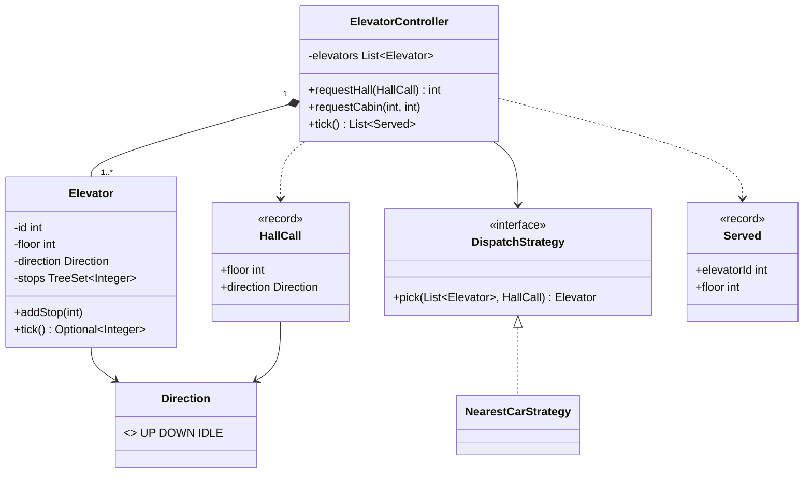

# Chapter 52 — Elevator system

## What and why

Elevator is the standard "state + scheduling" LLD question. Exam payoff: a SCAN schedule held in a `TreeSet`, a dispatch Strategy for hall calls, a facade that owns time (`tick`), and an exhaustive `switch` over an enum.

## Exam flash rules

- Two kinds of request: **hall call** (floor + direction, outside) and **cabin request** (floor, inside).
- Both reduce to "add a stop to one elevator"; the difference is **who picks the elevator**.
- **SCAN**: continue in the current direction while a stop remains ahead; reverse only when none is.
- An idle elevator goes to the **nearest** stop; ties go UP in this design.
- `TreeSet.higher(x)` / `lower(x)` find the next stop ahead; both are strictly greater / less.
- Dispatch varies → **Strategy** (`DispatchStrategy`); the controller is a **Facade**.
- A `switch` expression over an enum must be exhaustive (every constant or `default`).
- One tick = one floor of movement **or** one door opening.
- A hall call needs UP or DOWN: `IDLE` is rejected in the record's compact constructor.
- Validate floors at the boundary (`addStop`), not inside the movement loop.
- Simulated time (`tick()`) replaces threads in tests: deterministic and fast.
- A record's fields are private final; `call.floor = 4` does not compile.

## Short-answer strip

| Item | Answer |
|------|--------|
| Entities | `Elevator`, `ElevatorController`, `HallCall`, `Direction` |
| Value types | `Direction` (enum), `HallCall`, `Served` (records) |
| Relationships | `ElevatorController` **has** 1..* `Elevator` (composition); controller → `DispatchStrategy` (association) |
| APIs | `int requestHall(HallCall)`, `void requestCabin(int id, int floor)`, `List<Served> tick()` |
| Patterns | Strategy (dispatch), Facade (controller); state implicit in `direction` |
| Concurrency | `stops`, `floor`, `direction` are mutable and shared → `synchronized` per elevator; controller serialises pick + add |

## Requirements

| Kind | Line |
|------|------|
| Functional | N floors, M elevators; passengers press hall buttons (UP/DOWN) and cabin buttons |
| Functional | A hall call is assigned to one elevator |
| Functional | An elevator serves stops in SCAN order, opens doors at each stop |
| Functional | Reject floors outside the building |
| Non-functional | Requests may arrive from many threads while time advances |
| Out of scope | Door sensors, weight limit, express/fire modes, direction-aware pickup |

## Rules table

| Case | Compiles? | Compiler message |
|------|-----------|------------------|
| `switch` expression over `Direction` omitting `IDLE` | No | `the switch expression does not cover all possible input values` |
| `e.floor = 5` (private field) | No | `floor has private access in Elevator` |
| `call.floor = 4` on a record | No | `floor has private access in HallCall` |
| `Direction d = 1;` | No | `incompatible types: int cannot be converted to Direction` |
| `DispatchStrategy s = list -> ...` (one parameter) | No | `incompatible types: incompatible parameter types in lambda expression` |

## Walkthrough

### Value types

```java
{{#include ../../code/part-04-lld/src/main/java/lld/elevator/Direction.java:direction}}
```

```java
{{#include ../../code/part-04-lld/src/main/java/lld/elevator/HallCall.java:hall-call}}
```

```java
{{#include ../../code/part-04-lld/src/main/java/lld/elevator/Served.java:served}}
```

### The cabin (SCAN)

```java
{{#include ../../code/part-04-lld/src/main/java/lld/elevator/Elevator.java:elevator}}
```

### Dispatch strategy

```java
{{#include ../../code/part-04-lld/src/main/java/lld/elevator/DispatchStrategy.java:dispatch-strategy}}
```

```java
{{#include ../../code/part-04-lld/src/main/java/lld/elevator/NearestCarStrategy.java:nearest-car}}
```

### Controller facade

```java
{{#include ../../code/part-04-lld/src/main/java/lld/elevator/ElevatorController.java:controller}}
```

### Run

```java
{{#include ../../code/part-04-lld/src/main/java/lld/elevator/ElevatorDemo.java:elevator-demo}}
```

```text
{{#include ../../code/part-04-lld/out/elevator/ElevatorDemo.txt}}
```

Reading the trace: `E0` carries a cabin request for 5, so its cost for the hall call at 3 is distance 3 + 1 queued stop = 4; idle `E1` costs 3. `E1` answers, serves 3 on tick 3, then idles; `E0` keeps climbing to 5.

## Tests

```java
{{#include ../../code/part-04-lld/src/test/java/lld/elevator/ElevatorTest.java:elevator-test}}
```

## Extension discussion

| Extension | Change | Touches |
|-----------|--------|---------|
| Direction-aware pickup (UP call served only by a cabin going UP) | Keep separate `upStops` / `downStops` sets; cost function checks direction | `Elevator`, `NearestCarStrategy` |
| Zoned banks (low / high rise) | New `DispatchStrategy` filtering by zone | One class |
| Peak-hour "send idle cars to lobby" | `idle()` hook in controller `tick` | Controller |
| Weight limit / out of service | `ElevatorState` enum (add `OUT_OF_SERVICE`); strategy skips it | `Elevator`, strategy |
| Real time | Replace `tick()` with a scheduler thread calling it; the `synchronized` methods already guard shared state | Controller |
| Fire mode | State pattern: new state ignores requests and returns to ground | `Elevator` |

## Predict the output

**P1.**

```java
{{#include ../../code/part-04-lld/src/main/java/lld/elevator/exam/PredictScanOrder.java:predict-scan-order}}
```

<details><summary>Answer</summary>

```text
{{#include ../../code/part-04-lld/out/elevator/PredictScanOrder.txt}}
```

Trace: stops {2,3,5}; idle picks nearest (2) and goes UP; moving from 0, floor 2 is reached on tick 2; then 3, then 5 on tick 5.

</details>

**P2.**

```java
{{#include ../../code/part-04-lld/src/main/java/lld/elevator/exam/PredictReverse.java:predict-reverse}}
```

<details><summary>Answer</summary>

```text
{{#include ../../code/part-04-lld/out/elevator/PredictReverse.txt}}
```

Trace: at 5, idle: up=7 (distance 2) vs down=2 (distance 3) → UP first; after 7 nothing is higher, so reverse and serve 2.

</details>

**P3.**

```java
{{#include ../../code/part-04-lld/src/main/java/lld/elevator/exam/PredictIdle.java:predict-idle}}
```

<details><summary>Answer</summary>

```text
{{#include ../../code/part-04-lld/out/elevator/PredictIdle.txt}}
```

Trace: no stops → empty, `IDLE`; a stop on the current floor is served by the first branch of `tick` without moving.

</details>

**P4.**

```java
{{#include ../../code/part-04-lld/src/main/java/lld/elevator/exam/PredictDispatch.java:predict-dispatch}}
```

<details><summary>Answer</summary>

```text
{{#include ../../code/part-04-lld/out/elevator/PredictDispatch.txt}}
```

Trace: after 4 ticks `E0` is at 4 going UP with stop 8. Call at 2: `E0` cost 2+1+10 (moving away) = 13, `E1` cost 2 → `E1`. Call at 6: `E0` cost 2+1 = 3, `E1` cost 6+1 = 7 → `E0`.

</details>

**P5.**

```java
{{#include ../../code/part-04-lld/src/main/java/lld/elevator/exam/PredictBadFloor.java:predict-bad-floor}}
```

<details><summary>Answer</summary>

```text
{{#include ../../code/part-04-lld/out/elevator/PredictBadFloor.txt}}
```

Trace: both validations throw before any state changes; `pendingStops()` stays 0.

</details>

## Compile or not?

**C1.**

```java
{{#include ../../code/part-04-lld/broken/elevator/ElevatorSwitchBroken.java}}
```

<div class="compiler-error">

```text
{{#include ../../code/part-04-lld/out/elevator/ElevatorSwitchBroken.javac.txt}}
```

</div>

**C2.**

```java
{{#include ../../code/part-04-lld/broken/elevator/ElevatorPrivateFieldBroken.java}}
```

<div class="compiler-error">

```text
{{#include ../../code/part-04-lld/out/elevator/ElevatorPrivateFieldBroken.javac.txt}}
```

</div>

**C3.**

```java
{{#include ../../code/part-04-lld/broken/elevator/ElevatorRecordMutateBroken.java}}
```

<div class="compiler-error">

```text
{{#include ../../code/part-04-lld/out/elevator/ElevatorRecordMutateBroken.javac.txt}}
```

</div>

**C4.**

```java
{{#include ../../code/part-04-lld/broken/elevator/ElevatorIntToEnumBroken.java}}
```

<div class="compiler-error">

```text
{{#include ../../code/part-04-lld/out/elevator/ElevatorIntToEnumBroken.javac.txt}}
```

</div>

**C5.**

```java
{{#include ../../code/part-04-lld/broken/elevator/ElevatorLambdaArityBroken.java}}
```

<div class="compiler-error">

```text
{{#include ../../code/part-04-lld/out/elevator/ElevatorLambdaArityBroken.javac.txt}}
```

</div>

## Gotchas

1. **Reversing too early.** Check for stops ahead (`higher`/`lower`) before flipping direction (`PredictReverse`).
2. **Stop on the current floor.** Serve it before moving, or the cabin leaves and comes back (`PredictIdle`).
3. **Ignoring direction in cost.** A cabin moving away looks near but arrives last (`PredictDispatch`).
4. **Validating floors late.** Reject at `addStop`; a bad floor in the queue breaks the loop.
5. **Pick-then-add race.** Two threads can pick the same "idle" cabin; the controller serialises both steps.

## UML



## Interview Q&A

1. **Q:** Which algorithm schedules stops? **A:** SCAN: continue while stops remain ahead, then reverse (`Elevator.nextDirection`).
2. **Q:** Why a `TreeSet`? **A:** Sorted, de-duplicating; `higher`/`lower` answer "next stop ahead" in O(log n).
3. **Q:** Where is the Strategy? **A:** `DispatchStrategy` picks the cabin for a hall call.
4. **Q:** Why does the cost include direction? **A:** A cabin moving away reaches the caller last (`NearestCarStrategy.AWAY_PENALTY`).
5. **Q:** How do you test without threads or sleeps? **A:** Drive `tick()` manually and assert served order.
6. **Q:** What makes the enum `switch` safe? **A:** The compiler enforces exhaustiveness (`ElevatorSwitchBroken`).
7. **Q:** Hall call vs cabin request? **A:** Hall call needs a dispatch decision; a cabin request names the elevator.
8. **Q:** How do you add an out-of-service cabin? **A:** Add a state; strategies skip it; no change to SCAN.
9. **Q:** What is shared and mutable? **A:** Each elevator's `stops`, `floor`, `direction`.
10. **Q:** Why is `HallCall` a record with a compact constructor? **A:** Immutable, and `IDLE` is rejected at construction.
11. **Q:** Why not give `Elevator` a public `floor` field? **A:** Encapsulation; the compiler rejects it (`ElevatorPrivateFieldBroken`).
12. **Q:** How would you make pickup direction-aware? **A:** Two sets, `upStops` and `downStops`; serve the set matching direction.

## Exam writing prompts

1. (5) Write `Elevator.addStop` with floor validation and a `tick()` that moves one floor toward the nearest stop.
2. (5) Write a `DispatchStrategy` choosing the closest elevator by `|floor − call.floor|`.
3. (8) Draw the class diagram for controller, elevator, strategy, hall call.
4. (3) Complete a `switch` expression mapping `Direction` to `+1 / −1 / 0`.

## Exercises

Solutions: `solutions/ch52/SolutionElevator.java`.

1. Write a "least busy" strategy as a lambda.
2. Write `runUntilIdle` returning the ticks used.
3. One cabin, hall call at 9 and cabin request 2: print the served order.
4. Show an out-of-range request is rejected.
5. Stops {4, 1} from floor 0: how many ticks, in which order?

```java
{{#include ../../code/part-04-lld/solutions/ch52/SolutionElevator.java}}
```

```text
{{#include ../../code/part-04-lld/out/elevator/SolutionElevator.txt}}
```

## Recap checklist

- [x] Hall call vs cabin request; SCAN with `TreeSet`
- [x] Strategy + Facade; simulated time
- [x] Tests (order, reversal, dispatch, validation)
- [x] Exam banks: flash 12, predict 5, compile 5, writing 4
