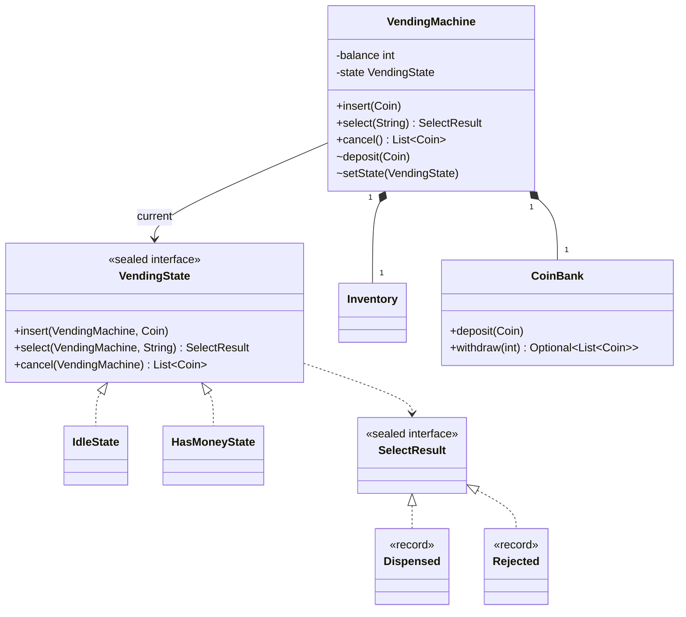

# Chapter 53 — Vending machine

## What and why

Vending machine is the standard **State pattern** question. Exam payoff: state classes that change behaviour per event, a sealed result type handled by an exhaustive `switch`, and a change-making routine that must search, not just be greedy.

## Exam flash rules

- State pattern: the **context** delegates each event to the current **state** object; states change the context's state.
- A `sealed` interface lists its subtypes with `permits`; a `switch` over it needs no `default` (Java 17+ sealed, Java 21 pattern `switch`).
- Money is `int` cents; never `double`.
- Greedy change fails with limited coins (`bank {25, 10, 10, 10}`, change 30): search or backtrack.
- Return a result type (`Dispensed` / `Rejected`) instead of throwing for expected business outcomes.
- Cancel must refund exactly the inserted amount; the inserted coins are already in the bank.
- A rejected selection must not change balance or state.
- State instances without fields are stateless: share one `INSTANCE`.
- Package-private members (`deposit`, `setState`) keep mutation inside the package.
- Public entry points are `synchronized`: events are processed one at a time.
- An enum cannot be instantiated with `new`; a record constructor needs all components.
- A class not in `permits` cannot implement a sealed interface.

## Short-answer strip

| Item | Answer |
|------|--------|
| Entities | `VendingMachine`, `Inventory`, `CoinBank`, `Product`, `Coin` |
| States | `IdleState`, `HasMoneyState` (both implement sealed `VendingState`) |
| Relationships | `VendingMachine` **has** `Inventory`, `CoinBank` (composition), **current** `VendingState` (association); states depend on machine |
| APIs | `insert(Coin)`, `SelectResult select(String)`, `List<Coin> cancel()`, `balance()` |
| Patterns | State, sealed result type (algebraic data type), Facade |
| Concurrency | `balance`, `state`, inventory, bank: mutable + shared → all entry points `synchronized` |

State table:

| State | `insert` | `select` | `cancel` |
|-------|----------|----------|----------|
| Idle | deposit → HasMoney | Rejected `INSERT_COIN` | `[]` |
| HasMoney | deposit | Dispensed / Rejected (`UNKNOWN_PRODUCT`, `SOLD_OUT`, `INSUFFICIENT`, `NO_CHANGE`) | refund → Idle |

## Requirements

| Kind | Line |
|------|------|
| Functional | Products have a code, name, price (cents) and stock |
| Functional | Accept NICKEL / DIME / QUARTER / DOLLAR; track balance |
| Functional | Select a product: dispense and return change, or reject with a reason |
| Functional | Cancel refunds the balance |
| Non-functional | Machine has limited coins; change must be exact or the sale is refused |
| Out of scope | Cards, restock UI, coin jams, temperature |

## Rules table

| Case | Compiles? | Compiler message |
|------|-----------|------------------|
| Implement sealed `VendingState` outside `permits` | No | `class is not allowed to extend sealed class: VendingState (as it is not listed in its 'permits' clause)` |
| `switch` over `SelectResult` missing `Rejected` | No | `the switch expression does not cover all possible input values` |
| `new Coin(50)` | No | `enum classes may not be instantiated` |
| `new Product("A1", "Cola")` | No | `constructor Product in record Product cannot be applied to given types;` |
| Call package-private `m.deposit(...)` from another package | No | `deposit(Coin) is not public in VendingMachine; cannot be accessed from outside package` |

## Walkthrough

### Value types and results

```java
{{#include ../../code/part-04-lld/src/main/java/lld/vending/Coin.java:coin}}
```

```java
{{#include ../../code/part-04-lld/src/main/java/lld/vending/Product.java:product}}
```

```java
{{#include ../../code/part-04-lld/src/main/java/lld/vending/SelectResult.java:select-result}}
```

### Stock and coins

```java
{{#include ../../code/part-04-lld/src/main/java/lld/vending/Inventory.java:inventory}}
```

```java
{{#include ../../code/part-04-lld/src/main/java/lld/vending/CoinBank.java:coin-bank}}
```

### The states

```java
{{#include ../../code/part-04-lld/src/main/java/lld/vending/VendingState.java:vending-state}}
```

```java
{{#include ../../code/part-04-lld/src/main/java/lld/vending/IdleState.java:idle-state}}
```

```java
{{#include ../../code/part-04-lld/src/main/java/lld/vending/HasMoneyState.java:has-money-state}}
```

### The context

```java
{{#include ../../code/part-04-lld/src/main/java/lld/vending/VendingMachine.java:vending-machine}}
```

### Run

```java
{{#include ../../code/part-04-lld/src/main/java/lld/vending/VendingDemo.java:vending-demo}}
```

```text
{{#include ../../code/part-04-lld/out/vending/VendingDemo.txt}}
```

## Tests

```java
{{#include ../../code/part-04-lld/src/test/java/lld/vending/VendingMachineTest.java:vending-test}}
```

## Extension discussion

| Extension | Change | Touches |
|-----------|--------|---------|
| Card payment | New state `CardPendingState`; `PaymentMethod` interface | `VendingState` permits list, machine |
| Out-of-service | New state that rejects everything; `cancel` still refunds | One state class |
| Promotions | `PricingPolicy` Strategy used in `HasMoneyState.select` | One call site |
| Restock / audit | `Admin` facade with `load`; log every `Dispensed` (Observer) | `Inventory`, machine |
| Many machines | One machine = one lock; nothing shared between machines | None |
| Persist counts | Snapshot `Inventory` and `CoinBank` (Memento) | Both classes |

Adding a state is a closed change: the compiler lists every `switch` that no longer covers all cases.

## Predict the output

**P1.**

```java
{{#include ../../code/part-04-lld/src/main/java/lld/vending/exam/PredictChange.java:predict-change}}
```

<details><summary>Answer</summary>

```text
{{#include ../../code/part-04-lld/out/vending/PredictChange.txt}}
```

Trace: 30 with one quarter would leave 5 (impossible), so the search backtracks to three dimes; 5 cannot be made; the quarter is still there for 25; both counts end at 0.

</details>

**P2.**

```java
{{#include ../../code/part-04-lld/src/main/java/lld/vending/exam/PredictState.java:predict-state}}
```

<details><summary>Answer</summary>

```text
{{#include ../../code/part-04-lld/out/vending/PredictState.txt}}
```

Trace: insert moves Idle → HasMoney; cancel refunds the nickel and returns to Idle; cancel in Idle returns an empty list.

</details>

**P3.**

```java
{{#include ../../code/part-04-lld/src/main/java/lld/vending/exam/PredictReject.java:predict-reject}}
```

<details><summary>Answer</summary>

```text
{{#include ../../code/part-04-lld/out/vending/PredictReject.txt}}
```

Trace: Idle rejects; in HasMoney an unknown code is rejected first; 60 − 25 = 35 short; balance is untouched.

</details>

**P4.**

```java
{{#include ../../code/part-04-lld/src/main/java/lld/vending/exam/PredictSwitch.java:predict-switch}}
```

<details><summary>Answer</summary>

```text
{{#include ../../code/part-04-lld/out/vending/PredictSwitch.txt}}
```

Trace: 100 − 60 = 40 in three coins (25+10+5); the single chips slot is then empty.

</details>

**P5.**

```java
{{#include ../../code/part-04-lld/src/main/java/lld/vending/exam/PredictBalance.java:predict-balance}}
```

<details><summary>Answer</summary>

```text
{{#include ../../code/part-04-lld/out/vending/PredictBalance.txt}}
```

Trace: 100+25+25 = 150; cola is 125 → change 25 (one quarter); balance clears and the state is Idle, so the next select is `INSERT_COIN`.

</details>

## Compile or not?

**C1.**

```java
{{#include ../../code/part-04-lld/broken/vending/VendingSealedBroken.java}}
```

<div class="compiler-error">

```text
{{#include ../../code/part-04-lld/out/vending/VendingSealedBroken.javac.txt}}
```

</div>

**C2.**

```java
{{#include ../../code/part-04-lld/broken/vending/VendingSwitchBroken.java}}
```

<div class="compiler-error">

```text
{{#include ../../code/part-04-lld/out/vending/VendingSwitchBroken.javac.txt}}
```

</div>

**C3.**

```java
{{#include ../../code/part-04-lld/broken/vending/VendingCoinNewBroken.java}}
```

<div class="compiler-error">

```text
{{#include ../../code/part-04-lld/out/vending/VendingCoinNewBroken.javac.txt}}
```

</div>

**C4.**

```java
{{#include ../../code/part-04-lld/broken/vending/VendingRecordArgsBroken.java}}
```

<div class="compiler-error">

```text
{{#include ../../code/part-04-lld/out/vending/VendingRecordArgsBroken.javac.txt}}
```

</div>

**C5.**

```java
{{#include ../../code/part-04-lld/broken/vending/VendingPackagePrivateBroken.java}}
```

<div class="compiler-error">

```text
{{#include ../../code/part-04-lld/out/vending/VendingPackagePrivateBroken.javac.txt}}
```

</div>

## Gotchas

1. **Greedy change.** Fails with limited coins (`PredictChange`).
2. **State flags instead of State objects.** `if (hasMoney)` chains grow with every state; the state table is the cure.
3. **Mutating before validating.** Check product, stock, balance and change, then take stock and clear balance (`HasMoneyState.select`).
4. **Throwing for sold-out.** It is an expected outcome; return `Rejected` (`PredictSwitch`).
5. **Forgetting to return to Idle.** After a sale or cancel the next `select` must say `INSERT_COIN` (`PredictBalance`).

## UML



## Interview Q&A

1. **Q:** Which pattern models the modes? **A:** State: `IdleState` and `HasMoneyState` implement `VendingState`.
2. **Q:** Why `sealed`? **A:** The compiler knows every state/result, so `switch` needs no `default` (`VendingSwitchBroken`).
3. **Q:** Why not an enum with a `switch` inside the machine? **A:** It works for two states; State objects keep each state's behaviour in one class as states grow.
4. **Q:** Why does change-making search? **A:** Limited coins make greedy fail (`bank {25,10,10,10}`, 30).
5. **Q:** What if exact change is impossible? **A:** `Rejected("NO_CHANGE")`; balance stays; cancel refunds.
6. **Q:** Why return `SelectResult` rather than throw? **A:** Sold out is a normal outcome; the caller must handle both cases.
7. **Q:** Why are states singletons? **A:** They hold no fields; the context carries the data.
8. **Q:** How do you add card payment? **A:** A new state and a `PaymentMethod` interface; update `permits`.
9. **Q:** Why `int` cents? **A:** No floating-point rounding.
10. **Q:** What keeps events ordered? **A:** `synchronized` entry points on the machine.
11. **Q:** Why can't outside code call `deposit`? **A:** Package-private (`VendingPackagePrivateBroken`).
12. **Q:** What do you refund on cancel? **A:** Exactly the balance, drawn from the bank where the coins were deposited.

## Exam writing prompts

1. (5) Write the sealed `SelectResult` with two record implementations and a `switch` that renders each.
2. (5) Write `IdleState.insert` and `HasMoneyState.cancel`.
3. (8) Write `CoinBank.withdraw(int)` that returns exact change from limited coins; explain why greedy is not enough.
4. (3) Draw the state table with events as columns.

## Exercises

Solutions: `solutions/ch53/SolutionVending.java`.

1. Render any `SelectResult` with an exhaustive pattern `switch`.
2. Sum a `List<Coin>` with a stream.
3. Show `NO_CHANGE` for a 20-cent item paid with a quarter and an empty float, then cancel.
4. Restock and buy with two dimes.
5. Show that a refund equals what was inserted.

```java
{{#include ../../code/part-04-lld/solutions/ch53/SolutionVending.java}}
```

```text
{{#include ../../code/part-04-lld/out/vending/SolutionVending.txt}}
```

## Recap checklist

- [x] State pattern with sealed states and sealed result
- [x] Change-making by search; limited coin float
- [x] Tests incl. no-change, sold-out, cancel
- [x] Exam banks: flash 12, predict 5, compile 5, writing 4
