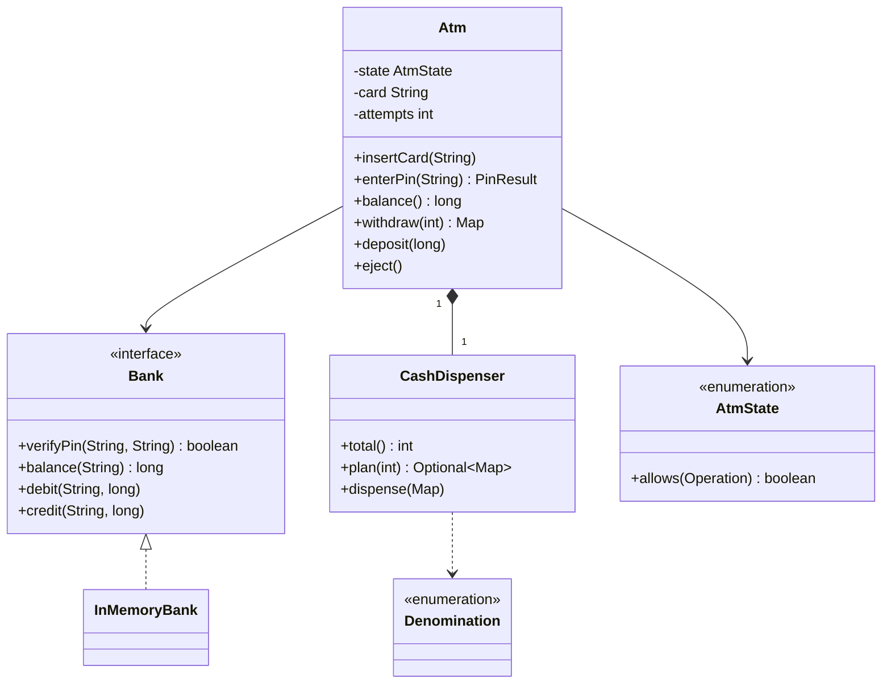

# Chapter 54 — ATM

## What and why

ATM tests **state-checked operations**, a **bank port** (interface), and **ordering of side effects**: plan the notes, debit the account, then dispense. Exam payoff: an exhaustive enum `switch`, checked exceptions for business failures, and a short answer on why the order of the three steps matters.

## Exam flash rules

- Session states: `IDLE` → `CARD_INSERTED` → `AUTHENTICATED`; every operation is legal in some states only.
- Centralise the check: `AtmState.allows(Operation)`; a violation is an `IllegalStateException` (a bug in the caller, not a business outcome).
- Business failures are checked exceptions: `InsufficientFundsException`, `CashUnavailableException`.
- Withdraw order: **plan notes → debit account → dispense notes**. Failing early leaves nothing to undo.
- Three wrong PINs block the card and end the session.
- The ATM talks to the bank only through the `Bank` interface (DIP): swap `InMemoryBank` for a remote bank.
- Per-account lock inside the bank; per-machine lock inside the ATM: many machines can share one account safely.
- Amounts are `long`/`int` of the smallest currency unit; withdrawals must be a multiple of the smallest note.
- Limited notes can make greedy dispensing fail; search all counts of each denomination.
- `catch (Exception e)` before `catch (InsufficientFundsException e)` does not compile: the second is unreachable.
- Catching a checked exception the `try` body cannot throw does not compile.
- A class implementing an interface must implement every abstract method or be abstract.

## Short-answer strip

| Item | Answer |
|------|--------|
| Entities | `Atm`, `Bank`, `CashDispenser`, `Denomination` (and the account inside `InMemoryBank`) |
| Value types | `AtmState`, `Operation`, `PinResult`, `Denomination` (enums) |
| Relationships | `Atm` → `Bank` (association to interface); `Atm` **has** `CashDispenser` (composition); `InMemoryBank` realizes `Bank` |
| APIs | `insertCard(String)`, `PinResult enterPin(String)`, `long balance()`, `Map<Denomination,Integer> withdraw(int)`, `deposit(long)`, `eject()` |
| Patterns | State (as enum + `allows`), Port/Adapter (`Bank`), Facade |
| Concurrency | `Atm` session fields: synchronized methods; bank account balance: per-account lock |

Allowed operations:

| State | Allowed |
|-------|---------|
| `IDLE` | `INSERT_CARD` |
| `CARD_INSERTED` | `ENTER_PIN`, `EJECT` |
| `AUTHENTICATED` | `BALANCE`, `WITHDRAW`, `DEPOSIT`, `EJECT` |

## Requirements

| Kind | Line |
|------|------|
| Functional | Insert a card, enter a PIN (3 attempts), then check balance, withdraw, deposit |
| Functional | Withdraw in notes of 500, 200, 100; refuse amounts that need smaller notes |
| Functional | Refuse if the account lacks funds or the machine lacks suitable notes |
| Functional | Eject ends the session |
| Non-functional | Several machines serve one account; no overdraft |
| Out of scope | Receipts, card capture hardware, cheque deposit, currencies |

## Rules table

| Case | Compiles? | Compiler message |
|------|-----------|------------------|
| `atm.withdraw(100)` with no `try`/`throws` | No | `unreported exception InsufficientFundsException; must be caught or declared to be thrown` |
| `switch` expression over `AtmState` missing a constant | No | `the switch expression does not cover all possible input values` |
| Implement `Bank` with one method | No | `... is not abstract and does not override abstract method credit(String,long) in Bank` |
| `catch (Exception)` then `catch (InsufficientFundsException)` | No | `exception InsufficientFundsException has already been caught` |
| `catch (InsufficientFundsException)` around `atm.balance()` | No | `exception InsufficientFundsException is never thrown in body of corresponding try statement` |

## Walkthrough

### States and operations

```java
{{#include ../../code/part-04-lld/src/main/java/lld/atm/Operation.java:operation}}
```

```java
{{#include ../../code/part-04-lld/src/main/java/lld/atm/AtmState.java:atm-state}}
```

```java
{{#include ../../code/part-04-lld/src/main/java/lld/atm/PinResult.java:pin-result}}
```

### Failures as checked exceptions

```java
{{#include ../../code/part-04-lld/src/main/java/lld/atm/InsufficientFundsException.java:insufficient-funds}}
```

```java
{{#include ../../code/part-04-lld/src/main/java/lld/atm/CashUnavailableException.java:cash-unavailable}}
```

### The bank port and an in-memory adapter

```java
{{#include ../../code/part-04-lld/src/main/java/lld/atm/Bank.java:bank}}
```

```java
{{#include ../../code/part-04-lld/src/main/java/lld/atm/InMemoryBank.java:in-memory-bank}}
```

### Notes

```java
{{#include ../../code/part-04-lld/src/main/java/lld/atm/Denomination.java:denomination}}
```

```java
{{#include ../../code/part-04-lld/src/main/java/lld/atm/CashDispenser.java:cash-dispenser}}
```

### The machine

```java
{{#include ../../code/part-04-lld/src/main/java/lld/atm/Atm.java:atm}}
```

### Run

```java
{{#include ../../code/part-04-lld/src/main/java/lld/atm/AtmDemo.java:atm-demo}}
```

```text
{{#include ../../code/part-04-lld/out/atm/AtmDemo.txt}}
```

## Tests

```java
{{#include ../../code/part-04-lld/src/test/java/lld/atm/AtmTest.java:atm-test}}
```

## Extension discussion

| Extension | Change | Touches |
|-----------|--------|---------|
| Real bank | New `Bank` implementation (HTTP client); same ATM | One class |
| Daily withdrawal limit | `Bank.debit` rule, or a `LimitPolicy` Strategy checked before debit | Bank / one interface |
| New note (₹2000) | One enum constant; `search` handles it | `Denomination` |
| Debit succeeded but the dispenser jams | Reverse with `bank.credit` (compensating action) or a two-phase hold/commit | `Atm.withdraw` |
| Cash-out alerts | Observer on `CashDispenser.total()` below threshold | Dispenser |
| Receipts / audit | Command or event log per operation | `Atm` |

The order *plan → debit → dispense* is what makes the jam case the only one needing compensation.

## Predict the output

**P1.**

```java
{{#include ../../code/part-04-lld/src/main/java/lld/atm/exam/PredictPin.java:predict-pin}}
```

<details><summary>Answer</summary>

```text
{{#include ../../code/part-04-lld/out/atm/PredictPin.txt}}
```

Trace: attempts 1 and 2 → `WRONG_PIN`; attempt 3 blocks the card and resets to `IDLE`; re-inserting a blocked card throws.

</details>

**P2.**

```java
{{#include ../../code/part-04-lld/src/main/java/lld/atm/exam/PredictPlan.java:predict-plan}}
```

<details><summary>Answer</summary>

```text
{{#include ../../code/part-04-lld/out/atm/PredictPlan.txt}}
```

Trace: 600 with one 500 leaves 100 (none), so the search falls back to 3 × 200; 150 is not a multiple of any note; 1100 = 500 + 3 × 200; stock is 500 + 600 = 1100.

</details>

**P3.**

```java
{{#include ../../code/part-04-lld/src/main/java/lld/atm/exam/PredictStateGuard.java:predict-state-guard}}
```

<details><summary>Answer</summary>

```text
{{#include ../../code/part-04-lld/out/atm/PredictStateGuard.txt}}
```

Trace: the guard names the operation and the current state; `EJECT` is legal in `CARD_INSERTED` and returns to `IDLE`.

</details>

**P4.**

```java
{{#include ../../code/part-04-lld/src/main/java/lld/atm/exam/PredictDebitOrder.java:predict-debit-order}}
```

<details><summary>Answer</summary>

```text
{{#include ../../code/part-04-lld/out/atm/PredictDebitOrder.txt}}
```

Trace: 500 fails at debit, so no notes leave (1600 stays) and balance stays 300; 300 = 200 + 100, stock becomes 1300, balance 0.

</details>

**P5.**

```java
{{#include ../../code/part-04-lld/src/main/java/lld/atm/exam/PredictAllows.java:predict-allows}}
```

<details><summary>Answer</summary>

```text
{{#include ../../code/part-04-lld/out/atm/PredictAllows.txt}}
```

Trace: reads the `allows` switch for each state; operations print in declaration order.

</details>

## Compile or not?

**C1.**

```java
{{#include ../../code/part-04-lld/broken/atm/AtmUnreportedBroken.java}}
```

<div class="compiler-error">

```text
{{#include ../../code/part-04-lld/out/atm/AtmUnreportedBroken.javac.txt}}
```

</div>

**C2.**

```java
{{#include ../../code/part-04-lld/broken/atm/AtmSwitchBroken.java}}
```

<div class="compiler-error">

```text
{{#include ../../code/part-04-lld/out/atm/AtmSwitchBroken.javac.txt}}
```

</div>

**C3.**

```java
{{#include ../../code/part-04-lld/broken/atm/AtmMissingMethodsBroken.java}}
```

<div class="compiler-error">

```text
{{#include ../../code/part-04-lld/out/atm/AtmMissingMethodsBroken.javac.txt}}
```

</div>

**C4.**

```java
{{#include ../../code/part-04-lld/broken/atm/AtmCatchOrderBroken.java}}
```

<div class="compiler-error">

```text
{{#include ../../code/part-04-lld/out/atm/AtmCatchOrderBroken.javac.txt}}
```

</div>

**C5.**

```java
{{#include ../../code/part-04-lld/broken/atm/AtmNeverThrownBroken.java}}
```

<div class="compiler-error">

```text
{{#include ../../code/part-04-lld/out/atm/AtmNeverThrownBroken.javac.txt}}
```

</div>

## Gotchas

1. **Debit before planning.** Money leaves the account but no notes can be dispensed (`cashShortageLeavesBalanceUntouched`).
2. **Dispense before debit.** Cash leaves for an account without funds (`PredictDebitOrder`).
3. **Greedy note selection.** Fails with limited notes (`PredictPlan`).
4. **PIN attempts not reset.** `insertCard` resets the counter; `reset()` clears it on eject and block.
5. **Check-then-debit in the ATM.** Reading the balance in the ATM and then debiting races across machines; the bank's `debit` checks and subtracts under one lock.

## UML



## Interview Q&A

1. **Q:** Why is `Bank` an interface? **A:** The ATM depends on an abstraction; tests and production use different banks (`InMemoryBank`).
2. **Q:** Why this withdrawal order? **A:** Plan and debit can fail without side effects; dispense cannot fail after both succeeded (same lock).
3. **Q:** What if the dispenser jams after the debit? **A:** Compensate with `bank.credit`, or use hold/commit.
4. **Q:** Where are state rules kept? **A:** `AtmState.allows(Operation)`, one exhaustive switch.
5. **Q:** Checked vs unchecked here? **A:** Business failures (funds, cash) are checked; wrong-state calls are `IllegalStateException`.
6. **Q:** How do two machines avoid overdraft? **A:** `InMemoryBank.debit` checks and subtracts inside `synchronized (account)`.
7. **Q:** Why does greedy note selection fail? **A:** With limited stock, taking the most 500s can leave an amount that no remaining notes make.
8. **Q:** What blocks a card? **A:** `MAX_PIN_ATTEMPTS` (3) wrong PINs; the card number goes into `blocked`.
9. **Q:** How would you add a daily limit? **A:** A policy consulted before `debit`; or enforced in the bank.
10. **Q:** Why `catch (Exception)` before a specific catch fails? **A:** The specific handler can never run (`AtmCatchOrderBroken`).
11. **Q:** Why `long` for balances? **A:** Integral smallest unit; no rounding errors.
12. **Q:** Pattern for the session? **A:** State; here an enum with an exhaustive `allows` switch instead of one class per state.

## Exam writing prompts

1. (5) Write `AtmState.allows(Operation)` as a switch expression.
2. (5) Write `Atm.withdraw` with the three steps in the right order and explain the order.
3. (8) Write `Bank` and an in-memory implementation whose `debit` is thread-safe.
4. (3) Draw the state diagram of the session (events on edges).

## Exercises

Solutions: `solutions/ch54/SolutionAtm.java`.

1. Write `tryWithdraw` that turns every outcome (funds, cash, bad amount, bad state) into a message.
2. Show a withdrawal where greedy fails but search succeeds.
3. Show the "not a multiple of 100" refusal.
4. Show the cash-shortage refusal when no 100 notes remain.
5. Deposit and read the balance back.
6. (Bonus) Ten machines, one 500 account: exactly five 100-withdrawals succeed.

```java
{{#include ../../code/part-04-lld/solutions/ch54/SolutionAtm.java}}
```

```text
{{#include ../../code/part-04-lld/out/atm/SolutionAtm.txt}}
```

## Recap checklist

- [x] State guard with exhaustive switch; PIN lockout
- [x] Port (`Bank`) and ordered side effects; compensation discussion
- [x] Tests incl. multi-machine concurrency
- [x] Exam banks: flash 12, predict 5, compile 5, writing 4
