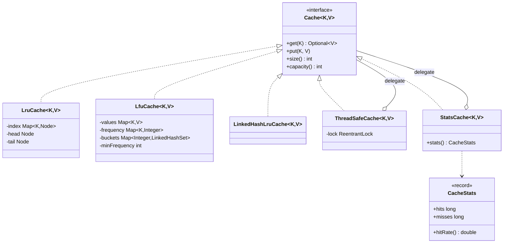

# Chapter 55 — LRU and LFU cache

## What and why

Cache is the "data structure as LLD" question. Exam payoff: O(1) LRU from `HashMap` + doubly linked list, O(1) LFU from frequency buckets, decorators for thread safety and statistics, and the generics rules behind `Cache<K, V>`.

## Exam flash rules

- **LRU** evicts the entry unused for the longest time; **LFU** evicts the entry used the fewest times; **FIFO** evicts the oldest insertion.
- LRU in O(1): `HashMap<K, Node>` for lookup + doubly linked list ordered by recency; sentinel head/tail remove null checks.
- Both `get` and `put` of an existing key count as a **use**.
- LFU in O(1): `key → value`, `key → frequency`, `frequency → LinkedHashSet<key>`, and `minFrequency`.
- LFU tie-break: among the lowest frequency, evict the least recently used (first in the `LinkedHashSet`).
- A new key in LFU always starts at frequency 1, so `minFrequency = 1` after an insert.
- `LinkedHashMap(cap, load, accessOrder=true)` + `removeEldestEntry` is a three-line LRU.
- In an access-ordered cache a **read mutates** structure: a read-write lock does not make it safe; use one exclusive lock.
- Wrap policies with **decorators** (`ThreadSafeCache`, `StatsCache`) instead of editing them.
- Generic type arguments must be **reference types**: `Cache<int, String>` does not compile; use `Integer`.
- `Optional<V> get(K)` makes "absent" explicit; do not store `null` values.
- A cyclic scan larger than capacity gives LRU a 0 % hit rate.

## Short-answer strip

| Item | Answer |
|------|--------|
| Entities | `Cache<K,V>` (interface), `LruCache`, `LfuCache`, `LinkedHashLruCache`, decorators |
| Value types | `CacheStats` (record) |
| Relationships | `LruCache` realizes `Cache`; `ThreadSafeCache` and `StatsCache` realize `Cache` **and** hold a `Cache` (decorator) |
| APIs | `Optional<V> get(K)`, `void put(K, V)`, `size()`, `capacity()` |
| Patterns | Strategy (eviction policy behind one interface), Decorator (lock, stats) |
| Concurrency | map + list (or buckets) are mutable and shared; a hit changes order → exclusive lock |
| Complexity | `get` / `put`: O(1) average for LRU and LFU |

## Requirements

| Kind | Line |
|------|------|
| Functional | Bounded cache with `get` and `put` |
| Functional | LRU policy; LFU policy with LRU tie-break |
| Functional | Reject non-positive capacity and `null` keys/values |
| Non-functional | O(1) operations; safe under concurrent use when wrapped |
| Out of scope | TTL expiry, write-through to a backing store, distributed caches |

## Rules table

| Case | Compiles? | Compiler message |
|------|-----------|------------------|
| `Cache<int, String>` | No | `unexpected type` (`required: reference`, `found: int`) |
| `new Cache<>()` (interface) | No | `Cache is abstract; cannot be instantiated` |
| `c.put("a", "one")` on `Cache<String,Integer>` | No | `incompatible types: String cannot be converted to Integer` |
| `Integer v = c.get("a")` | No | `incompatible types: Optional<Integer> cannot be converted to Integer` |
| Naming the private inner `Node` | No | `LruCache.Node has private access in LruCache` |

## Walkthrough

### Contract

```java
{{#include ../../code/part-04-lld/src/main/java/lld/cache/Cache.java:cache}}
```

### LRU — map + linked list

```java
{{#include ../../code/part-04-lld/src/main/java/lld/cache/LruCache.java:lru-cache}}
```

### LRU — the JDK shortcut

```java
{{#include ../../code/part-04-lld/src/main/java/lld/cache/LinkedHashLruCache.java:linked-hash-lru}}
```

### LFU — frequency buckets

```java
{{#include ../../code/part-04-lld/src/main/java/lld/cache/LfuCache.java:lfu-cache}}
```

### Decorators

```java
{{#include ../../code/part-04-lld/src/main/java/lld/cache/ThreadSafeCache.java:thread-safe-cache}}
```

```java
{{#include ../../code/part-04-lld/src/main/java/lld/cache/CacheStats.java:cache-stats}}
```

```java
{{#include ../../code/part-04-lld/src/main/java/lld/cache/StatsCache.java:stats-cache}}
```

### Run

```java
{{#include ../../code/part-04-lld/src/main/java/lld/cache/CacheDemo.java:cache-demo}}
```

```text
{{#include ../../code/part-04-lld/out/cache/CacheDemo.txt}}
```

The third line is the LRU worst case: three keys cycling through two slots never hit.

## Tests

```java
{{#include ../../code/part-04-lld/src/test/java/lld/cache/CacheTest.java:cache-test}}
```

`handWrittenLruMatchesLinkedHashMapVersion` runs 2,000 seeded random operations against both LRU implementations.

## Extension discussion

| Extension | Change | Touches |
|-----------|--------|---------|
| TTL expiry | Store `expiresAt` per entry; check on `get`; lazy removal plus a sweeper | Entry class, `Cache` |
| Policy chosen at runtime | `EvictionPolicy` Strategy with `onAccess`, `onInsert`, `victim` | Split storage and policy |
| Read-through loader | `getOrCompute(key, loader)` (see `SolutionCache`) | Decorator |
| Higher concurrency | Shard keys over N independent `ThreadSafeCache` instances | New `ShardedCache` |
| Write-back / write-through | `Store` interface called on `put` / eviction | New decorator |
| Metrics | `StatsCache` already counts; add evictions via a listener | Decorator |

## Predict the output

**P1.**

```java
{{#include ../../code/part-04-lld/src/main/java/lld/cache/exam/PredictLru.java:predict-lru}}
```

<details><summary>Answer</summary>

```text
{{#include ../../code/part-04-lld/out/cache/PredictLru.txt}}
```

Trace: `get(1)` makes 2 the least recent; `put(3)` evicts 2; `get(2)` is empty, `get(1)` hits; size equals capacity.

</details>

**P2.**

```java
{{#include ../../code/part-04-lld/src/main/java/lld/cache/exam/PredictLfu.java:predict-lfu}}
```

<details><summary>Answer</summary>

```text
{{#include ../../code/part-04-lld/out/cache/PredictLfu.txt}}
```

Trace: frequencies a=3, b=2; inserting `c` evicts the lowest (b).

</details>

**P3.**

```java
{{#include ../../code/part-04-lld/src/main/java/lld/cache/exam/PredictTie.java:predict-tie}}
```

<details><summary>Answer</summary>

```text
{{#include ../../code/part-04-lld/out/cache/PredictTie.txt}}
```

Trace: a and b both have frequency 1; the older (a) goes first.

</details>

**P4.**

```java
{{#include ../../code/part-04-lld/src/main/java/lld/cache/exam/PredictUpdate.java:predict-update}}
```

<details><summary>Answer</summary>

```text
{{#include ../../code/part-04-lld/out/cache/PredictUpdate.txt}}
```

Trace: updating `a` makes `b` least recent; `c` evicts `b`; `a` holds the new value.

</details>

**P5.**

```java
{{#include ../../code/part-04-lld/src/main/java/lld/cache/exam/PredictStats.java:predict-stats}}
```

<details><summary>Answer</summary>

```text
{{#include ../../code/part-04-lld/out/cache/PredictStats.txt}}
```

Trace: hit (a), miss (b), `put(b)` evicts `a`, miss (a): 1 hit, 2 misses, 1/3.

</details>

## Compile or not?

**C1.**

```java
{{#include ../../code/part-04-lld/broken/cache/CachePrimitiveTypeArgBroken.java}}
```

<div class="compiler-error">

```text
{{#include ../../code/part-04-lld/out/cache/CachePrimitiveTypeArgBroken.javac.txt}}
```

</div>

**C2.**

```java
{{#include ../../code/part-04-lld/broken/cache/CacheNewInterfaceBroken.java}}
```

<div class="compiler-error">

```text
{{#include ../../code/part-04-lld/out/cache/CacheNewInterfaceBroken.javac.txt}}
```

</div>

**C3.**

```java
{{#include ../../code/part-04-lld/broken/cache/CacheValueTypeBroken.java}}
```

<div class="compiler-error">

```text
{{#include ../../code/part-04-lld/out/cache/CacheValueTypeBroken.javac.txt}}
```

</div>

**C4.**

```java
{{#include ../../code/part-04-lld/broken/cache/CacheOptionalBroken.java}}
```

<div class="compiler-error">

```text
{{#include ../../code/part-04-lld/out/cache/CacheOptionalBroken.javac.txt}}
```

</div>

**C5.**

```java
{{#include ../../code/part-04-lld/broken/cache/CachePrivateNodeBroken.java}}
```

<div class="compiler-error">

```text
{{#include ../../code/part-04-lld/out/cache/CachePrivateNodeBroken.javac.txt}}
```

</div>

## Gotchas

1. **`get` is a write.** LRU/LFU reads reorder entries; use an exclusive lock (`ThreadSafeCache`).
2. **Forgetting to refresh on `put` of an existing key.** The key then evicts too early (`PredictUpdate`).
3. **LFU without a tie-break.** Equal-frequency keys evict in arbitrary order; `LinkedHashSet` fixes it (`PredictTie`).
4. **Stale `minFrequency`.** After `touch` empties the min bucket, `minFrequency` must advance.
5. **Scan pollution.** Cyclic scans larger than capacity make LRU useless (`CacheDemo`).

## UML



## Interview Q&A

1. **Q:** How is LRU O(1)? **A:** `HashMap` finds the node; a doubly linked list moves it to the front and removes the tail in O(1).
2. **Q:** Why sentinels? **A:** No special cases for an empty list or the first/last node.
3. **Q:** How is LFU O(1)? **A:** Frequency buckets of `LinkedHashSet`s plus `minFrequency`.
4. **Q:** LFU tie-break? **A:** Least recently used within the lowest frequency bucket.
5. **Q:** Why can't a read-write lock protect LRU? **A:** `get` mutates the order, so every call is a write.
6. **Q:** Why decorators? **A:** Add locking and stats without changing eviction code (open/closed).
7. **Q:** LRU vs LFU when would LFU win? **A:** A hot key with an old last access (`lfuKeepsFrequentKeyAgainstRecentOne`).
8. **Q:** LRU worst case? **A:** A cyclic scan bigger than capacity: 0 % hits.
9. **Q:** Why `Optional` from `get`? **A:** Distinguishes absent from a stored value; values may not be `null` here.
10. **Q:** Why can't `Cache<int, String>` compile? **A:** Type arguments must be reference types; use `Integer`.
11. **Q:** Shortcut LRU in the JDK? **A:** `LinkedHashMap` with `accessOrder = true` and `removeEldestEntry`.
12. **Q:** How to scale writes? **A:** Shard keys across several independently locked caches.

## Exam writing prompts

1. (8) Write `LruCache.get` and `put` using a `HashMap` and a doubly linked list.
2. (5) Write an LRU cache using `LinkedHashMap`.
3. (5) Write the `touch` step of LFU: move a key from frequency `f` to `f+1` and update `minFrequency`.
4. (3) Show the type-parameter declaration `class StatsCache<K, V> implements Cache<K, V>`.

## Exercises

Solutions: `solutions/ch55/SolutionCache.java`.

1. Write `getOrCompute(cache, key, loader)` (read-through).
2. Run the same access sequence on LRU and LFU and compare what survives.
3. Write a `FifoCache` and add it to the comparison.
4. Show that the hand-written LRU matches the `LinkedHashMap` one on a sequence.
5. Show the hit rate of a cyclic scan of 3 keys on a 2-slot LRU.

```java
{{#include ../../code/part-04-lld/solutions/ch55/SolutionCache.java}}
```

```text
{{#include ../../code/part-04-lld/out/cache/SolutionCache.txt}}
```

## Recap checklist

- [x] LRU (list + map), LFU (buckets), JDK shortcut
- [x] Decorators for thread safety and statistics
- [x] Tests incl. cross-implementation and contention
- [x] Exam banks: flash 12, predict 5, compile 5, writing 4
