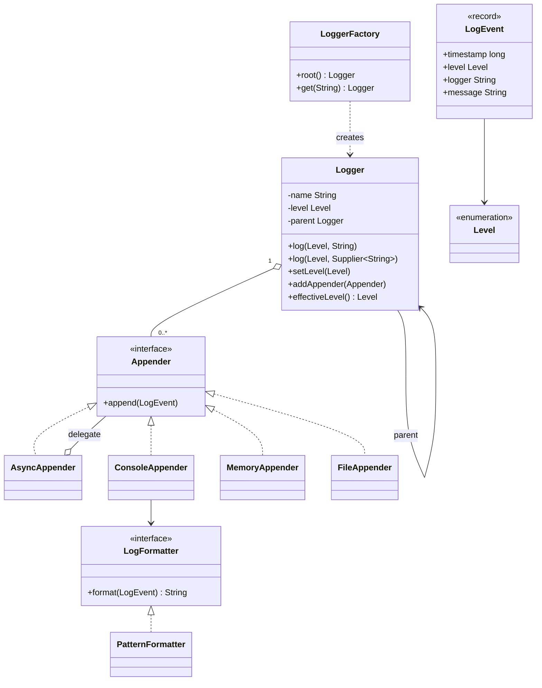

# Chapter 56 — Logger framework

## What and why

A logger framework is the standard "several patterns in one small system" question. Exam payoff: level filtering, a logger hierarchy with inherited levels, pluggable appenders and formatters, a decorator for async I/O, and lazy message construction.

## Exam flash rules

- Levels are ordered: `DEBUG < INFO < WARN < ERROR`; an event is logged when `level >= effective level`.
- A logger with no level of its own **inherits** the nearest ancestor's level; the root must have one.
- Names are dotted: `app.db` is a child of `app`, which is a child of root.
- Events are **additive**: they go to the logger's appenders and then to every ancestor's appenders.
- **Appender** = where (console, file, memory); **formatter** = how (pattern). Both are interfaces (Strategy).
- Decorate, don't edit: `AsyncAppender` wraps any appender.
- Pass a `Supplier<String>` so expensive messages are built only when the level is enabled.
- A bounded queue gives **back-pressure**: producers block when it is full.
- `close()` on the async appender drains the queue, then stops the worker (poison pill).
- A file appender must `flush`/`close`; `try-with-resources` needs `AutoCloseable`.
- Inject the clock (`LongSupplier`) so timestamps are deterministic in tests.
- A package-private constructor means "create me through the factory".

## Short-answer strip

| Item | Answer |
|------|--------|
| Entities | `Logger`, `LoggerFactory`, `Appender`, `LogFormatter`, `LogEvent`, `Level` |
| Value types | `Level` (enum), `LogEvent` (record) |
| Relationships | `Logger` → parent `Logger` (association, 0..1); `Logger` **has** 0..* `Appender`; appender → `LogFormatter`; `AsyncAppender` wraps an `Appender` |
| APIs | `Logger.log(Level, String)`, `log(Level, Supplier)`, `setLevel`, `addAppender`; `LoggerFactory.get(String)` |
| Patterns | Strategy (formatter), Observer-like fan-out (appenders), Decorator (`AsyncAppender`), Factory (`LoggerFactory`), Chain via parent links |
| Concurrency | appender list: `CopyOnWriteArrayList`; level: `volatile`; registry: `ConcurrentHashMap`; file and memory appenders synchronise their writes |

## Requirements

| Kind | Line |
|------|------|
| Functional | Four levels; each logger has an optional level, inheriting from its parent |
| Functional | A logger can have many appenders; events propagate to ancestors' appenders |
| Functional | Pluggable formatting; console, file and in-memory destinations |
| Functional | Optional asynchronous delivery |
| Non-functional | Called from many threads; no lost lines; disabled levels cost almost nothing |
| Out of scope | Log rotation, MDC/context maps, structured JSON, remote shipping |

## Rules table

| Case | Compiles? | Compiler message |
|------|-----------|------------------|
| `new Logger(...)` from outside the package | No | `Logger(String,Logger,Level,LongSupplier) is not public in Logger; cannot be accessed from outside package` |
| `Level.TRACE` (no such constant) | No | `cannot find symbol` (`symbol: variable TRACE`) |
| Implement `Appender` without `append` | No | `... is not abstract and does not override abstract method append(LogEvent) in Appender` |
| `switch` expression over `Level` missing `ERROR` | No | `the switch expression does not cover all possible input values` |
| `try (ConsoleAppender c = ...)` | No | `incompatible types: try-with-resources not applicable to variable type` |

## Walkthrough

### Levels and events

```java
{{#include ../../code/part-04-lld/src/main/java/lld/logger/Level.java:level}}
```

```java
{{#include ../../code/part-04-lld/src/main/java/lld/logger/LogEvent.java:log-event}}
```

### Formatting

```java
{{#include ../../code/part-04-lld/src/main/java/lld/logger/LogFormatter.java:log-formatter}}
```

```java
{{#include ../../code/part-04-lld/src/main/java/lld/logger/PatternFormatter.java:pattern-formatter}}
```

### Appenders

```java
{{#include ../../code/part-04-lld/src/main/java/lld/logger/Appender.java:appender}}
```

```java
{{#include ../../code/part-04-lld/src/main/java/lld/logger/ConsoleAppender.java:console-appender}}
```

```java
{{#include ../../code/part-04-lld/src/main/java/lld/logger/MemoryAppender.java:memory-appender}}
```

```java
{{#include ../../code/part-04-lld/src/main/java/lld/logger/FileAppender.java:file-appender}}
```

```java
{{#include ../../code/part-04-lld/src/main/java/lld/logger/AsyncAppender.java:async-appender}}
```

### Logger and registry

```java
{{#include ../../code/part-04-lld/src/main/java/lld/logger/Logger.java:logger}}
```

```java
{{#include ../../code/part-04-lld/src/main/java/lld/logger/LoggerFactory.java:logger-factory}}
```

### Run

```java
{{#include ../../code/part-04-lld/src/main/java/lld/logger/LoggerDemo.java:logger-demo}}
```

```text
{{#include ../../code/part-04-lld/out/logger/LoggerDemo.txt}}
```

`app.db` logs `info` → hidden (its level is `WARN`); `app.web` has no level, so it inherits `DEBUG` from `app`; `other` inherits `INFO` from root; the lazy supplier runs only for the `ERROR` call.

## Tests

```java
{{#include ../../code/part-04-lld/src/test/java/lld/logger/LoggerTest.java:logger-test}}
```

## Extension discussion

| Extension | Change | Touches |
|-----------|--------|---------|
| Rotating files | `RollingFileAppender` decorator choosing the file by size/date | One class |
| Filters | `Filter` interface (Chain of Responsibility) consulted before `deliver` | `Logger` |
| JSON output | New `LogFormatter` | One class |
| Context (request id) | `ThreadLocal` map copied into `LogEvent` | `LogEvent`, `Logger` |
| Non-additive loggers | `additive` flag; stop `deliver` at that logger | `Logger.deliver` |
| Drop instead of block | `AsyncAppender` with `offer` and a dropped counter | `AsyncAppender` |
| Global access | One static `LoggerFactory` holder (Singleton); keep the constructor public for tests | New holder class |

## Predict the output

**P1.**

```java
{{#include ../../code/part-04-lld/src/main/java/lld/logger/exam/PredictLevels.java:predict-levels}}
```

<details><summary>Answer</summary>

```text
{{#include ../../code/part-04-lld/out/logger/PredictLevels.txt}}
```

Trace: root level `INFO`; `debug` is dropped; `x` inherits; the rest pass in call order.

</details>

**P2.**

```java
{{#include ../../code/part-04-lld/src/main/java/lld/logger/exam/PredictInherit.java:predict-inherit}}
```

<details><summary>Answer</summary>

```text
{{#include ../../code/part-04-lld/out/logger/PredictInherit.txt}}
```

Trace: child follows parent (`WARN`, then `DEBUG`); its own `ERROR` wins; `setLevel(null)` returns it to inheriting.

</details>

**P3.**

```java
{{#include ../../code/part-04-lld/src/main/java/lld/logger/exam/PredictLazy.java:predict-lazy}}
```

<details><summary>Answer</summary>

```text
{{#include ../../code/part-04-lld/out/logger/PredictLazy.txt}}
```

Trace: the disabled `Supplier` is never called (0); the enabled one runs (1); `"eager " + built.incrementAndGet()` is evaluated **before** the call, so it counts even though `DEBUG` is disabled (2).

</details>

**P4.**

```java
{{#include ../../code/part-04-lld/src/main/java/lld/logger/exam/PredictAdditive.java:predict-additive}}
```

<details><summary>Answer</summary>

```text
{{#include ../../code/part-04-lld/out/logger/PredictAdditive.txt}}
```

Trace: `svc` is enabled for `INFO`; it delivers to its own appender and to root's, even though root's level is `ERROR`. `other` inherits `ERROR`, so its `info` is dropped.

</details>

**P5.**

```java
{{#include ../../code/part-04-lld/src/main/java/lld/logger/exam/PredictFormat.java:predict-format}}
```

<details><summary>Answer</summary>

```text
{{#include ../../code/part-04-lld/out/logger/PredictFormat.txt}}
```

Trace: placeholders are replaced everywhere they occur; a lambda can implement `LogFormatter` (one abstract method).

</details>

## Compile or not?

**C1.**

```java
{{#include ../../code/part-04-lld/broken/logger/LoggerPrivateCtorBroken.java}}
```

<div class="compiler-error">

```text
{{#include ../../code/part-04-lld/out/logger/LoggerPrivateCtorBroken.javac.txt}}
```

</div>

**C2.**

```java
{{#include ../../code/part-04-lld/broken/logger/LoggerUnknownLevelBroken.java}}
```

<div class="compiler-error">

```text
{{#include ../../code/part-04-lld/out/logger/LoggerUnknownLevelBroken.javac.txt}}
```

</div>

**C3.**

```java
{{#include ../../code/part-04-lld/broken/logger/LoggerMissingAppendBroken.java}}
```

<div class="compiler-error">

```text
{{#include ../../code/part-04-lld/out/logger/LoggerMissingAppendBroken.javac.txt}}
```

</div>

**C4.**

```java
{{#include ../../code/part-04-lld/broken/logger/LoggerSwitchBroken.java}}
```

<div class="compiler-error">

```text
{{#include ../../code/part-04-lld/out/logger/LoggerSwitchBroken.javac.txt}}
```

</div>

**C5.**

```java
{{#include ../../code/part-04-lld/broken/logger/LoggerTryResourceBroken.java}}
```

<div class="compiler-error">

```text
{{#include ../../code/part-04-lld/out/logger/LoggerTryResourceBroken.javac.txt}}
```

</div>

## Gotchas

1. **Eager message concatenation.** `"x" + expensive()` runs even when the level is off (`PredictLazy`); pass a `Supplier`.
2. **Mutable appender list during iteration.** A plain `ArrayList` can throw `ConcurrentModificationException`; `CopyOnWriteArrayList` iterates a snapshot.
3. **Unclosed file appender.** Lines sit in the buffer; close it (`fileAppenderWritesUtf8Lines`).
4. **Async close that does not drain.** Lines are lost; `close` enqueues a poison pill and joins the worker.
5. **Level check on the root only.** The effective level comes from the *logger*, not the appender's owner (`PredictAdditive`).

## UML



## Interview Q&A

1. **Q:** How does level inheritance work? **A:** `effectiveLevel()` returns the logger's level or its parent's, recursively; root always has one.
2. **Q:** Which patterns are in the design? **A:** Strategy (formatter), Decorator (`AsyncAppender`), Factory (`LoggerFactory`), parent chain for propagation.
3. **Q:** Why `Supplier<String>`? **A:** Defers message construction until the level check passes (`PredictLazy`).
4. **Q:** Why `CopyOnWriteArrayList` for appenders? **A:** Many reads, rare writes; iteration needs no lock.
5. **Q:** What does the async appender add? **A:** Callers return after an enqueue; one worker does the slow I/O; back-pressure through a bounded queue.
6. **Q:** How do you stop the worker cleanly? **A:** A poison pill (`STOP`) enqueued by `close`; then `join`.
7. **Q:** Why inject the clock? **A:** Deterministic timestamps in tests.
8. **Q:** Why is `Logger`'s constructor package-private? **A:** Loggers must come from the factory so the hierarchy is consistent (`LoggerPrivateCtorBroken`).
9. **Q:** Why a static singleton factory is risky? **A:** Global state leaks between tests; keep an instance and hold one in production.
10. **Q:** What happens if the queue is full? **A:** `put` blocks the caller; alternatives are drop-newest or drop-oldest with a counter.
11. **Q:** Why does `ConsoleAppender` not work in try-with-resources? **A:** It is not `AutoCloseable` (`LoggerTryResourceBroken`).
12. **Q:** How do you make a logger non-additive? **A:** A flag checked in `deliver`.

## Exam writing prompts

1. (5) Write `Level` with `atLeast` and `Logger.isEnabled` using the effective level.
2. (5) Write `Logger.effectiveLevel()` for a hierarchy with a root.
3. (8) Write an `Appender` decorator that forwards only events at or above a threshold.
4. (3) Draw the class diagram for `Logger`, `Appender`, `LogFormatter`.

## Exercises

Solutions: `solutions/ch56/SolutionLogger.java`.

1. Write a threshold-filtering `Appender` decorator.
2. Write a formatter as a lambda.
3. Raise one package's level without touching the code that logs.
4. Show that a disabled lazy message does no work.
5. Print the effective levels of two loggers in different branches.

```java
{{#include ../../code/part-04-lld/solutions/ch56/SolutionLogger.java}}
```

```text
{{#include ../../code/part-04-lld/out/logger/SolutionLogger.txt}}
```

## Recap checklist

- [x] Levels, hierarchy, additive propagation
- [x] Appender / formatter strategies; async decorator with back-pressure
- [x] Tests incl. file I/O (`@TempDir`) and concurrency
- [x] Exam banks: flash 12, predict 5, compile 5, writing 4
