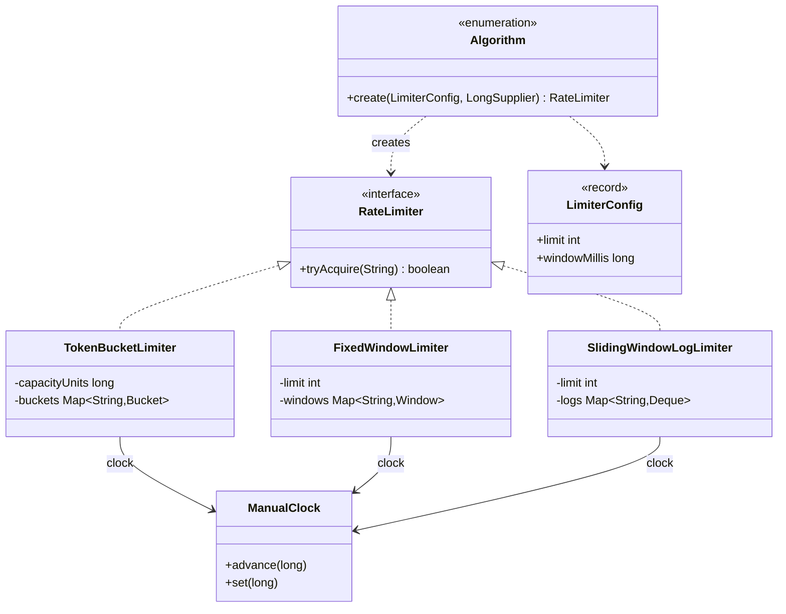

# Chapter 57 — Rate limiter

## What and why

A rate limiter is the standard "algorithm choice + concurrency" LLD question. Exam payoff: token bucket, fixed window and sliding-window log with their trade-offs, an injectable clock, per-key state, and exactness under contention.

## Exam flash rules

- A limiter answers `tryAcquire(key)`: allowed or not, per key (user, IP, API key).
- **Token bucket**: capacity `C`, refill `r` per period; a request costs one token; allows bursts up to `C`, then the refill rate. Memory O(1) per key.
- **Fixed window**: count per aligned window; O(1) memory; allows up to **2 × limit** across a window boundary.
- **Sliding-window log**: store accepted timestamps; exact; O(limit) memory per key.
- **Sliding-window counter** (extension): weighted sum of two fixed windows; approximate, O(1).
- **Leaky bucket**: constant outflow queue; smooths bursts; token bucket allows them.
- Take the clock as a `LongSupplier`; tests use a manual clock, production uses `System::currentTimeMillis`.
- Ignore a clock that goes backwards: `max(0, now − last)`; never mint tokens.
- Per-key state in a `ConcurrentHashMap`; `computeIfAbsent` is atomic; mutate each key's state under that key's lock.
- Keep integers: store tokens as `tokens × periodMillis` units to avoid floating-point drift.
- A requirement a request must satisfy in two limiters needs check-then-commit; `a && b` charges `a` even when `b` rejects.
- A functional interface (`RateLimiter`) is implemented by a lambda with the **same parameter list**.

## Short-answer strip

| Item | Answer |
|------|--------|
| Entities | `RateLimiter` (interface), `TokenBucketLimiter`, `FixedWindowLimiter`, `SlidingWindowLogLimiter` |
| Value types | `LimiterConfig` (record), `Algorithm` (enum factory) |
| Relationships | Each limiter **has** a map of per-key state (composition) and a clock (association); `Algorithm` creates limiters |
| APIs | `boolean tryAcquire(String key)`; `Algorithm.create(LimiterConfig, LongSupplier)` |
| Patterns | Strategy (algorithm behind one interface), Factory (enum with exhaustive `switch`) |
| Concurrency | per-key state mutable + shared → `synchronized (stateObject)`; key map → `ConcurrentHashMap` |

| Algorithm | Memory / key | Burst | Boundary effect | Accuracy |
|-----------|--------------|-------|-----------------|----------|
| Token bucket | O(1) | up to capacity | none | exact for its rule |
| Fixed window | O(1) | up to limit | 2 × limit | exact per window |
| Sliding log | O(limit) | up to limit | none | exact |

## Requirements

| Kind | Line |
|------|------|
| Functional | Allow at most `limit` requests per `window` per key |
| Functional | Several algorithms selectable by configuration |
| Functional | Keys are independent |
| Non-functional | Many threads; the shared key never exceeds its limit |
| Non-functional | Deterministic tests (no sleeping) |
| Out of scope | Distributed counters (Redis), response headers, idle-key eviction |

## Rules table

| Case | Compiles? | Compiler message |
|------|-----------|------------------|
| `switch` expression over `Algorithm` missing a constant | No | `the switch expression does not cover all possible input values` |
| `cfg.limit = 5` on a record | No | `limit has private access in LimiterConfig` |
| `RateLimiter r = () -> true;` | No | `incompatible types: incompatible parameter types in lambda expression` |
| `int now = clock.getAsLong();` | No | `incompatible types: possible lossy conversion from long to int` |
| `Thread.sleep(10)` with no handler | No | `unreported exception InterruptedException; must be caught or declared to be thrown` |

## Walkthrough

### Contract and clock

```java
{{#include ../../code/part-04-lld/src/main/java/lld/ratelimit/RateLimiter.java:rate-limiter}}
```

```java
{{#include ../../code/part-04-lld/src/main/java/lld/ratelimit/ManualClock.java:manual-clock}}
```

### Token bucket

```java
{{#include ../../code/part-04-lld/src/main/java/lld/ratelimit/TokenBucketLimiter.java:token-bucket}}
```

### Fixed window

```java
{{#include ../../code/part-04-lld/src/main/java/lld/ratelimit/FixedWindowLimiter.java:fixed-window}}
```

### Sliding-window log

```java
{{#include ../../code/part-04-lld/src/main/java/lld/ratelimit/SlidingWindowLogLimiter.java:sliding-log}}
```

### Configuration and factory

```java
{{#include ../../code/part-04-lld/src/main/java/lld/ratelimit/LimiterConfig.java:limiter-config}}
```

```java
{{#include ../../code/part-04-lld/src/main/java/lld/ratelimit/Algorithm.java:algorithm}}
```

### Run — the boundary burst

```java
{{#include ../../code/part-04-lld/src/main/java/lld/ratelimit/RateLimitDemo.java:rate-limit-demo}}
```

```text
{{#include ../../code/part-04-lld/out/ratelimit/RateLimitDemo.txt}}
```

Requests at 900, 910, 920, 1000, 1010, 1020, 1900 with limit 3 per 1000 ms: fixed window lets all six through around the boundary; token bucket and sliding log let three.

## Tests

```java
{{#include ../../code/part-04-lld/src/test/java/lld/ratelimit/RateLimiterTest.java:ratelimit-test}}
```

## Extension discussion

| Extension | Change | Touches |
|-----------|--------|---------|
| Sliding-window counter | Two counters + weight `1 − elapsed/window`; O(1), approximate | New `RateLimiter` |
| Distributed limiting | Move per-key state to a shared store; use an atomic script (check + decrement) | New limiter; same interface |
| Two limits per key (per second **and** per minute) | Composite with check-then-commit to avoid charging the first limiter on rejection | New decorator |
| Idle-key cleanup | Remove keys untouched for `window`; or Caffeine-style expiry | State map |
| `Retry-After` | Return a result (`allowed`, `retryAfterMillis`) instead of `boolean` | Interface, all limiters |
| Weighted requests | `tryAcquire(key, cost)`; token bucket subtracts `cost` | Interface, token bucket |
| Runtime reconfiguration | Hold `LimiterConfig` in an `AtomicReference`; rebuild per-key state lazily | Limiters |

## Predict the output

**P1.**

```java
{{#include ../../code/part-04-lld/src/main/java/lld/ratelimit/exam/PredictBurst.java:predict-burst}}
```

<details><summary>Answer</summary>

```text
{{#include ../../code/part-04-lld/out/ratelimit/PredictBurst.txt}}
```

Trace: capacity 2 → two immediate passes, third fails; 999 ms yields 0.999 token (no); 1000 ms yields a whole token; the next call finds none.

</details>

**P2.**

```java
{{#include ../../code/part-04-lld/src/main/java/lld/ratelimit/exam/PredictFixedBoundary.java:predict-fixed-boundary}}
```

<details><summary>Answer</summary>

```text
{{#include ../../code/part-04-lld/out/ratelimit/PredictFixedBoundary.txt}}
```

Trace: 990, 995 fill window 0; 999 is rejected; 1000 starts window 1 (two more pass), 1002 is rejected: four passes within 12 ms.

</details>

**P3.**

```java
{{#include ../../code/part-04-lld/src/main/java/lld/ratelimit/exam/PredictSlidingLog.java:predict-sliding-log}}
```

<details><summary>Answer</summary>

```text
{{#include ../../code/part-04-lld/out/ratelimit/PredictSlidingLog.txt}}
```

Trace: log {0,500}; 600 rejected; at 1000 the entry 0 expires (`<= now − window`) → log {500,1000}; 1001 rejected; at 1500 entry 500 expires → pass.

</details>

**P4.**

```java
{{#include ../../code/part-04-lld/src/main/java/lld/ratelimit/exam/PredictKeys.java:predict-keys}}
```

<details><summary>Answer</summary>

```text
{{#include ../../code/part-04-lld/out/ratelimit/PredictKeys.txt}}
```

Trace: `a` and `b` have separate windows; the second `a` is rejected; after 1000 ms both start a new window.

</details>

**P5.**

```java
{{#include ../../code/part-04-lld/src/main/java/lld/ratelimit/exam/PredictFactory.java:predict-factory}}
```

<details><summary>Answer</summary>

```text
{{#include ../../code/part-04-lld/out/ratelimit/PredictFactory.txt}}
```

Trace: enum ordinals follow declaration order; the compact constructor rejects `limit == 0`; a record prints its components.

</details>

## Compile or not?

**C1.**

```java
{{#include ../../code/part-04-lld/broken/ratelimit/RateLimitSwitchBroken.java}}
```

<div class="compiler-error">

```text
{{#include ../../code/part-04-lld/out/ratelimit/RateLimitSwitchBroken.javac.txt}}
```

</div>

**C2.**

```java
{{#include ../../code/part-04-lld/broken/ratelimit/RateLimitRecordFieldBroken.java}}
```

<div class="compiler-error">

```text
{{#include ../../code/part-04-lld/out/ratelimit/RateLimitRecordFieldBroken.javac.txt}}
```

</div>

**C3.**

```java
{{#include ../../code/part-04-lld/broken/ratelimit/RateLimitLambdaBroken.java}}
```

<div class="compiler-error">

```text
{{#include ../../code/part-04-lld/out/ratelimit/RateLimitLambdaBroken.javac.txt}}
```

</div>

**C4.**

```java
{{#include ../../code/part-04-lld/broken/ratelimit/RateLimitLossyBroken.java}}
```

<div class="compiler-error">

```text
{{#include ../../code/part-04-lld/out/ratelimit/RateLimitLossyBroken.javac.txt}}
```

</div>

**C5.**

```java
{{#include ../../code/part-04-lld/broken/ratelimit/RateLimitSleepBroken.java}}
```

<div class="compiler-error">

```text
{{#include ../../code/part-04-lld/out/ratelimit/RateLimitSleepBroken.javac.txt}}
```

</div>

## Gotchas

1. **Boundary burst.** Fixed window passes `2 × limit` around a boundary (`PredictFixedBoundary`, `RateLimitDemo`).
2. **Check-then-act on a shared key.** Read count, compare, increment without one lock lets extra requests through; each limiter locks its per-key state.
3. **Storing time as `int`.** Epoch milliseconds overflow `int` (`RateLimitLossyBroken`).
4. **Trusting the clock.** Time can go backwards; clamp elapsed to 0 (`clockGoingBackwardsDoesNotMintTokens`).
5. **`a && b` across two limiters.** `a` is charged when `b` rejects (`SolutionRateLimit`, exercise 1).

## UML



## Interview Q&A

1. **Q:** Token bucket vs fixed window? **A:** Token bucket allows a bounded burst then a steady rate with O(1) state; fixed window is simplest but allows `2 × limit` at a boundary.
2. **Q:** Why is a sliding log exact? **A:** It stores accepted timestamps and expires those older than the window.
3. **Q:** Its cost? **A:** O(limit) memory per key and O(expired) work per call.
4. **Q:** Token bucket vs leaky bucket? **A:** Token bucket permits bursts; leaky bucket releases at a constant rate.
5. **Q:** How do you keep it thread-safe per key? **A:** `computeIfAbsent` creates the state once; mutate it under `synchronized (state)`.
6. **Q:** Why a global lock is a poor answer? **A:** It serialises unrelated keys.
7. **Q:** Why inject the clock? **A:** Tests advance time instantly and deterministically.
8. **Q:** Why integer units in the bucket? **A:** Fractional tokens in `double` drift; `tokens × periodMillis` stays exact.
9. **Q:** What if the system clock jumps back? **A:** Clamp elapsed time to zero.
10. **Q:** How do you limit across servers? **A:** Shared store with an atomic check-and-decrement; the `RateLimiter` interface is unchanged.
11. **Q:** How do you enforce two limits at once? **A:** Check both, then commit both; plain `&&` charges the first one on a rejection.
12. **Q:** What does the enum factory buy? **A:** Config-driven choice; an exhaustive `switch` forces a case for every new algorithm.

## Exam writing prompts

1. (5) Write `FixedWindowLimiter.tryAcquire` for one key.
2. (8) Write a token bucket whose `tryAcquire` refills lazily from the elapsed time.
3. (5) Write `Algorithm.create` as an exhaustive `switch` expression.
4. (3) State the boundary problem of the fixed window with a numeric example.

## Exercises

Solutions: `solutions/ch57/SolutionRateLimit.java`.

1. Write `allOf(strict, loose)` as a lambda and show its limitation.
2. Write a deny-list wrapper as a lambda.
3. Compare how many of 60 requests each algorithm allows at 20 req/s with limit 5/s.
4. Show the boundary burst for the three algorithms.
5. Count allowed requests for a bucket refilling 2 tokens/s with capacity 5.

```java
{{#include ../../code/part-04-lld/solutions/ch57/SolutionRateLimit.java}}
```

```text
{{#include ../../code/part-04-lld/out/ratelimit/SolutionRateLimit.txt}}
```

## Recap checklist

- [x] Token bucket, fixed window, sliding log; trade-off table
- [x] Injectable clock, per-key locking, integer arithmetic
- [x] Tests incl. 64-thread exactness for every algorithm
- [x] Exam banks: flash 12, predict 5, compile 5, writing 4
