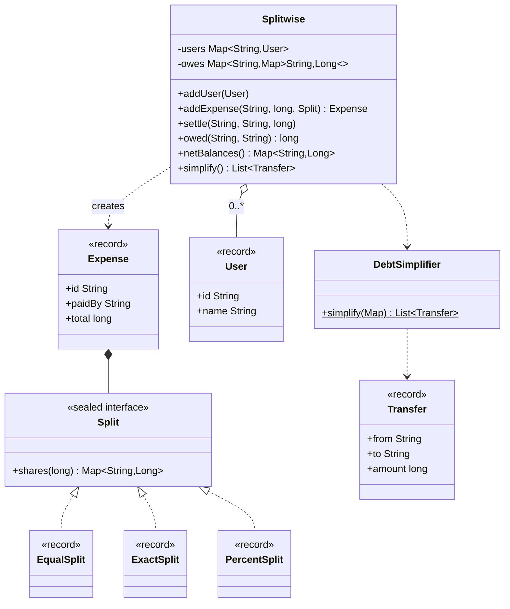

# Chapter 58 — Splitwise (expense sharing)

## What and why

Splitwise is the standard "money correctness + algorithm" LLD question. Exam payoff: split types as a sealed interface, exact integer arithmetic with leftover cents, a one-directional pairwise ledger, and greedy debt simplification.

## Exam flash rules

- Money is `long` cents; `double` loses precision (`0.1 + 0.2 != 0.3`).
- A split must add up **exactly** to the total, or the expense is rejected before any state changes.
- **Equal** split: `total / n` each; the `total % n` leftover cents go one each to the first participants.
- **Exact** split: stated amounts; their sum must equal the total.
- **Percent** split: percentages sum to 100; shares round down and leftover cents go to the first entries.
- A `sealed` interface lists its split types; a pattern `switch` over it is exhaustive without `default` (Java 17+ sealed, 21 patterns).
- The payer does not owe themself: skip `share` for `paidBy`.
- Keep the pairwise ledger **one-directional**: A→B and B→A are netted into a single edge.
- Net balance of a user: what others owe them minus what they owe; the sum over all users is **0**.
- Debt simplification: greedy match of the largest creditor with the largest debtor; at most `n − 1` transfers; minimum-transfer is NP-hard.
- `Map.of("a", 50)` infers `Integer` values, so it cannot be passed where `Map<String, Long>` is needed.
- Validate users and splits **before** mutating the ledger; failed calls leave no trace.

## Short-answer strip

| Item | Answer |
|------|--------|
| Entities | `User`, `Expense`, `Split`, `Splitwise` (ledger), `Transfer` |
| Value types | `User`, `Expense`, `Transfer` (records); amounts as `long` cents |
| Relationships | `Expense` **has** one `Split` (composition); `Splitwise` **has** many `User` (aggregation) and a debt map; `EqualSplit` / `ExactSplit` / `PercentSplit` realize `Split` |
| APIs | `addExpense(paidBy, total, Split)`, `settle(from, to, amount)`, `owed(debtor, creditor)`, `netBalances()`, `simplify()` |
| Patterns | Strategy (`Split` computes shares), sealed hierarchy, greedy algorithm with a priority queue |
| Concurrency | debt map is mutable and shared → every `Splitwise` method is `synchronized` |
| Invariant | `sum(netBalances) == 0` after every operation |

## Requirements

| Kind | Line |
|------|------|
| Functional | Users add expenses paid by one user and shared by others |
| Functional | Three splits: equal, exact amounts, percentages |
| Functional | Show who owes whom; settle a debt; simplify all debts |
| Functional | Reject totals that do not add up, unknown users, non-positive amounts |
| Non-functional | Exact money arithmetic; safe under concurrent additions |
| Out of scope | Groups, currencies, receipts, notifications, persistence |

## Rules table

| Case | Compiles? | Compiler message |
|------|-----------|------------------|
| Implement sealed `Split` outside `permits` | No | `class is not allowed to extend sealed class: Split (as it is not listed in its 'permits' clause)` |
| `switch` over `Split` covering two of three subtypes | No | `the switch expression does not cover all possible input values` |
| `long cents = price * 100;` (`double price`) | No | `incompatible types: possible lossy conversion from double to long` |
| `new EqualSplit("a", "b")` | No | `constructor EqualSplit in record EqualSplit cannot be applied to given types;` |
| `new ExactSplit(Map.of("a", 50, "b", 50))` | No | `incompatible types: inference variable V has incompatible bounds` |

## Walkthrough

### Users, results, expenses

```java
{{#include ../../code/part-04-lld/src/main/java/lld/splitwise/User.java:user}}
```

```java
{{#include ../../code/part-04-lld/src/main/java/lld/splitwise/Expense.java:expense}}
```

```java
{{#include ../../code/part-04-lld/src/main/java/lld/splitwise/Transfer.java:transfer}}
```

### The splits

```java
{{#include ../../code/part-04-lld/src/main/java/lld/splitwise/Split.java:split}}
```

```java
{{#include ../../code/part-04-lld/src/main/java/lld/splitwise/EqualSplit.java:equal-split}}
```

```java
{{#include ../../code/part-04-lld/src/main/java/lld/splitwise/ExactSplit.java:exact-split}}
```

```java
{{#include ../../code/part-04-lld/src/main/java/lld/splitwise/PercentSplit.java:percent-split}}
```

### The ledger

```java
{{#include ../../code/part-04-lld/src/main/java/lld/splitwise/Splitwise.java:splitwise}}
```

### Debt simplification

```java
{{#include ../../code/part-04-lld/src/main/java/lld/splitwise/DebtSimplifier.java:debt-simplifier}}
```

### Run

```java
{{#include ../../code/part-04-lld/src/main/java/lld/splitwise/SplitwiseDemo.java:splitwise-demo}}
```

```text
{{#include ../../code/part-04-lld/out/splitwise/SplitwiseDemo.txt}}
```

Reading the trace: A pays 400 for four (B, C, D owe A 100 each); B pays 300 for B, C, D (C and D owe B 100 each); D pays 90 split 50/50 with A (A owes D 45, netted against D's 100 debt to A → D owes A 55). Net: A +255, B +100, C −200, D −155 (sum 0). Greedy: C → A 200, D → B 100, D → A 55.

## Tests

```java
{{#include ../../code/part-04-lld/src/test/java/lld/splitwise/SplitwiseTest.java:splitwise-test}}
```

## Extension discussion

| Extension | Change | Touches |
|-----------|--------|---------|
| Groups | `Group` entity with members; balances per group | New class, `Splitwise` keyed by group |
| Multiple currencies | `Money(long minor, Currency c)`; conversion rate service | Amount type everywhere |
| Share by weight / shares | New `Split`; add to `permits` — every exhaustive `switch` then fails to compile until updated | `Split` |
| Itemised receipts | `Item(name, price, Split)` list inside `Expense` | `Expense` |
| Audit trail / undo | Keep `Expense` list; undo = apply the reverse expense (Command) | `Splitwise` |
| Large groups | Min-cash-flow heuristics; or per-user `ConcurrentHashMap` and fine-grained locks | `Splitwise`, `DebtSimplifier` |
| Notifications | Observer on `addExpense` | `Splitwise` |

## Predict the output

**P1.**

```java
{{#include ../../code/part-04-lld/src/main/java/lld/splitwise/exam/PredictEqualRemainder.java:predict-equal-remainder}}
```

<details><summary>Answer</summary>

```text
{{#include ../../code/part-04-lld/out/splitwise/PredictEqualRemainder.txt}}
```

Trace: 100/3 = 33 r 1 → first gets 34; 10/4 = 2 r 2 → first two get 3; the sum is always the total (7).

</details>

**P2.**

```java
{{#include ../../code/part-04-lld/src/main/java/lld/splitwise/exam/PredictPercent.java:predict-percent}}
```

<details><summary>Answer</summary>

```text
{{#include ../../code/part-04-lld/out/splitwise/PredictPercent.txt}}
```

Trace: 33%, 33%, 34% of 101 round down to 33, 33, 34 = 100; the missing cent goes to the first entry (x = 34). 60 + 30 = 90 ≠ 100.

</details>

**P3.**

```java
{{#include ../../code/part-04-lld/src/main/java/lld/splitwise/exam/PredictNetting.java:predict-netting}}
```

<details><summary>Answer</summary>

```text
{{#include ../../code/part-04-lld/out/splitwise/PredictNetting.txt}}
```

Trace: B owes A 50; B pays 30 → A owes B 15 → net B owes A 35; B pays 200 → A owes B 100 → the direction flips: A owes B 65.

</details>

**P4.**

```java
{{#include ../../code/part-04-lld/src/main/java/lld/splitwise/exam/PredictExactMismatch.java:predict-exact-mismatch}}
```

<details><summary>Answer</summary>

```text
{{#include ../../code/part-04-lld/out/splitwise/PredictExactMismatch.txt}}
```

Trace: 60 + 30 = 90 ≠ 100; the second expense names an unknown user; both fail before any debt is recorded, so balances stay 0.

</details>

**P5.**

```java
{{#include ../../code/part-04-lld/src/main/java/lld/splitwise/exam/PredictSimplify.java:predict-simplify}}
```

<details><summary>Answer</summary>

```text
{{#include ../../code/part-04-lld/out/splitwise/PredictSimplify.txt}}
```

Trace: creditor a (50); debtors c (30) then b (20), largest first; a balance of 5 with no counterpart is rejected.

</details>

## Compile or not?

**C1.**

```java
{{#include ../../code/part-04-lld/broken/splitwise/SplitSealedBroken.java}}
```

<div class="compiler-error">

```text
{{#include ../../code/part-04-lld/out/splitwise/SplitSealedBroken.javac.txt}}
```

</div>

**C2.**

```java
{{#include ../../code/part-04-lld/broken/splitwise/SplitSwitchBroken.java}}
```

<div class="compiler-error">

```text
{{#include ../../code/part-04-lld/out/splitwise/SplitSwitchBroken.javac.txt}}
```

</div>

**C3.**

```java
{{#include ../../code/part-04-lld/broken/splitwise/SplitDoubleMoneyBroken.java}}
```

<div class="compiler-error">

```text
{{#include ../../code/part-04-lld/out/splitwise/SplitDoubleMoneyBroken.javac.txt}}
```

</div>

**C4.**

```java
{{#include ../../code/part-04-lld/broken/splitwise/SplitRecordArityBroken.java}}
```

<div class="compiler-error">

```text
{{#include ../../code/part-04-lld/out/splitwise/SplitRecordArityBroken.javac.txt}}
```

</div>

**C5.**

```java
{{#include ../../code/part-04-lld/broken/splitwise/SplitMapLongBroken.java}}
```

<div class="compiler-error">

```text
{{#include ../../code/part-04-lld/out/splitwise/SplitMapLongBroken.javac.txt}}
```

</div>

Fix for C5: write the values as `long` literals (`50L`).

## Gotchas

1. **`double` for money.** Binary fractions: `0.1 + 0.2 == 0.3` is `false` (`SolutionSplitwise`).
2. **Dropping leftover cents.** `100 / 3 × 3 = 99`; assign the remainder (`PredictEqualRemainder`).
3. **Two-directional edges.** Keeping both A→B and B→A hides the real balance; net them (`PredictNetting`).
4. **Partial updates.** Validate shares and users first; a failed expense must change nothing (`PredictExactMismatch`).
5. **Payer owes themself.** Skip the payer's own share.

## UML



## Interview Q&A

1. **Q:** Why `long` cents? **A:** Exact integer arithmetic; `double` cannot represent most decimals.
2. **Q:** Where do leftover cents go? **A:** One each to the first participants (equal) or first entries (percent), so shares sum to the total.
3. **Q:** Why a sealed `Split`? **A:** A closed set of strategies; the compiler checks every `switch` over it.
4. **Q:** How do you represent balances? **A:** A map `debtor → creditor → amount`, one direction per pair.
5. **Q:** What is the invariant? **A:** Net balances sum to zero after every operation.
6. **Q:** How does simplification work? **A:** Priority queues of creditors and debtors; repeatedly match the largest of each.
7. **Q:** Is greedy minimal? **A:** Not always; minimum transfers is NP-hard. Greedy gives at most `n − 1`.
8. **Q:** How do you add a new split type? **A:** New record implementing `Split`, add it to `permits`; fix each `switch` the compiler flags.
9. **Q:** What happens if an exact split does not sum? **A:** `IllegalArgumentException` before any ledger change.
10. **Q:** How do you handle concurrency? **A:** One lock (`synchronized`) over the ledger; operations touch several entries and must be atomic.
11. **Q:** How does `settle` work? **A:** It is a reverse debt: `addDebt(to, from, amount)` nets against the existing edge.
12. **Q:** Why does `Map.of("a", 50)` not fit `Map<String, Long>`? **A:** It infers `Integer`; use `50L` (`SplitMapLongBroken`).

## Exam writing prompts

1. (5) Write `EqualSplit.shares(long total)` so the shares sum to `total`.
2. (5) Write the sealed interface `Split` with two record implementations.
3. (8) Write `addDebt(debtor, creditor, amount)` that keeps one direction per pair.
4. (8) Write the greedy simplification using two `PriorityQueue`s.
5. (3) Given nets `A +50, B −20, C −30`, list the transfers.

## Exercises

Solutions: `solutions/ch58/SolutionSplitwise.java`.

1. Write a weighted split (e.g. by nights) with the largest-remainder rule, returning an `ExactSplit`.
2. List who owes a given user, largest first.
3. Settle part of a debt and print the new net balances.
4. Apply the simplified transfers and show all balances reach zero.
5. Show why money is stored as `long` cents.

```java
{{#include ../../code/part-04-lld/solutions/ch58/SolutionSplitwise.java}}
```

```text
{{#include ../../code/part-04-lld/out/splitwise/SolutionSplitwise.txt}}
```

## Recap checklist

- [x] Sealed split types with exact leftover handling
- [x] One-directional pairwise ledger; settle; greedy simplification
- [x] Tests incl. random invariant and concurrency
- [x] Exam banks: flash 12, predict 5, compile 5, writing 5
