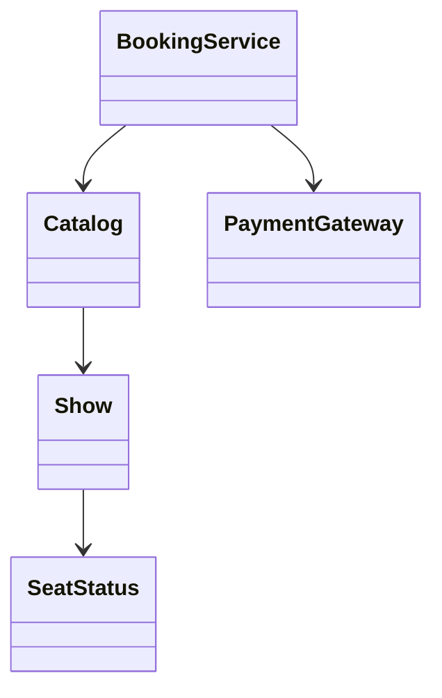

# Chapter 59 — BookMyShow

## What and why

Movie-ticket booking is the classic concurrency LLD: catalogue of theatres/shows, seat inventory, time-boxed holds, payment outside the seat lock, cancel before the show starts. Exam payoff: sealed seat status, all-or-nothing holds, `ManualClock` for TTL, and “payment declined releases seats”.

## Exam flash rules

- Money is `long` paise; `double` surcharge is a compile-time lossy conversion.
- Seat lifecycle: `Available` → `Held` → `Booked` (or back to `Available` on release/expiry/decline).
- A `sealed` `SeatStatus` + pattern `switch` needs no `default` and must be exhaustive.
- Hold is **all-or-nothing**: if any requested seat is busy, none are taken (`PredictAllOrNothing`).
- Cap seats per booking (`MAX_SEATS`); reject oversize before mutating.
- TTL: hold expires when `!clock.instant().isBefore(expiresAt)` — boundary inclusive of expiry instant.
- Charge the gateway **outside** the show lock so a slow payment does not block other users.
- Declined payment → release seats and throw; the hold id is consumed (`PredictDeclinedPayment`).
- Cancel before `show.startsAt()`; second cancel is idempotent failure (`PredictCancelTwice`).
- Concurrent holds on the same seat: exactly one winner (`PredictRace`).
- Records are immutable: assigning `hold.totalPaise` fails at compile time.
- A multi-method interface is not a functional interface — lambdas will not implement it.
- Checked exceptions inside lambdas must be handled; `Thread.sleep` is checked.

## Short-answer strip

| Item | Answer |
|------|--------|
| Entities | `Movie`, `Theatre`, `Screen`, `Show`, `Seat`, `SeatHold`, `Booking`, `Catalog`, `BookingService` |
| Value types | records for ids/amounts; `SeatStatus` sealed; `BookingStatus` enum |
| Relationships | `Show` owns seat map; `BookingService` owns holds/bookings maps; `Catalog` indexes shows |
| APIs | `hold`, `checkout`, `releaseHold`, `cancel`, search by movie |
| Patterns | State (seat status), Facade (`BookingService`), Strategy-ish `PaymentGateway` |
| Concurrency | per-`Show` lock for seat mutations; payment outside; `ConcurrentHashMap` for holds |
| Invariant | a seat id is in at most one live hold or booking for a show |

## Requirements

| Kind | Line |
|------|------|
| Functional | Search shows; hold seats with TTL; checkout with payment; release; cancel |
| Functional | All-or-nothing multi-seat hold; max seats per booking |
| Non-functional | Deterministic time via injected `Clock`; concurrent holds safe |
| Out of scope | UI, QR tickets, multipay, seat maps as graphics |

## Rules table

| Case | Compiles? | Compiler message |
|------|-----------|------------------|
| Extra `SeatStatus` implementor | No | `class is not allowed to extend sealed class: SeatStatus …` |
| Incomplete `switch` on `SeatStatus` | No | `the switch expression does not cover all possible input values` |
| `hold.totalPaise = 0` | No | `totalPaise has private access in SeatHold` |
| `long total = paise * 1.18` | No | `possible lossy conversion from double to long` |
| Lambda for multi-method gateway | No | `Gateway is not a functional interface` |
| `Thread.sleep` in lambda, uncaught | No | `unreported exception InterruptedException` |

## Walkthrough

### Seat status and show inventory

```java
{{#include ../../code/part-04-lld/src/main/java/lld/bookmyshow/SeatStatus.java}}
```

```java
{{#include ../../code/part-04-lld/src/main/java/lld/bookmyshow/Show.java}}
```

### Booking service

```java
{{#include ../../code/part-04-lld/src/main/java/lld/bookmyshow/BookingService.java}}
```

### Demo

```java
{{#include ../../code/part-04-lld/src/main/java/lld/bookmyshow/BookMyShowDemo.java}}
```

```text
{{#include ../../code/part-04-lld/out/bookmyshow/BookMyShowDemo.txt}}
```

## Predict the output

### All-or-nothing hold

```java
{{#include ../../code/part-04-lld/src/main/java/lld/bookmyshow/exam/PredictAllOrNothing.java}}
```

```text
{{#include ../../code/part-04-lld/out/bookmyshow/PredictAllOrNothing.txt}}
```

### Declined payment

```java
{{#include ../../code/part-04-lld/src/main/java/lld/bookmyshow/exam/PredictDeclinedPayment.java}}
```

```text
{{#include ../../code/part-04-lld/out/bookmyshow/PredictDeclinedPayment.txt}}
```

### Expiry boundary

```java
{{#include ../../code/part-04-lld/src/main/java/lld/bookmyshow/exam/PredictExpiryBoundary.java}}
```

```text
{{#include ../../code/part-04-lld/out/bookmyshow/PredictExpiryBoundary.txt}}
```

### Cancel twice

```java
{{#include ../../code/part-04-lld/src/main/java/lld/bookmyshow/exam/PredictCancelTwice.java}}
```

```text
{{#include ../../code/part-04-lld/out/bookmyshow/PredictCancelTwice.txt}}
```

### Race

```java
{{#include ../../code/part-04-lld/src/main/java/lld/bookmyshow/exam/PredictRace.java}}
```

```text
{{#include ../../code/part-04-lld/out/bookmyshow/PredictRace.txt}}
```

### Sealed switch + copy-on-construct

```java
{{#include ../../code/part-04-lld/src/main/java/lld/bookmyshow/exam/PredictSealedSwitch.java}}
```

```text
{{#include ../../code/part-04-lld/out/bookmyshow/PredictSealedSwitch.txt}}
```

```java
{{#include ../../code/part-04-lld/src/main/java/lld/bookmyshow/exam/PredictCopyOnConstruct.java}}
```

```text
{{#include ../../code/part-04-lld/out/bookmyshow/PredictCopyOnConstruct.txt}}
```

## Compile or not?

```java
{{#include ../../code/part-04-lld/broken/bookmyshow/BmsPermitsBroken.java}}
```

```text
{{#include ../../code/part-04-lld/out/bookmyshow/BmsPermitsBroken.javac.txt}}
```

```java
{{#include ../../code/part-04-lld/broken/bookmyshow/BmsSwitchMissingBroken.java}}
```

```text
{{#include ../../code/part-04-lld/out/bookmyshow/BmsSwitchMissingBroken.javac.txt}}
```

```java
{{#include ../../code/part-04-lld/broken/bookmyshow/BmsRecordFieldBroken.java}}
```

```text
{{#include ../../code/part-04-lld/out/bookmyshow/BmsRecordFieldBroken.javac.txt}}
```

```java
{{#include ../../code/part-04-lld/broken/bookmyshow/BmsMoneyDoubleBroken.java}}
```

```text
{{#include ../../code/part-04-lld/out/bookmyshow/BmsMoneyDoubleBroken.javac.txt}}
```

```java
{{#include ../../code/part-04-lld/broken/bookmyshow/BmsNotFunctionalBroken.java}}
```

```text
{{#include ../../code/part-04-lld/out/bookmyshow/BmsNotFunctionalBroken.javac.txt}}
```

```java
{{#include ../../code/part-04-lld/broken/bookmyshow/BmsCheckedLambdaBroken.java}}
```

```text
{{#include ../../code/part-04-lld/out/bookmyshow/BmsCheckedLambdaBroken.javac.txt}}
```

## Gotchas

1. Holding `[A1,A2]` then asking for `[A2,A3]` fails entirely — A3 stays free.
2. Expiry uses `isBefore`: at the exact `expiresAt` instant the hold is dead.
3. After a declined charge the hold id is gone — retry needs a new `hold`.
4. Refund path if confirm fails after charge (gateway refund in `checkout`).

## UML



## Short answers (marks trail)

| Marks | Prompt | Answer |
|-------|--------|--------|
| 2 | Seat states | Available, Held(holdId, expiresAt), Booked(bookingId) |
| 5 | Why payment outside lock? | Slow I/O must not block other seat mutations |
| 5 | All-or-nothing | Validate every seat free, then mark all Held in one critical section |
| 3 | TTL test seam | Inject `Clock` / `ManualClock` |

## Interview Q&A

1. **Q:** Hold vs book? **A:** Hold is temporary with TTL; book is after successful payment.
2. **Q:** How do you test expiry? **A:** `ManualClock.advance` past `expiresAt`.
3. **Q:** Two users, one seat? **A:** Show lock; one hold wins (`PredictRace`).
4. **Q:** Why sealed status? **A:** Exhaustive switches; no silent default.
5. **Q:** Cancel after show start? **A:** Rejected (`IllegalStateException`).

## Exam writing prompts

1. (5) Write `hold` so either every seat becomes `Held` or none do.
2. (5) Sketch `checkout` with payment outside the seat lock and release on decline.
3. (2) Why `long` paise instead of `double`?

## Exercises

Solutions: `code/part-04-lld/solutions/ch59/`.

1. Extend with a blocked seat status — keep the sealed switch compiling.
2. Add a soft hold extension API that bumps `expiresAt` without releasing.
3. Assert race invariant in a JUnit test with a latch.

## Recap checklist

- [x] Domain + `BookingService` + demo
- [x] Predict ≥5 / compile ≥4 / writing ≥3
- [x] Tests — `BookMyShowTest`
