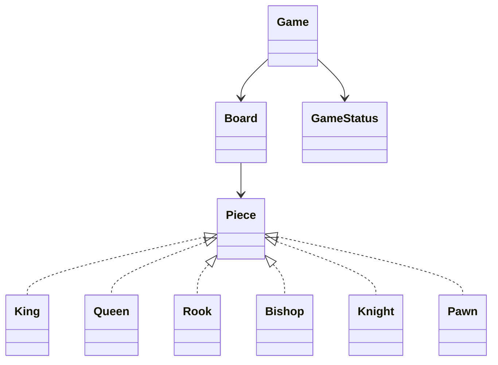

# Chapter 60 — Chess

## What and why

Chess LLD tests sealed hierarchies, coordinate math, and a two-phase move rule: **pseudo-legal** geometry, then filter moves that leave your king in check. Scope here: all six piece types, check/checkmate/stalemate; out of scope: castling, en passant, draws by repetition.

## Exam flash rules

- `Square` is file 0–7 / rank 0–7; algebraic `e2` parses to a square.
- `Piece` is `sealed` (`King`…`Pawn`); each implements `pseudoLegalTargets`.
- Sliding pieces use ray loops; knights/kings use fixed deltas; pawns move and attack differently.
- `Game.move` rejects empty/wrong-color/illegal geometry, then rejects if the trial board leaves the mover in check.
- Status: `InProgress(turn, check)`, `Checkmate(winner)`, `Stalemate` — sealed, exhaustive `switch`.
- No legal moves + in check → checkmate; no legal moves + not in check → stalemate.
- Enums cannot be `new`'d; records' fields are `final`.
- A `permits` list rejects unknown implementors.
- Fool's mate is a short sequence that ends in `Checkmate(BLACK)` (`PredictFoolsMate`).
- Pawn promotion (queen) applies on last rank after the move.

## Short-answer strip

| Item | Answer |
|------|--------|
| Entities | `Board`, `Game`, `Piece`, `Square`, `Move`, `Color`, `GameStatus` |
| Patterns | Strategy-ish movement per piece; State via `GameStatus` |
| APIs | `legalMoves()`, `move(from,to)` / `move("e2e4")`, `status()` |
| Concurrency | single-threaded model; no shared mutable board across threads |
| Invariant | after every successful move, opponent to move; never leave own king in check |

## Requirements

| Kind | Line |
|------|------|
| Functional | Standard setup; legal moves; check filter; mate/stalemate |
| Functional | Knight/rook/pawn geometry demos |
| Out of scope | Castling, en passant, clocks, UI, full FIDE draws |

## Rules table

| Case | Compiles? | Message |
|------|-----------|---------|
| `new Color()` | No | `enum classes may not be instantiated` |
| Extra `Piece` type outside permits | No | `class is not allowed to extend sealed class: Piece …` |
| Assign record component | No | `cannot assign a value to final variable …` / private access |
| Incomplete `switch` on `GameStatus` | No | `the switch expression does not cover all possible input values` |

## Walkthrough

### Geometry types

```java
{{#include ../../code/part-04-lld/src/main/java/lld/chess/Square.java}}
```

```java
{{#include ../../code/part-04-lld/src/main/java/lld/chess/Move.java}}
```

```java
{{#include ../../code/part-04-lld/src/main/java/lld/chess/Piece.java}}
```

### Game loop

```java
{{#include ../../code/part-04-lld/src/main/java/lld/chess/GameStatus.java}}
```

```java
{{#include ../../code/part-04-lld/src/main/java/lld/chess/Game.java}}
```

### Demo

```java
{{#include ../../code/part-04-lld/src/main/java/lld/chess/ChessDemo.java}}
```

```text
{{#include ../../code/part-04-lld/out/chess/ChessDemo.txt}}
```

## Predict the output

### Pawn / knight / rook

```java
{{#include ../../code/part-04-lld/src/main/java/lld/chess/exam/PredictPawn.java}}
```

```text
{{#include ../../code/part-04-lld/out/chess/PredictPawn.txt}}
```

```java
{{#include ../../code/part-04-lld/src/main/java/lld/chess/exam/PredictKnight.java}}
```

```text
{{#include ../../code/part-04-lld/out/chess/PredictKnight.txt}}
```

```java
{{#include ../../code/part-04-lld/src/main/java/lld/chess/exam/PredictRookBlocked.java}}
```

```text
{{#include ../../code/part-04-lld/out/chess/PredictRookBlocked.txt}}
```

### Check filter and mate

```java
{{#include ../../code/part-04-lld/src/main/java/lld/chess/exam/PredictCheckFilter.java}}
```

```text
{{#include ../../code/part-04-lld/out/chess/PredictCheckFilter.txt}}
```

```java
{{#include ../../code/part-04-lld/src/main/java/lld/chess/exam/PredictFoolsMate.java}}
```

```text
{{#include ../../code/part-04-lld/out/chess/PredictFoolsMate.txt}}
```

```java
{{#include ../../code/part-04-lld/src/main/java/lld/chess/exam/PredictSealedStatus.java}}
```

```text
{{#include ../../code/part-04-lld/out/chess/PredictSealedStatus.txt}}
```

## Compile or not?

```java
{{#include ../../code/part-04-lld/broken/chess/ChessEnumNewBroken.java}}
```

```text
{{#include ../../code/part-04-lld/out/chess/ChessEnumNewBroken.javac.txt}}
```

```java
{{#include ../../code/part-04-lld/broken/chess/ChessPermitsBroken.java}}
```

```text
{{#include ../../code/part-04-lld/out/chess/ChessPermitsBroken.javac.txt}}
```

```java
{{#include ../../code/part-04-lld/broken/chess/ChessRecordMutateBroken.java}}
```

```text
{{#include ../../code/part-04-lld/out/chess/ChessRecordMutateBroken.javac.txt}}
```

```java
{{#include ../../code/part-04-lld/broken/chess/ChessSwitchBroken.java}}
```

```text
{{#include ../../code/part-04-lld/out/chess/ChessSwitchBroken.javac.txt}}
```

## Gotchas

1. Pseudo-legal ≠ legal: a move can be geometrically fine and still leave you in check.
2. Pawn attacks ≠ pawn moves — check detection uses `attacks`.
3. Copy the board for the trial move; mutate only after validation.
4. After mate, further `move` throws `IllegalStateException`.

## UML



## Short answers

| Marks | Prompt | Answer |
|-------|--------|--------|
| 2 | Legal move definition | Pseudo-legal and does not leave own king in check |
| 3 | Mate vs stalemate | No moves + check vs no moves + not in check |
| 5 | Why trial board? | Validate check without corrupting the live board |

## Interview Q&A

1. **Q:** Where do rules live? **A:** Geometry on `Piece`; check filter and turn on `Game`.
2. **Q:** How do you unit-test mate? **A:** Set a custom `Board` + `PredictFoolsMate` style sequence.
3. **Q:** Extending with castling? **A:** Special-case in `King`/`Rook` + rights flags on `Game`.

## Exam writing prompts

1. (5) Write `pseudoLegalTargets` for a knight.
2. (5) Pseudocode `move` with trial-board check filter.
3. (2) Difference between checkmate and stalemate.

## Exercises

`code/part-04-lld/solutions/ch60/SolutionChess.java`.

## Recap checklist

- [x] Sealed pieces + game + demo
- [x] Predict ≥5 / compile ≥4 / writing ≥3
- [x] Tests — `ChessTest`
