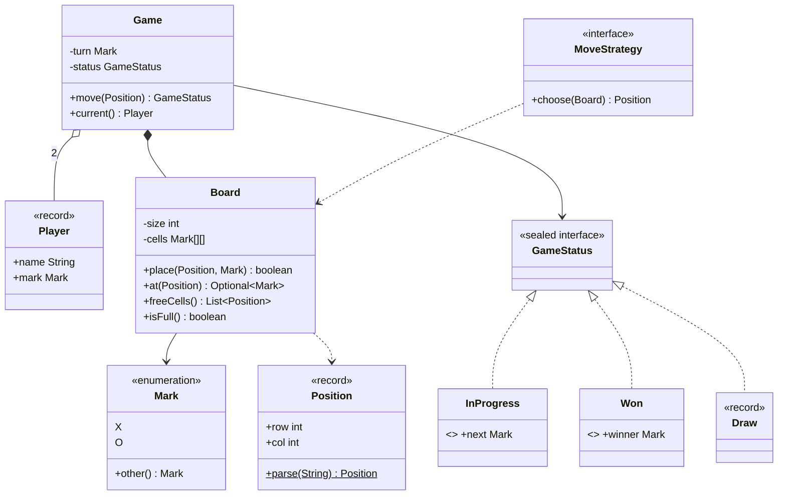

# Chapter 61 — Tic-Tac-Toe

## What and why

A two-player N×N game is the smallest LLD problem that still has every part of the exam answer: entities, a state machine, validation, a strategy seam, and tests. Exam payoff: you can draw the class diagram and write `Board.place` and `Game.move` from memory.

## Requirements

**Functional**

- Two players with different marks (`X`, `O`); the first player moves first.
- Board is N×N, N ≥ 3 (default 3); a win is N in a row, column or either diagonal.
- A move is rejected if the cell is occupied or out of bounds; the turn does not change.
- Outcomes: in progress, won, draw. No moves after the game ends.

**Non-functional**

- Win check O(1) per move (no board rescan).
- Model has no I/O; rendering is separate and the whole thing is unit-testable.

**Out of scope:** networking, UI, undo, AI beyond a trivial bot (see Extensions).

## Exam flash rules

- An `enum` has a fixed set of instances; `new` on an enum is a compile error.
- `==` is correct for enum comparison; enums are singletons per constant.
- A `record` generates `equals`, `hashCode`, `toString` and accessors; fields are `final`.
- A record's compact constructor may validate or reassign the *parameters*, never assign `this.field`.
- `sealed … permits` closes a hierarchy; a pattern `switch` over it needs no `default` and must be exhaustive.
- Every permitted subclass must be `final`, `sealed` or `non-sealed`.
- Validate **before** mutating so a rejected move leaves state unchanged.
- O(1) win check: keep counters per row, column and both diagonals per mark; a line wins when a counter hits N.
- A move that fills the last cell *and* completes a line is a win, not a draw — check win first.
- Keep rules in `Board`, turn order and outcome in `Game`, printing in a renderer.
- A strategy interface (`MoveStrategy`) lets humans and bots share one game loop.
- Unchecked exception for bad input from callers (`InvalidMoveException`); `IllegalStateException` for wrong lifecycle.

## Rules table

| Rule | Allowed | Not allowed | Compiler message (verbatim) |
|------|---------|-------------|------------------------------|
| Enum instances | `Mark.X` | `new Mark()` | `enum classes may not be instantiated` |
| Record fields | assign parameter in compact ctor | `this.row = …` in compact ctor | `cannot assign a value to final variable row` |
| Sealed | implement a type listed in `permits` | extra implementor | `class is not allowed to extend sealed class: GameStatus (as it is not listed in its 'permits' clause)` |
| Pattern switch | cover all permitted types | omit one, no `default` | `the switch expression does not cover all possible input values` |

## Design

### Entities and relationships

| Type | Kind | Responsibility |
|------|------|----------------|
| `Mark` | enum | `X`, `O`, `other()` |
| `Position` | record | immutable `(row, col)`, validated, `parse("r,c")` |
| `Player` | record | name + mark |
| `Board` | class | grid, bounds/occupancy checks, O(1) win counters, `freeCells()` |
| `GameStatus` | sealed interface | `InProgress(next)`, `Won(winner)`, `Draw` |
| `Game` | class | owns `Board`, whose turn, outcome; `move(Position)` |
| `MoveStrategy` | functional interface | `Position choose(Board)`; `FIRST_FREE` bot |
| `BoardRenderer`, `StatusText` | utility | text view; exhaustive switch over `GameStatus` |

Relationships: `Game` **composes** one `Board` and **has** two `Player`s; `Game` **depends on** `GameStatus`; `MoveStrategy` **depends on** `Board`.

### API

```text
Game(Player first, Player second, int size)
GameStatus move(Position p)   // IllegalStateException if over; InvalidMoveException if bad cell
GameStatus status()
Player current()
Board board()
```

## UML



## Walkthrough

### Value types

```java
{{#include ../../code/part-04-lld/src/main/java/lld/tictactoe/Mark.java}}
```

```java
{{#include ../../code/part-04-lld/src/main/java/lld/tictactoe/Position.java}}
```

```java
{{#include ../../code/part-04-lld/src/main/java/lld/tictactoe/GameStatus.java}}
```

### Board — O(1) win detection

```java
{{#include ../../code/part-04-lld/src/main/java/lld/tictactoe/Board.java}}
```

Trace: placing at `(r, c)` bumps `rows[mark][r]`, `cols[mark][c]`, and the diagonal counters if `r == c` / `r + c == N-1`. Any counter equal to `N` means a full line of that mark.

### Game — turns and outcome

```java
{{#include ../../code/part-04-lld/src/main/java/lld/tictactoe/Game.java}}
```

### Views and strategy

```java
{{#include ../../code/part-04-lld/src/main/java/lld/tictactoe/StatusText.java}}
```

```java
{{#include ../../code/part-04-lld/src/main/java/lld/tictactoe/MoveStrategy.java}}
```

### Demo and captured output

```java
{{#include ../../code/part-04-lld/src/main/java/lld/tictactoe/TicTacToeDemo.java}}
```

```text
{{#include ../../code/part-04-lld/out/tictactoe/TicTacToeDemo.txt}}
```

## Tests

```java
{{#include ../../code/part-04-lld/src/test/java/lld/tictactoe/TicTacToeTest.java}}
```

Covered: row / column / diagonal / anti-diagonal win, draw, last-cell win beats draw, occupied cell keeps the turn, out of bounds, move after game over, 4×4, bot game, renderer, exhaustive status text.

## Predict the output

**P1.** Enum basics.

```java
{{#include ../../code/part-04-lld/src/main/java/lld/tictactoe/exam/PredictEnum.java}}
```

<details><summary>Answer</summary>

```text
{{#include ../../code/part-04-lld/out/tictactoe/PredictEnum.txt}}
```

`other()` flips; `ordinal` of `O` is 1; two constants; `valueOf` returns the same instance.

</details>

**P2.** Record equality.

```java
{{#include ../../code/part-04-lld/src/main/java/lld/tictactoe/exam/PredictRecord.java}}
```

<details><summary>Answer</summary>

```text
{{#include ../../code/part-04-lld/out/tictactoe/PredictRecord.txt}}
```

Two objects (`==` false), equal by components, generated `toString`, compact constructor throws.

</details>

**P3.** Winning row.

```java
{{#include ../../code/part-04-lld/src/main/java/lld/tictactoe/exam/PredictWin.java}}
```

<details><summary>Answer</summary>

```text
{{#include ../../code/part-04-lld/out/tictactoe/PredictWin.txt}}
```

Turn alternates after each non-final move; X completes row 0 on its third mark.

</details>

**P4.** Rejected move.

```java
{{#include ../../code/part-04-lld/src/main/java/lld/tictactoe/exam/PredictOccupied.java}}
```

<details><summary>Answer</summary>

```text
{{#include ../../code/part-04-lld/out/tictactoe/PredictOccupied.txt}}
```

Validation happens before mutation: still B's turn, status unchanged.

</details>

**P5.** Move after the game ended.

```java
{{#include ../../code/part-04-lld/src/main/java/lld/tictactoe/exam/PredictAfterOver.java}}
```

<details><summary>Answer</summary>

```text
{{#include ../../code/part-04-lld/out/tictactoe/PredictAfterOver.txt}}
```

The status check runs first; the board is untouched (`false` for the cell).

</details>

**P6.** Full board, no line.

```java
{{#include ../../code/part-04-lld/src/main/java/lld/tictactoe/exam/PredictDraw.java}}
```

<details><summary>Answer</summary>

```text
{{#include ../../code/part-04-lld/out/tictactoe/PredictDraw.txt}}
```

Nine moves, no counter reached 3, `isFull()` → `Draw`.

</details>

## Compile or not?

**C1.** Switch missing a case — **fails**.

```java
{{#include ../../code/part-04-lld/broken/tictactoe/StatusSwitchBroken.java}}
```

```text
{{#include ../../code/part-04-lld/out/tictactoe/StatusSwitchBroken.javac.txt}}
```

**C2.** `new` on an enum — **fails**.

```java
{{#include ../../code/part-04-lld/broken/tictactoe/EnumNewBroken.java}}
```

```text
{{#include ../../code/part-04-lld/out/tictactoe/EnumNewBroken.javac.txt}}
```

**C3.** Assigning a field in a compact constructor — **fails** (looks fine, but the fields are assigned automatically *after* the body).

```java
{{#include ../../code/part-04-lld/broken/tictactoe/RecordCompactAssignBroken.java}}
```

```text
{{#include ../../code/part-04-lld/out/tictactoe/RecordCompactAssignBroken.javac.txt}}
```

**C4.** Implementing a sealed interface that does not permit you — **fails**.

```java
{{#include ../../code/part-04-lld/broken/tictactoe/SealedPermitsBroken.java}}
```

```text
{{#include ../../code/part-04-lld/out/tictactoe/SealedPermitsBroken.javac.txt}}
```

Fix for C3: write `row = Math.abs(row);` (the parameter) — the compiler then stores it into the field.

## Gotchas

1. **Draw checked before win** — a full board whose last move completes a line is a win (`lastCellThatCompletesLineIsAWinNotADraw`).
2. **Mutating before validating** — switching the turn or setting the cell first corrupts state on a bad move (`PredictOccupied`).
3. **Rescanning the board** each move is O(N²); counters are O(1) (`Board`).
4. **Diagonal tests** — anti-diagonal is `row + col == N − 1`, not `row == col`.
5. **`default` in a sealed switch** hides a missing case when a new status is added; omit it so the compiler flags it (`StatusSwitchBroken`).

## Extensions

| Extension | Design change |
|-----------|---------------|
| K-in-a-row on a larger board | Counters need a sliding window per line instead of "reach N" |
| Undo / replay | Store moves as a `Deque<Position>`; undo decrements counters (invert `place`) |
| Smarter bot | New `MoveStrategy` (minimax) — `Game` unchanged |
| Three players | `Mark` gains a constant; `other()` becomes `next()`; counters array grows |
| Observers (UI, stats) | `Game` publishes a status event; see the pub-sub chapter |
| Concurrency (online play) | Make `move` `synchronized` or confine a game to one thread; compare-and-set on a move number |

## Short-answer strip

| Question | 1–2 line answer |
|----------|-----------------|
| Entities | `Game`, `Board`, `Player`, `Mark`, `Position`, `GameStatus` |
| Relationships | `Game` composes `Board`, has 2 `Player`; `Board` uses `Mark`; `GameStatus` has 3 permitted records |
| Key API | `Game.move(Position) → GameStatus`; `Board.place(Position, Mark) → boolean` |
| Win check complexity | O(1) per move with row/col/diag counters; O(N) memory |
| Pattern | State (status record), Strategy (`MoveStrategy`) |
| Why a record for `Position`? | Immutable value, free `equals`/`hashCode` |
| Why sealed `GameStatus`? | Exhaustive switch; compiler finds missing cases |
| Failure handling | Validate → mutate; unchecked exceptions; turn unchanged |

## Interview Q&A

1. **Q:** How do you detect a win in O(1)? **A:** Counters per mark for each row, column, diagonal; compare with N (`Board.place`).
2. **Q:** Where does the turn live? **A:** `Game`, not `Board` — the board is rules about cells only.
3. **Q:** Why check win before draw? **A:** The last move can win (`TicTacToeTest.lastCellThatCompletesLineIsAWinNotADraw`).
4. **Q:** Why is `Position` a record? **A:** Immutable value with structural equality (`PredictRecord`).
5. **Q:** Why `sealed` for status? **A:** Closed set; exhaustive switch (`StatusSwitchBroken` fails if a case is missing).
6. **Q:** Checked or unchecked for an occupied cell? **A:** Unchecked — caller bug, no sensible recovery in the model.
7. **Q:** How would you add an AI? **A:** Implement `MoveStrategy`; `Game` and `Board` do not change.
8. **Q:** How to support N×N? **A:** Constructor parameter; counters sized N (`fourByFour` in the solutions).
9. **Q:** Is `Game` thread-safe? **A:** No; confine to one thread or synchronize `move`.
10. **Q:** Why keep rendering out of `Board`? **A:** Single responsibility; test without capturing stdout.
11. **Q:** What does a rejected move change? **A:** Nothing — validation precedes mutation (`PredictOccupied`).
12. **Q:** Enum vs constants for marks? **A:** Enum: type-safe, `EnumMap`, switch support, no invalid values.

## Exam writing prompts

1. (8) Draw the class diagram for a two-player N×N game and write the signature of `Game.move`. State which class owns the turn.
2. (5) Write `Board.place(Position, Mark)` that rejects an occupied cell and returns whether the move wins on a row or column only.
3. (5) Define a sealed `GameStatus` with `InProgress`, `Won`, `Draw` and write an exhaustive `switch` that returns a `String` without `default`.
4. (3) Explain why `Position` should be a record and show its declaration with validation of negative values.

## Exercises

Solutions: `code/part-04-lld/solutions/ch61/Solutions61.java`.

1. Win a 4×4 game with a column — `fourByFour`.
2. Play bot vs bot with `FIRST_FREE` — `botVsBot`.
3. Count remaining moves — `movesLeft`.
4. Build a `Scoreboard` with an `EnumMap` — `Scoreboard`.
5. Make parse failures an `InvalidMoveException` — `tryParse`.

```java
{{#include ../../code/part-04-lld/solutions/ch61/Solutions61.java}}
```

```text
{{#include ../../code/part-04-lld/out/tictactoe/Solutions61.txt}}
```

## Recap checklist

- [x] Requirements, entities, relationships, API
- [x] O(1) win detection and the draw-vs-win ordering
- [x] Sealed status + exhaustive switch; records; enum rules
- [x] Strategy seam for bots
- [x] Tests, 6 predict stems, 4 compile-or-not stems, 4 writing prompts, 5 exercises
- [x] Extensions and short-answer strip
