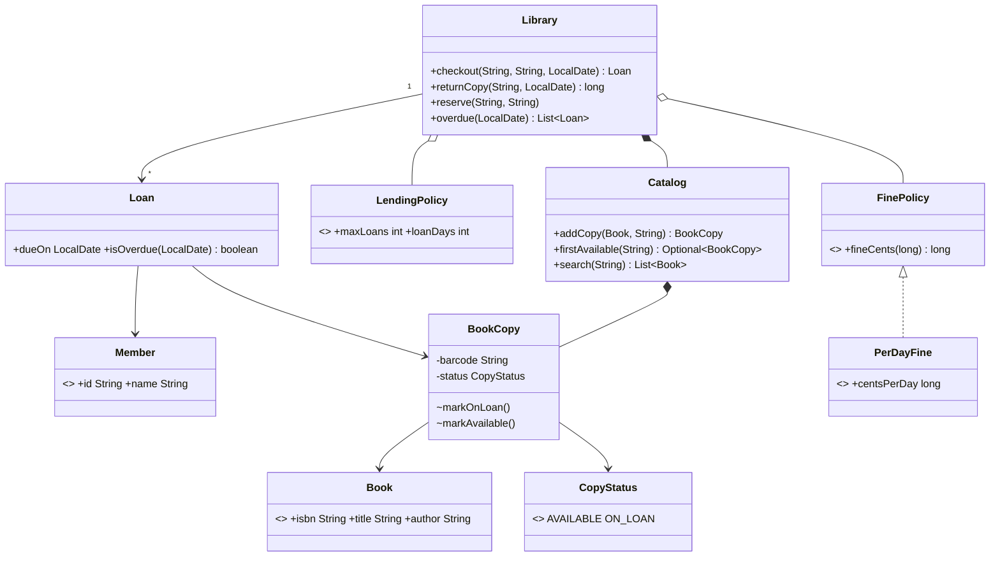

# Chapter 62 — Library Management

## What and why

A library separates *what exists* (titles) from *what you can touch* (copies), then layers rules (limits, due dates, fines, reservations) on top. Exam payoff: the Book/Copy split, a Strategy for fines, interface rules (`public` implementation, abstract instantiation) and a facade that keeps every rule in one place.

## Requirements

**Functional**

- Catalog of titles; each title has one or more physical copies with a barcode.
- Members borrow a copy of a title; max loans per member and loan length come from a policy.
- Return a copy; a late return produces a fine (pluggable formula).
- If no copy is free a member may reserve; reservations are FIFO and protect the freed copy.
- Search by title or author (case-insensitive); list overdue loans.

**Non-functional**

- Deterministic: dates are passed in, never read from a hidden clock.
- All state changes go through one facade; coarse `synchronized` is acceptable.

**Out of scope:** payments, notifications on reservation (see the notification chapter), renewals.

## Exam flash rules

- Implementing an interface method requires `public`; weaker access fails to compile.
- An interface cannot be instantiated: `new FinePolicy()` is an error; use a class or a lambda.
- A `@FunctionalInterface` has exactly one abstract method; `static` and `default` methods do not count.
- A class that implements an interface must implement every abstract method or be `abstract`.
- A package-private constructor/field/method cannot be used from another package.
- Separate *entity* from *instance*: `Book` (title) vs `BookCopy` (barcode, status).
- A `record` is a good immutable value: `Book`, `Member`, `LendingPolicy`.
- A compact constructor validates invariants (`LendingPolicy` rejects `maxLoans < 1`).
- Money in the smallest unit (`long` cents), never `double`.
- Pass `LocalDate today` into methods to make time-dependent rules testable.
- Strategy = interface + implementations (`FinePolicy`, `PerDayFine`, lambda); the facade depends on the interface.
- Late days = `max(0, days between due and returned)`; returning on the due date is not late.

## Rules table

| Rule | Allowed | Not allowed | Compiler message (verbatim) |
|------|---------|-------------|------------------------------|
| Interface implementation access | `public long fineCents(...)` | package-private body | `attempting to assign weaker access privileges; was public` |
| Interface instantiation | lambda / implementing class | `new FinePolicy()` | `FinePolicy is abstract; cannot be instantiated` |
| Abstract methods | implement all | implement none | `MissingImplBroken is not abstract and does not override abstract method fineCents(long) in FinePolicy` |
| Private member | accessor `status()` | `copy.status` | `status has private access in BookCopy` |
| Package-private ctor | `Catalog.addCopy` creates copies | `new BookCopy(...)` from outside | `BookCopy(String,Book) is not public in BookCopy; cannot be accessed from outside package` |

## Design

| Type | Kind | Responsibility |
|------|------|----------------|
| `Book` | record | isbn, title, author (a title) |
| `BookCopy` | class | barcode + status; mutators package-private |
| `CopyStatus` | enum | `AVAILABLE`, `ON_LOAN` |
| `Member` | record | id, name |
| `Catalog` | class | titles, copies, search; no loan knowledge |
| `LendingPolicy` | record | max loans, loan days |
| `FinePolicy` | functional interface | late days → cents; `PerDayFine`, lambdas |
| `Loan` | class | copy, member, dates, `isOverdue` |
| `Library` | facade | checkout, return, reserve, overdue; owns loans and reservation queues |
| `LibraryException` | unchecked | rule violations |

Relationships: `Catalog` **composes** `BookCopy`; `BookCopy` **references** its `Book` (aggregation); `Library` **has** a `Catalog`, a `LendingPolicy`, a `FinePolicy`; `Loan` **associates** `Member` and `BookCopy`.

Checkout algorithm: member exists → title exists → under limit → (head of queue **or** more free copies than waiting members) → take first free copy → record loan.

### API

```text
Library(LendingPolicy, FinePolicy)
Loan   checkout(String memberId, String isbn, LocalDate today)
long   returnCopy(String barcode, LocalDate today)      // fine in cents
void   reserve(String memberId, String isbn)
List<Loan> overdue(LocalDate today)
Catalog.search(String text)
```

## UML



## Walkthrough

### Titles vs copies

```java
{{#include ../../code/part-04-lld/src/main/java/lld/library/Book.java}}
```

```java
{{#include ../../code/part-04-lld/src/main/java/lld/library/BookCopy.java}}
```

```java
{{#include ../../code/part-04-lld/src/main/java/lld/library/Catalog.java}}
```

### Policies (Strategy)

```java
{{#include ../../code/part-04-lld/src/main/java/lld/library/FinePolicy.java}}
```

```java
{{#include ../../code/part-04-lld/src/main/java/lld/library/PerDayFine.java}}
```

```java
{{#include ../../code/part-04-lld/src/main/java/lld/library/LendingPolicy.java}}
```

### Facade

```java
{{#include ../../code/part-04-lld/src/main/java/lld/library/Library.java}}
```

### Demo and captured output

```java
{{#include ../../code/part-04-lld/src/main/java/lld/library/LibraryDemo.java}}
```

```text
{{#include ../../code/part-04-lld/out/library/LibraryDemo.txt}}
```

Trace: Asha borrows on Jan 10 (due Jan 24); Ben is refused (no copy) and reserves; Asha returns 3 days late → 75¢; Asha cannot re-borrow (copy is held for Ben); Ben gets `E-1`.

## Tests

```java
{{#include ../../code/part-04-lld/src/test/java/lld/library/LibraryTest.java}}
```

## Predict the output

**P1.** Due date and overdue boundary.

```java
{{#include ../../code/part-04-lld/src/main/java/lld/library/exam/PredictLoanDue.java}}
```

<details><summary>Answer</summary>

```text
{{#include ../../code/part-04-lld/out/library/PredictLoanDue.txt}}
```

Feb 25 + 7 days = Mar 4 (2026 is not a leap year). On the due date it is not overdue; the day after it is.

</details>

**P2.** Fine arithmetic.

```java
{{#include ../../code/part-04-lld/src/main/java/lld/library/exam/PredictFine.java}}
```

<details><summary>Answer</summary>

```text
{{#include ../../code/part-04-lld/out/library/PredictFine.txt}}
```

Returned on the due date → 0; 3 days late × 25 = 75; early → 0.

</details>

**P3.** Loan limit.

```java
{{#include ../../code/part-04-lld/src/main/java/lld/library/exam/PredictLimit.java}}
```

<details><summary>Answer</summary>

```text
{{#include ../../code/part-04-lld/out/library/PredictLimit.txt}}
```

Third checkout rejected before any state change (still 2 loans); after a return the limit frees up.

</details>

**P4.** Reservation order.

```java
{{#include ../../code/part-04-lld/src/main/java/lld/library/exam/PredictReserve.java}}
```

<details><summary>Answer</summary>

```text
{{#include ../../code/part-04-lld/out/library/PredictReserve.txt}}
```

Queue is `b, c`; the freed copy belongs to `b`. `c` is still queued, so a second reserve fails.

</details>

**P5.** Search and counts.

```java
{{#include ../../code/part-04-lld/src/main/java/lld/library/exam/PredictSearch.java}}
```

<details><summary>Answer</summary>

```text
{{#include ../../code/part-04-lld/out/library/PredictSearch.txt}}
```

Case-insensitive, sorted by title; `bloch` matches one *title* (two copies, one `Book`); `availableCount("2")` counts copies.

</details>

**P6.** A lambda as a strategy.

```java
{{#include ../../code/part-04-lld/src/main/java/lld/library/exam/PredictLambdaFine.java}}
```

<details><summary>Answer</summary>

```text
{{#include ../../code/part-04-lld/out/library/PredictLambdaFine.txt}}
```

`min(30,100)=30`, `min(300,100)=100`; `none()` is a static interface method; negative days clamp to 0.

</details>

## Compile or not?

**C1.** Package-private implementation of an interface method — **fails**.

```java
{{#include ../../code/part-04-lld/broken/library/WeakerAccessBroken.java}}
```

```text
{{#include ../../code/part-04-lld/out/library/WeakerAccessBroken.javac.txt}}
```

**C2.** `new` on an interface — **fails**.

```java
{{#include ../../code/part-04-lld/broken/library/InterfaceNewBroken.java}}
```

```text
{{#include ../../code/part-04-lld/out/library/InterfaceNewBroken.javac.txt}}
```

**C3.** Missing the abstract method — **fails**.

```java
{{#include ../../code/part-04-lld/broken/library/MissingImplBroken.java}}
```

```text
{{#include ../../code/part-04-lld/out/library/MissingImplBroken.javac.txt}}
```

**C4.** Reading a private field — **fails**.

```java
{{#include ../../code/part-04-lld/broken/library/PrivateFieldBroken.java}}
```

```text
{{#include ../../code/part-04-lld/out/library/PrivateFieldBroken.javac.txt}}
```

**C5.** Calling a package-private constructor from another package — **fails**.

```java
{{#include ../../code/part-04-lld/broken/library/PackagePrivateCtorBroken.java}}
```

```text
{{#include ../../code/part-04-lld/out/library/PackagePrivateCtorBroken.javac.txt}}
```

Fixes: C1 add `public`; C2 `FinePolicy.none()` or a lambda; C3 implement the method; C4 `copy.status()`; C5 create copies via `Catalog.addCopy`.

## Gotchas

1. **Modelling a copy as a title** — one `Book` with a `count` loses barcodes and per-copy status.
2. **`double` for fines** — use `long` cents (`PerDayFine`).
3. **Hidden `LocalDate.now()`** — makes late-fee tests flaky; pass `today`.
4. **Letting a queue be bypassed** — a freed copy must be held for the queue head (`PredictReserve`).
5. **Off-by-one on due day** — due date itself is on time (`PredictLoanDue`, `PredictFine`).

## Extensions

| Extension | Design change |
|-----------|---------------|
| Renewals | `Loan.renew(days)` with a max-renewals rule in `LendingPolicy`; blocked if the title has a queue |
| Member types | `Map<MemberType, LendingPolicy>` or a policy method on `Member` |
| Reservation expiry | Store `(memberId, heldUntil)`; `checkout` skips expired holds |
| Notification on availability | Publish an event on return; subscriber sends message (chapters 63–64) |
| Persistence | `Catalog`/`LoanRepository` interfaces; `Library` depends on them (DIP) |
| Concurrency | Per-ISBN lock instead of one `synchronized` facade |

## Short-answer strip

| Question | 1–2 line answer |
|----------|-----------------|
| Entities | `Book`, `BookCopy`, `Member`, `Loan`, `Catalog`, `Library` |
| Why `Book` and `BookCopy`? | Many physical copies share one title; status is per copy |
| Relationships | `Library` has `Catalog`; `Catalog` composes copies; `Loan` links member and copy |
| Pattern | Strategy (`FinePolicy`), Facade (`Library`) |
| Key API | `checkout`, `returnCopy` (→ fine), `reserve`, `overdue`, `search` |
| Fine formula | `max(0, daysLate) × centsPerDay` |
| Reservation rule | Head of queue, or more free copies than waiting members |
| Concurrency | Facade `synchronized`; finer: lock per ISBN |

## Interview Q&A

1. **Q:** Why split `Book` and `BookCopy`? **A:** Title data is shared; barcode and availability are per copy (`Catalog`).
2. **Q:** Where do fines live? **A:** In a `FinePolicy` strategy, not in `Loan`; swap with a lambda (`PredictLambdaFine`).
3. **Q:** Why pass `LocalDate`? **A:** Deterministic tests; no hidden clock.
4. **Q:** Why must the implementing method be `public`? **A:** Interface members are `public`; narrowing is illegal (`WeakerAccessBroken`).
5. **Q:** Checked or unchecked exceptions here? **A:** Unchecked `LibraryException`; callers cannot recover meaningfully except by showing the message.
6. **Q:** How is the reservation queue enforced? **A:** `checkout` allows only the head, or anyone if free copies exceed the queue length.
7. **Q:** What is the complexity of `firstAvailable`? **A:** O(copies of the title); fine for small N, index by status for large.
8. **Q:** How do you stop two threads taking the same copy? **A:** `synchronized` facade; `markOnLoan` also guards (`BookCopy`).
9. **Q:** Why a record for `LendingPolicy`? **A:** Immutable value with validation in the compact constructor.
10. **Q:** How would you add late-fee caps? **A:** Decorate `FinePolicy` (`capped` in the solutions).
11. **Q:** Can `Library` be tested without a database? **A:** Yes — all state is in memory behind the facade.
12. **Q:** What does `returnCopy` do for an unknown barcode? **A:** Throws `LibraryException("not on loan")` before touching state.

## Exam writing prompts

1. (8) Draw the class diagram for Book / BookCopy / Member / Loan / Library and mark composition vs association.
2. (5) Write `FinePolicy` and a class `PerDayFine` implementing it; state why the method must be `public`.
3. (5) Write `Library.returnCopy` that computes late days and fine, rejecting an unknown barcode.
4. (3) Explain Strategy with the fine example and give a lambda that caps fines at 100.

## Exercises

Solutions: `code/part-04-lld/solutions/ch62/Solutions62.java`.

1. Cap any fine policy — `capped`.
2. Faculty lending rule — `facultyLibrary`.
3. Availability helper — `canBorrow`.
4. Borrow-or-reserve — `borrowOrReserve`.
5. Total fine for a batch of returns — `totalFine`.

```java
{{#include ../../code/part-04-lld/solutions/ch62/Solutions62.java}}
```

```text
{{#include ../../code/part-04-lld/out/library/Solutions62.txt}}
```

## Recap checklist

- [x] Requirements, entities, relationships, API
- [x] Title/copy split, policies, reservation rule
- [x] Interface rules (`public`, no `new`, implement all)
- [x] Tests, 6 predict stems, 5 compile-or-not stems, 4 writing prompts, 5 exercises
- [x] Extensions and short-answer strip
