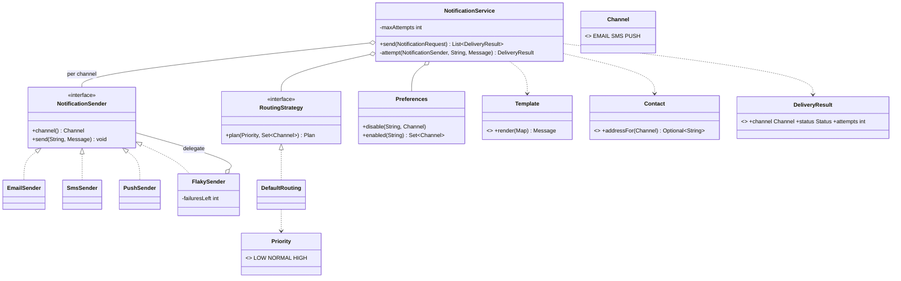

# Chapter 63 — Notification System

## What and why

A notification service renders one message and delivers it over several channels with preferences, retries and fallback. Exam payoff: Strategy (routing), Adapter-style senders behind one interface, checked vs unchecked exceptions, enum `switch`, `EnumSet`/`EnumMap`, generics invariance.

## Requirements

**Functional**

- Channels: email, SMS, push. A sender per channel behind one interface.
- Templates with `{placeholder}` substitution; a missing parameter is an error.
- Per-user opt-out of channels; a user may lack an address for a channel.
- Priority decides routing: `HIGH` → every enabled channel; `NORMAL` → first success in fallback order (push, email, SMS); `LOW` → email only.
- Transport failures are retried up to N attempts, then the channel is `FAILED` and fallback continues.
- Result per channel: `SENT`, `FAILED`, `SKIPPED`, with the attempt count.

**Non-functional**

- Adding a channel must not change `NotificationService` branching (open/closed).
- Deterministic and testable without a network (senders write to an in-memory log).

**Out of scope:** async queues, rate limiting, persistence (see Extensions).

## Exam flash rules

- A checked exception must be caught or declared (`throws`); `RuntimeException` need not.
- `catch (X e)` where the `try` body cannot throw checked `X` is a compile error.
- A `switch` **expression** over an enum must cover every constant or have `default`.
- Generics are invariant: `ArrayList<EmailSender>` is **not** a `List<NotificationSender>`.
- `EnumSet` iterates in declaration order; `EnumMap` is the fast map for enum keys.
- `Enum.valueOf` is case-sensitive and throws `IllegalArgumentException` for unknown names.
- `compareTo` on enums compares ordinals; `values()` is in declaration order.
- A `record` cannot declare instance fields beyond its components.
- `String.replace(CharSequence, CharSequence)` is literal; `replaceAll` is regex and treats `$` and `\` specially.
- Copy mutable inputs in a record's compact constructor (`Map.copyOf`).
- Strategy = a replaceable algorithm behind an interface; a one-method interface can be a lambda.
- Retry loops belong to the orchestrator, not inside each sender.

## Rules table

| Rule | Allowed | Not allowed | Compiler message (verbatim) |
|------|---------|-------------|------------------------------|
| Checked exception | `try`/`catch` or `throws SendException` | call `send` and ignore | `unreported exception SendException; must be caught or declared to be thrown` |
| Pointless catch | catch what the body can throw | catch a checked exception never thrown | `exception SendException is never thrown in body of corresponding try statement` |
| Enum switch expression | all constants | missing `PUSH`, no `default` | `the switch expression does not cover all possible input values` |
| Generics | `List<? extends NotificationSender>` | `List<NotificationSender> = new ArrayList<EmailSender>()` | `incompatible types: ArrayList<EmailSender> cannot be converted to List<NotificationSender>` |
| Record state | components only | extra instance field | `field declaration must be static` |

## Design

| Type | Kind | Responsibility |
|------|------|----------------|
| `Channel`, `Priority` | enums | closed vocabularies |
| `Template` → `Message` | record | literal placeholder fill; error on missing param |
| `NotificationRequest` | record | user, template id, params (defensively copied), priority |
| `Contact` | record | addresses; `addressFor(Channel)` via enum switch |
| `Preferences` | class | per-user disabled channels (`EnumSet`) |
| `NotificationSender` | interface | `channel()`, `send(address, message) throws SendException` |
| `EmailSender`, `SmsSender`, `PushSender` | classes | one per channel; SMS truncates to 160 |
| `FlakySender` | decorator | fails the first N sends (retry demo) |
| `RoutingStrategy` / `DefaultRouting` | strategy | `Plan(channels, stopOnFirstSuccess)` |
| `DeliveryResult` | record | channel, status, attempts |
| `NotificationService` | orchestrator | template → plan → send with retry |

Relationships: `NotificationService` **has** `RoutingStrategy`, `Preferences`, a `Map<Channel, NotificationSender>`; `FlakySender` **decorates** a sender; senders **implement** `NotificationSender`.

### API

```text
NotificationService(contacts, preferences, templates, routing, maxAttempts, NotificationSender...)
List<DeliveryResult> send(NotificationRequest)
```

## UML



## Walkthrough

### Content and addressing

```java
{{#include ../../code/part-04-lld/src/main/java/lld/notification/Template.java}}
```

```java
{{#include ../../code/part-04-lld/src/main/java/lld/notification/Contact.java}}
```

### Senders (one interface, many channels)

```java
{{#include ../../code/part-04-lld/src/main/java/lld/notification/NotificationSender.java}}
```

```java
{{#include ../../code/part-04-lld/src/main/java/lld/notification/SmsSender.java}}
```

```java
{{#include ../../code/part-04-lld/src/main/java/lld/notification/FlakySender.java}}
```

### Routing strategy

```java
{{#include ../../code/part-04-lld/src/main/java/lld/notification/RoutingStrategy.java}}
```

```java
{{#include ../../code/part-04-lld/src/main/java/lld/notification/DefaultRouting.java}}
```

### Orchestrator

```java
{{#include ../../code/part-04-lld/src/main/java/lld/notification/NotificationService.java}}
```

### Demo and captured output

```java
{{#include ../../code/part-04-lld/src/main/java/lld/notification/NotificationDemo.java}}
```

```text
{{#include ../../code/part-04-lld/out/notification/NotificationDemo.txt}}
```

Trace: (1) `NORMAL` → push fails once, succeeds on attempt 2, stops. (2) `HIGH` → all three channels. (3) `u2` opted out of push and has no phone → SMS `SKIPPED`, email `SENT`.

## Tests

```java
{{#include ../../code/part-04-lld/src/test/java/lld/notification/NotificationTest.java}}
```

## Predict the output

**P1.** Template rendering.

```java
{{#include ../../code/part-04-lld/src/main/java/lld/notification/exam/PredictTemplate.java}}
```

<details><summary>Answer</summary>

```text
{{#include ../../code/part-04-lld/out/notification/PredictTemplate.txt}}
```

`$5` survives because `replace` is literal. A leftover `{amount}` triggers the missing-param error.

</details>

**P2.** Routing plans.

```java
{{#include ../../code/part-04-lld/src/main/java/lld/notification/exam/PredictRouting.java}}
```

<details><summary>Answer</summary>

```text
{{#include ../../code/part-04-lld/out/notification/PredictRouting.txt}}
```

Order comes from the strategy, filtered by the enabled set; `HIGH` does not stop at first success; `LOW` with no email → empty plan.

</details>

**P3.** Retry counts.

```java
{{#include ../../code/part-04-lld/src/main/java/lld/notification/exam/PredictRetry.java}}
```

<details><summary>Answer</summary>

```text
{{#include ../../code/part-04-lld/out/notification/PredictRetry.txt}}
```

2 failures + 3 attempts → success on attempt 3. 3 failures + 3 attempts → `FAILED`; because `PUSH` failed, fallback tries EMAIL and SMS, but no sender is registered for them → `SKIPPED`.

</details>

**P4.** Fallback.

```java
{{#include ../../code/part-04-lld/src/main/java/lld/notification/exam/PredictFallback.java}}
```

<details><summary>Answer</summary>

```text
{{#include ../../code/part-04-lld/out/notification/PredictFallback.txt}}
```

Push never succeeds (2 attempts), email succeeds and the plan stops; SMS is never tried; the log holds only the email.

</details>

**P5.** Opt-out and missing address.

```java
{{#include ../../code/part-04-lld/src/main/java/lld/notification/exam/PredictSkip.java}}
```

<details><summary>Answer</summary>

```text
{{#include ../../code/part-04-lld/out/notification/PredictSkip.txt}}
```

`HIGH` plan = push, SMS (email opted out). No phone → SMS `SKIPPED` with 0 attempts.

</details>

**P6.** Enum utilities.

```java
{{#include ../../code/part-04-lld/src/main/java/lld/notification/exam/PredictEnumSet.java}}
```

<details><summary>Answer</summary>

```text
{{#include ../../code/part-04-lld/out/notification/PredictEnumSet.txt}}
```

Declaration order (`EMAIL`, `SMS`); `HIGH`(2) − `LOW`(0) = 2; `valueOf` is case-sensitive.

</details>

## Compile or not?

**C1.** Calling a method that `throws` a checked exception — **fails**.

```java
{{#include ../../code/part-04-lld/broken/notification/UnreportedSendBroken.java}}
```

```text
{{#include ../../code/part-04-lld/out/notification/UnreportedSendBroken.javac.txt}}
```

**C2.** Enum switch expression missing a constant — **fails**.

```java
{{#include ../../code/part-04-lld/broken/notification/EnumSwitchBroken.java}}
```

```text
{{#include ../../code/part-04-lld/out/notification/EnumSwitchBroken.javac.txt}}
```

**C3.** `List<Super>` from `ArrayList<Sub>` — **fails** (looks fine, generics are invariant).

```java
{{#include ../../code/part-04-lld/broken/notification/GenericInvarianceBroken.java}}
```

```text
{{#include ../../code/part-04-lld/out/notification/GenericInvarianceBroken.javac.txt}}
```

**C4.** Instance field in a record — **fails**.

```java
{{#include ../../code/part-04-lld/broken/notification/RecordFieldBroken.java}}
```

```text
{{#include ../../code/part-04-lld/out/notification/RecordFieldBroken.javac.txt}}
```

**C5.** Catching a checked exception the body never throws — **fails** (`EmailSender.send` declares no `throws`).

```java
{{#include ../../code/part-04-lld/broken/notification/NeverThrownBroken.java}}
```

```text
{{#include ../../code/part-04-lld/out/notification/NeverThrownBroken.javac.txt}}
```

Fixes: C1 `throws SendException` or `try/catch`; C2 add `case PUSH` (no `default`, so new constants are flagged later); C3 `List<? extends NotificationSender>` or `new ArrayList<NotificationSender>()`; C4 turn it into a component; C5 call through the `NotificationSender` interface type, whose method does declare the exception.

## Gotchas

1. **`replaceAll` for templates** — `$` and `\` in values break it; use literal `replace` (`PredictTemplate`).
2. **Retrying inside every sender** duplicates logic; keep it in the orchestrator (`NotificationService.attempt`).
3. **Fan-out vs fallback confusion** — `HIGH` sends everywhere; `NORMAL` stops at first success (`PredictRouting`).
4. **Mutable map in a record** — copy it (`NotificationRequest`, `requestDefensivelyCopiesParams`).
5. **`default` in an enum switch** hides a new channel that has no address mapping (`Contact.addressFor`, `EnumSwitchBroken`).

## Extensions

| Extension | Design change |
|-----------|---------------|
| Async delivery | Put `NotificationRequest` on a queue; worker threads call `send`; results via callback |
| Backoff | `RetryPolicy` with delay function; sleep between attempts (inject a clock/sleeper for tests) |
| Rate limits per channel | Decorator sender using a token bucket (see Rate Limiter chapter) |
| New channel (Slack) | Add enum constant + `NotificationSender`; compiler flags `Contact.addressFor` |
| Quiet hours | `RoutingStrategy` receives a `Clock`; drops `PUSH`/`SMS` at night |
| Delivery history | Publish `DeliveryResult` to a pub-sub topic (chapter 64) |

## Short-answer strip

| Question | 1–2 line answer |
|----------|-----------------|
| Entities | `NotificationRequest`, `Template`, `Message`, `Contact`, `Preferences`, `NotificationSender`, `DeliveryResult` |
| Patterns | Strategy (`RoutingStrategy`), Decorator (`FlakySender`), Adapter-style senders |
| Why an interface for senders? | Add channels without editing the service (OCP, DIP) |
| Checked or unchecked? | `SendException` checked (expected transport failure); bad input unchecked |
| Fan-out vs fallback | `Plan.stopOnFirstSuccess` |
| Retry location | `NotificationService.attempt`, bounded by `maxAttempts` |
| Scale | Queue + workers + per-channel limiter |

## Interview Q&A

1. **Q:** How do you add a channel? **A:** New enum constant + sender; routing may list it; no service change.
2. **Q:** Why is `SendException` checked? **A:** Transport failure is expected; the caller must handle it (`UnreportedSendBroken`).
3. **Q:** Fan-out vs fallback? **A:** `Plan.stopOnFirstSuccess`; `HIGH` fans out.
4. **Q:** Where does opt-out apply? **A:** `Preferences.enabled` filters before routing.
5. **Q:** How are retries tested deterministically? **A:** `FlakySender` fails the first N calls.
6. **Q:** Why `EnumSet`/`EnumMap`? **A:** Compact bit-set/array, declaration order, no hashing.
7. **Q:** Why copy `params` in the record? **A:** Callers could mutate the map after validation.
8. **Q:** Why is the SMS limit in `SmsSender`? **A:** Channel-specific adaptation belongs in the adapter, not the service.
9. **Q:** Why `List<? extends NotificationSender>`? **A:** Invariance; wildcard accepts any subtype list for reading (`GenericInvarianceBroken`).
10. **Q:** What if every channel fails? **A:** Results all `FAILED`; caller decides (dead-letter, alert).
11. **Q:** How to make delivery asynchronous? **A:** Queue + executor; keep `send` pure so workers reuse it.
12. **Q:** Why literal `replace` for templates? **A:** `replaceAll` interprets `$` and `\` (`templateIsLiteralNotRegex`).

## Exam writing prompts

1. (8) Draw the class diagram for senders, routing and the service; mark interface realization and the decorator.
2. (5) Write `NotificationSender` and an `EmailSender` that records messages; explain why `send` declares `throws SendException`.
3. (5) Write a `switch` expression mapping `Channel` to an address field of `Contact` without `default`.
4. (3) Write the retry loop for `maxAttempts` returning `SENT`/`FAILED` with the attempt count.

## Exercises

Solutions: `code/part-04-lld/solutions/ch63/Solutions63.java`.

1. Routing as a lambda — `EMAIL_ONLY`.
2. Counting decorator — `CountingSender`.
3. List template placeholders — `placeholders`.
4. Summarise results with an `EnumMap` — `summary`.
5. More attempts turn a failure into success — `withAttempts`.

```java
{{#include ../../code/part-04-lld/solutions/ch63/Solutions63.java}}
```

```text
{{#include ../../code/part-04-lld/out/notification/Solutions63.txt}}
```

## Recap checklist

- [x] Requirements, entities, relationships, API
- [x] Routing strategy, retry, fallback, opt-out, skip
- [x] Checked exceptions, enum switch, generics invariance, record rules
- [x] Tests, 6 predict stems, 5 compile-or-not stems, 4 writing prompts, 5 exercises
- [x] Extensions and short-answer strip
