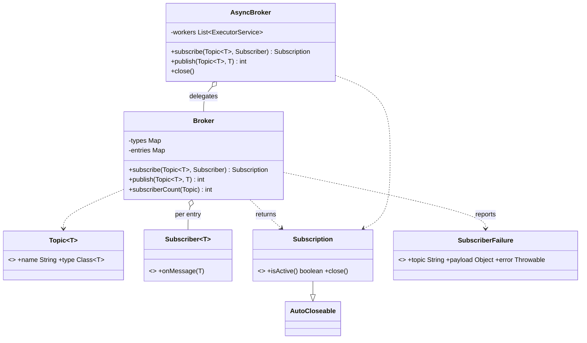

# Chapter 64 — Pub-Sub

## What and why

A broker decouples publishers from subscribers: publishers name a topic, subscribers register interest, neither knows the other. Exam payoff: generics with wildcards (PECS), `AutoCloseable` handles, lambdas and effectively-final capture, copy-on-write collections, and the sync-vs-async trade-off.

## Requirements

**Functional**

- Typed topics: a topic carries one payload type.
- `subscribe(topic, subscriber)` and `subscribe(topic, filter, subscriber)`; returns a closable `Subscription`.
- `publish(topic, payload)` delivers to every active matching subscriber and returns how many handled it.
- One failing subscriber must not stop the others; failures are reported.
- Same topic name with a different payload type is rejected.
- Async variant: per-subscriber FIFO queue; publisher never waits on a slow subscriber.

**Non-functional**

- Thread-safe publish / subscribe / unsubscribe, including subscribing from inside a handler.
- Closing the async broker drains queued messages.

**Out of scope:** persistence, replay, delivery guarantees across processes, wildcards in topic names.

## Exam flash rules

- A lambda may only capture **effectively final** locals; `count++` in a lambda is a compile error.
- Generic type arguments must be reference types: `Subscriber<int>` fails; use `Subscriber<Integer>`.
- Generics are invariant; use wildcards: `? super T` for a **consumer**, `? extends T` for a **producer** (PECS).
- A `Subscriber<? extends Number>` can only be read from (`null` aside); you cannot pass a value to it.
- `try`-with-resources requires `AutoCloseable`; resources close in reverse order, even on exceptions.
- An overriding `close()` may narrow `throws` (drop `Exception`) so callers need no `catch`.
- `CopyOnWriteArrayList` iterates over a snapshot: adds during iteration are not seen, no `ConcurrentModificationException`.
- `ConcurrentHashMap.putIfAbsent` and `computeIfAbsent` are atomic.
- `volatile boolean` gives visibility, not atomic read-modify-write.
- A single-thread executor per subscriber gives FIFO per subscriber and isolation between subscribers.
- `ExecutorService.shutdown()` lets queued tasks finish; `shutdownNow()` interrupts and discards them.
- Type erasure: `Topic<T>` carries a `Class<T>` token to check types at runtime.

## Rules table

| Rule | Allowed | Not allowed | Compiler message (verbatim) |
|------|---------|-------------|------------------------------|
| Lambda capture | read effectively-final local | mutate captured local | `local variables referenced from a lambda expression must be final or effectively final` |
| Type arguments | `Subscriber<Integer>` | `Subscriber<int>` | `unexpected type` / `required: reference` / `found:    int` |
| try-with-resources | `AutoCloseable` type | `Object` | `try-with-resources not applicable to variable type` |
| Generic inference | `publish(Topic<String>, String)` | `publish(Topic<String>, 42)` | `inference variable T has incompatible bounds` |
| Wildcard `extends` | read as `Number` | pass a value in | `incompatible types: int cannot be converted to CAP#1` |

## Design

| Type | Kind | Responsibility |
|------|------|----------------|
| `Topic<T>` | record | name + `Class<T>` token |
| `Subscriber<T>` | functional interface | `onMessage(T)`; `Subscriber<Object>` fits any topic |
| `Subscription` | interface (`AutoCloseable`) | `isActive()`, idempotent `close()` |
| `SubscriberFailure` | record | topic, payload, error |
| `Broker` | class | topic→subscribers (copy-on-write), type registry, synchronous publish |
| `AsyncBroker` | decorator | wraps `Broker`; one executor per subscriber |

Relationships: `Broker` **has** many entries per topic; each entry holds a filter and a subscriber; `AsyncBroker` **decorates** subscribers and **delegates** routing to `Broker`.

### API

```text
<T> Subscription subscribe(Topic<T>, Subscriber<? super T>)
<T> Subscription subscribe(Topic<T>, Predicate<? super T>, Subscriber<? super T>)
<T> int publish(Topic<T>, T payload)            // handled count
void close()                                    // AsyncBroker: drain + stop
```

## UML



## Walkthrough

### Value types and handles

```java
{{#include ../../code/part-04-lld/src/main/java/lld/pubsub/Topic.java}}
```

```java
{{#include ../../code/part-04-lld/src/main/java/lld/pubsub/Subscriber.java}}
```

```java
{{#include ../../code/part-04-lld/src/main/java/lld/pubsub/Subscription.java}}
```

### Synchronous broker

```java
{{#include ../../code/part-04-lld/src/main/java/lld/pubsub/Broker.java}}
```

Why it is safe: `ConcurrentHashMap` for topic maps, `CopyOnWriteArrayList` for subscriber lists (publish iterates a snapshot), `volatile active` so a closed subscription stops receiving immediately.

### Asynchronous broker

```java
{{#include ../../code/part-04-lld/src/main/java/lld/pubsub/AsyncBroker.java}}
```

### Demo and captured output

```java
{{#include ../../code/part-04-lld/src/main/java/lld/pubsub/PubSubDemo.java}}
```

```text
{{#include ../../code/part-04-lld/out/pubsub/PubSubDemo.txt}}
```

Trace: `billing` always, `vip desk` only for `vip-*`, `audit` is a `Subscriber<Object>` reused on both topics; the price subscriber throws, is reported, and does not count as delivered; after the `try` block `temp` is gone.

## Tests

```java
{{#include ../../code/part-04-lld/src/test/java/lld/pubsub/PubSubTest.java}}
```

Includes an 8-thread × 1000-publish test (no lost deliveries) and async tests for ordering, draining on close, non-blocking publish and failure reporting.

## Predict the output

**P1.** Fan-out.

```java
{{#include ../../code/part-04-lld/src/main/java/lld/pubsub/exam/PredictFanout.java}}
```

<details><summary>Answer</summary>

```text
{{#include ../../code/part-04-lld/out/pubsub/PredictFanout.txt}}
```

Subscription order per message; the delivered count prints after the handlers ran; no subscribers → 0.

</details>

**P2.** Filter.

```java
{{#include ../../code/part-04-lld/src/main/java/lld/pubsub/exam/PredictFilter.java}}
```

<details><summary>Answer</summary>

```text
{{#include ../../code/part-04-lld/out/pubsub/PredictFilter.txt}}
```

Only 2 and 4 pass; `total` counts handled deliveries.

</details>

**P3.** Unsubscribe.

```java
{{#include ../../code/part-04-lld/src/main/java/lld/pubsub/exam/PredictUnsubscribe.java}}
```

<details><summary>Answer</summary>

```text
{{#include ../../code/part-04-lld/out/pubsub/PredictUnsubscribe.txt}}
```

Inside the block both receive "1" and `isActive()` is true; `try` closes `temp`; closing `keep` twice is harmless; last line: 0 delivered, 0 subscribers.

</details>

**P4.** Failure isolation.

```java
{{#include ../../code/part-04-lld/src/main/java/lld/pubsub/exam/PredictIsolation.java}}
```

<details><summary>Answer</summary>

```text
{{#include ../../code/part-04-lld/out/pubsub/PredictIsolation.txt}}
```

The first subscriber throws → reported; the second still runs; delivered = 1.

</details>

**P5.** Type registry and record equality.

```java
{{#include ../../code/part-04-lld/src/main/java/lld/pubsub/exam/PredictTypeMismatch.java}}
```

<details><summary>Answer</summary>

```text
{{#include ../../code/part-04-lld/out/pubsub/PredictTypeMismatch.txt}}
```

`data` was registered for `String`; publishing an `Integer` topic with that name is rejected. Records compare name **and** type token. `requireNonNull(payload, "payload")` supplies the message.

</details>

**P6.** Async ordering.

```java
{{#include ../../code/part-04-lld/src/main/java/lld/pubsub/exam/PredictAsyncOrder.java}}
```

<details><summary>Answer</summary>

```text
{{#include ../../code/part-04-lld/out/pubsub/PredictAsyncOrder.txt}}
```

One subscriber = one single-thread queue = publish order. The `try` block's implicit `close()` waits for the queue, so the list is complete.

</details>

## Compile or not?

**C1.** Mutating a captured local — **fails**.

```java
{{#include ../../code/part-04-lld/broken/pubsub/EffectivelyFinalBroken.java}}
```

```text
{{#include ../../code/part-04-lld/out/pubsub/EffectivelyFinalBroken.javac.txt}}
```

**C2.** Primitive type argument — **fails**.

```java
{{#include ../../code/part-04-lld/broken/pubsub/PrimitiveTypeArgBroken.java}}
```

```text
{{#include ../../code/part-04-lld/out/pubsub/PrimitiveTypeArgBroken.javac.txt}}
```

**C3.** try-with-resources on a non-`AutoCloseable` — **fails**.

```java
{{#include ../../code/part-04-lld/broken/pubsub/TryWithResourcesBroken.java}}
```

```text
{{#include ../../code/part-04-lld/out/pubsub/TryWithResourcesBroken.javac.txt}}
```

**C4.** Wrong payload type for a typed topic — **fails** at compile time (looks fine: `42` is "just a value").

```java
{{#include ../../code/part-04-lld/broken/pubsub/PublishWrongTypeBroken.java}}
```

```text
{{#include ../../code/part-04-lld/out/pubsub/PublishWrongTypeBroken.javac.txt}}
```

**C5.** Passing a value to a `? extends` consumer — **fails**.

```java
{{#include ../../code/part-04-lld/broken/pubsub/WildcardConsumerBroken.java}}
```

```text
{{#include ../../code/part-04-lld/out/pubsub/WildcardConsumerBroken.javac.txt}}
```

Fixes: C1 `AtomicInteger`; C2 `Subscriber<Integer>`; C3 use a type implementing `AutoCloseable` (`Subscription`); C4 publish a `String` or use `Topic<Integer>`; C5 declare `Subscriber<? super Integer>` (consumer → `super`).

## Gotchas

1. **Mutating a captured counter** — use `AtomicInteger` or a field (`EffectivelyFinalBroken`).
2. **Raw/erased topics** — a name-only topic lets a `String` subscriber receive an `Integer`; the `Class` token + registry stops that (`PredictTypeMismatch`).
3. **Iterating a plain `ArrayList` while a handler subscribes** → `ConcurrentModificationException`; use copy-on-write (`subscribeDuringPublishIsSafe`).
4. **One handler's exception aborting the loop** — catch per subscriber (`PredictIsolation`).
5. **`shutdownNow()` on close** loses queued messages; use `shutdown()` + `awaitTermination` (`AsyncBroker.close`).

## Extensions

| Extension | Design change |
|-----------|---------------|
| Replay / durability | Append payloads to a log with offsets; subscriber tracks its offset |
| Backpressure | Bounded queue per subscriber; policy: block, drop-oldest, or fail |
| Topic wildcards (`orders.*`) | Trie or regex index instead of exact-name map |
| Ordering across topics | Single dispatcher thread, or sequence numbers |
| Dead-letter queue | `onError` publishes a `SubscriberFailure` to a dead-letter topic |
| Distributed | Replace `Broker` with a network client behind the same interface |

## Short-answer strip

| Question | 1–2 line answer |
|----------|-----------------|
| Entities | `Topic`, `Subscriber`, `Subscription`, `Broker`, `AsyncBroker` |
| Pattern | Observer (broker mediates), Decorator (`AsyncBroker`) |
| Why generics + `Class` token? | Compile-time typing plus runtime check after erasure |
| Why `Subscriber<? super T>`? | A consumer of `Object` can accept `String` payloads (PECS) |
| Thread safety | Concurrent map + copy-on-write lists + `volatile active` |
| Sync vs async | Sync: simple, caller blocks; async: per-subscriber queue, FIFO, isolation |
| Failure policy | Per-subscriber try/catch; report; others unaffected |
| Unsubscribe | `Subscription.close()` (idempotent, try-with-resources) |

## Interview Q&A

1. **Q:** Observer vs pub-sub? **A:** Observer: subject knows observers; pub-sub: a broker/topic sits between (`Broker`).
2. **Q:** Why `CopyOnWriteArrayList`? **A:** Reads vastly outnumber changes; snapshot iteration avoids locks and CME.
3. **Q:** Ordering guarantee? **A:** Sync: caller order. Async: FIFO per subscriber, none across subscribers.
4. **Q:** Slow subscriber? **A:** Async broker isolates it in its own queue; add bounds for backpressure.
5. **Q:** Why a `Class<T>` in `Topic`? **A:** Erasure removes `T` at runtime.
6. **Q:** `? super` vs `? extends` here? **A:** Subscriber consumes → `super`; the broker only calls `onMessage` (`WildcardConsumerBroken`).
7. **Q:** Why does `close()` not declare `throws Exception`? **A:** Overriding may narrow checked exceptions (`Subscription`).
8. **Q:** How is double-unsubscribe handled? **A:** `close()` is idempotent (`PredictUnsubscribe`).
9. **Q:** Can a handler subscribe? **A:** Yes; the new subscriber starts with the next publish (`subscribeDuringPublishIsSafe`).
10. **Q:** At-least-once vs at-most-once? **A:** Here at-most-once in memory; at-least-once needs ack + redelivery.
11. **Q:** How to test async code? **A:** `close()` drains; latches with timeouts; never `sleep` for correctness.
12. **Q:** What does `publish` return and why? **A:** Handled count — useful for tests and "no listeners" detection.

## Exam writing prompts

1. (8) Draw the class diagram for `Topic`, `Subscriber`, `Subscription`, `Broker`; show which relationships are composition and which are dependencies.
2. (5) Write `Broker.publish` that isolates a failing subscriber and returns the number that succeeded.
3. (5) Write a generic method `<T> void subscribe(Topic<T> t, Subscriber<? super T> s)` and explain `? super`.
4. (3) Write a class `Handle implements AutoCloseable` whose `close()` throws no checked exception and is safe to call twice.

## Exercises

Solutions: `code/part-04-lld/solutions/ch64/Solutions64.java`.

1. A subscriber that unsubscribes itself after one message — `once`.
2. One `Subscriber<Object>` on two topics — `audit`.
3. Count failures with the error handler — `failures`.
4. Total delivered count over several publishes — `totalDelivered`.
5. Request/reply with two topics — `requestReply`.

```java
{{#include ../../code/part-04-lld/solutions/ch64/Solutions64.java}}
```

```text
{{#include ../../code/part-04-lld/out/pubsub/Solutions64.txt}}
```

## Recap checklist

- [x] Requirements, entities, relationships, API
- [x] Typed topics, filters, subscriptions, failure isolation
- [x] Async decorator with per-subscriber queues; thread-safety tests
- [x] Lambda capture, wildcards/PECS, AutoCloseable, generic inference rules
- [x] Tests, 6 predict stems, 5 compile-or-not stems, 4 writing prompts, 5 exercises
- [x] Extensions and short-answer strip
