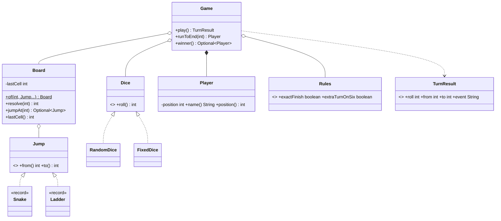

# Chapter 65 — Snake and Ladder

## What and why

A dice game looks trivial but tests the three things LLD answers hinge on: **injecting randomness** (so tests are scripted), **modelling variants as types** (sealed `Snake`/`Ladder`), and **configurable rules** (exact finish, extra turn on six). Exam payoff: sealed hierarchies, records with validation, pattern `switch` with dominance rules, and functional interfaces.

## Requirements

**Functional**

- Board of N×N cells numbered 1..N²; players start off-board at 0.
- Snakes move a player down, ladders up; a cell holds at most one jump; no chains or cycles.
- A roll is 1–6. Landing on a jump start moves the player to its end.
- Rules: *exact finish* (overshoot = stay) and *extra turn on six* (both configurable).
- First player to reach the last cell wins; no moves after that.

**Non-functional**

- Deterministic tests: dice are an interface (`FixedDice`, seeded `RandomDice`).
- Invalid boards are rejected at construction.

**Out of scope:** UI, three-sixes penalty, multiple dice (see Extensions).

## Exam flash rules

- `sealed … permits A, B` closes the hierarchy; each permitted subtype must be `final`, `sealed` or `non-sealed` (records are implicitly `final`).
- A pattern `switch` over a sealed type needs no `default`; adding a subtype later makes the switch fail to compile.
- Case order matters: a general pattern before a specific one is **dominated** and does not compile.
- A record's compact constructor is the place to validate (`Snake` requires `to < from`).
- A lambda can implement any interface with **one** abstract method (`Dice`).
- A static method cannot call an instance method; `Board.lastCell()` needs an instance.
- `int + long` is `long`; assigning back to `int` needs a cast (`possible lossy conversion`).
- Varargs `int...` is an array; clone it if you keep it (`FixedDice`).
- `new Random(seed)` is deterministic: same seed, same sequence.
- A list returned from `List.copyOf` is unmodifiable; `Map.put` returning non-null signals a duplicate key.
- Keep randomness, rules and board data in separate types so each is testable alone.
- Validate invariants once, in the constructor, so the rest of the code can trust them.

## Rules table

| Rule | Allowed | Not allowed | Compiler message (verbatim) |
|------|---------|-------------|------------------------------|
| Pattern dominance | specific case first | `case Jump any` before `case Snake s` | `this case label is dominated by a preceding case label` |
| Sealed subtype | `final` / `sealed` / `non-sealed` | plain `class Plain implements Cell` | `sealed, non-sealed or final modifiers expected` |
| Static vs instance | `board.lastCell()` | `Board.lastCell()` | `non-static method lastCell() cannot be referenced from a static context` |
| Narrowing | `(int) (p + roll)` | `int t = int + long` | `incompatible types: possible lossy conversion from long to int` |
| Lambda return | return `int` | return `String` | `incompatible types: bad return type in lambda expression` |

## Design

| Type | Kind | Responsibility |
|------|------|----------------|
| `Jump` | sealed interface | `from()`, `to()`; permits `Snake`, `Ladder` |
| `Snake`, `Ladder` | records | validate direction in compact ctor |
| `Board` | class | size, jumps, `resolve(cell)`; rejects out-of-range, duplicate starts, chains |
| `Dice` | functional interface | `roll()`; `RandomDice`, `FixedDice` |
| `Player` | class | name + position (mutated only by `Game`) |
| `Rules` | record | `exactFinish`, `extraTurnOnSix` |
| `TurnResult` | record | roll, from, to, event, extra turn |
| `Game` | class | turn order, rules, winner; `play()`, `runToEnd(max)` |

Relationships: `Game` **has** a `Board`, a `Dice`, `Rules`, and **owns** `Player`s; `Board` **aggregates** `Jump`s; `Snake`/`Ladder` **realize** `Jump`.

### API

```text
Board.of(int size, Jump... jumps)
Game(Board, List<String> names, Dice, Rules)
TurnResult play()                 // IllegalStateException when over
Player runToEnd(int maxTurns)
Optional<Player> winner()
```

## UML



## Walkthrough

### Sealed jumps

```java
{{#include ../../code/part-04-lld/src/main/java/lld/snakeladder/Jump.java}}
```

```java
{{#include ../../code/part-04-lld/src/main/java/lld/snakeladder/Snake.java}}
```

```java
{{#include ../../code/part-04-lld/src/main/java/lld/snakeladder/Ladder.java}}
```

### Board validation

```java
{{#include ../../code/part-04-lld/src/main/java/lld/snakeladder/Board.java}}
```

### Dice (injectable randomness)

```java
{{#include ../../code/part-04-lld/src/main/java/lld/snakeladder/Dice.java}}
```

```java
{{#include ../../code/part-04-lld/src/main/java/lld/snakeladder/FixedDice.java}}
```

### Game loop

```java
{{#include ../../code/part-04-lld/src/main/java/lld/snakeladder/Game.java}}
```

### Demo and captured output

```java
{{#include ../../code/part-04-lld/src/main/java/lld/snakeladder/SnakeLadderDemo.java}}
```

```text
{{#include ../../code/part-04-lld/out/snakeladder/SnakeLadderDemo.txt}}
```

Trace highlights: roll 3 hits ladder `3->11`; Asha's `6` on `11` lands on 17 and rolls again; `21 + 1 = 22` is a snake to 9; the last roll `19 + 6 = 25` wins, so no extra turn.

## Tests

```java
{{#include ../../code/part-04-lld/src/test/java/lld/snakeladder/SnakeLadderTest.java}}
```

Covers ladders, snakes, alternation, extra turn on/off, exact vs loose finish, win on a six, game-over guard, all invalid-board cases, seeded determinism, 50 seeded games, and the stuck-game guard.

## Predict the output

**P1.** Records and `instanceof`.

```java
{{#include ../../code/part-04-lld/src/main/java/lld/snakeladder/exam/PredictJumpRecord.java}}
```

<details><summary>Answer</summary>

```text
{{#include ../../code/part-04-lld/out/snakeladder/PredictJumpRecord.txt}}
```

A `Snake` is not a `Ladder`; equality is component-wise **and** same class; `Snake(3,5)` fails validation.

</details>

**P2.** Resolving cells.

```java
{{#include ../../code/part-04-lld/src/main/java/lld/snakeladder/exam/PredictResolve.java}}
```

<details><summary>Answer</summary>

```text
{{#include ../../code/part-04-lld/out/snakeladder/PredictResolve.txt}}
```

Only jump *starts* are keys: cell 11 (a ladder end) has no jump.

</details>

**P3.** Exact finish.

```java
{{#include ../../code/part-04-lld/src/main/java/lld/snakeladder/exam/PredictOvershoot.java}}
```

<details><summary>Answer</summary>

```text
{{#include ../../code/part-04-lld/out/snakeladder/PredictOvershoot.txt}}
```

A: 6, 12, 18, 24 (each six rolls again). 24+3 = 27 > 25 → stays; turn passes. B moves to 2. A rolls 1 → 25 wins.

</details>

**P4.** Extra turn bookkeeping.

```java
{{#include ../../code/part-04-lld/src/main/java/lld/snakeladder/exam/PredictExtraTurn.java}}
```

<details><summary>Answer</summary>

```text
{{#include ../../code/part-04-lld/out/snakeladder/PredictExtraTurn.txt}}
```

`FixedDice(6,2,3)` wraps: A6 (again), A2, B3, A6 (again). With the rule off, a six passes the turn to `B`.

</details>

**P5.** Dice behaviours.

```java
{{#include ../../code/part-04-lld/src/main/java/lld/snakeladder/exam/PredictFixedDice.java}}
```

<details><summary>Answer</summary>

```text
{{#include ../../code/part-04-lld/out/snakeladder/PredictFixedDice.txt}}
```

Wraps after 3; `4 + 4` is **integer** addition → `8` (not `44`); the constructor clones the array so later edits are invisible.

</details>

**P6.** Board validation messages.

```java
{{#include ../../code/part-04-lld/src/main/java/lld/snakeladder/exam/PredictInvalidBoard.java}}
```

<details><summary>Answer</summary>

```text
{{#include ../../code/part-04-lld/out/snakeladder/PredictInvalidBoard.txt}}
```

Ladder ends at 5 and a snake starts at 5 → chain. Two jumps from 2. Snake from the last cell (9) is out of range. `Ladder(2, 9)` is **valid** (a ladder may end on the last cell). Size 1 is too small.

</details>

## Compile or not?

**C1.** General case before a specific one — **fails**.

```java
{{#include ../../code/part-04-lld/broken/snakeladder/DominatedCaseBroken.java}}
```

```text
{{#include ../../code/part-04-lld/out/snakeladder/DominatedCaseBroken.javac.txt}}
```

**C2.** Instance method from a static reference — **fails**.

```java
{{#include ../../code/part-04-lld/broken/snakeladder/StaticContextBroken.java}}
```

```text
{{#include ../../code/part-04-lld/out/snakeladder/StaticContextBroken.javac.txt}}
```

**C3.** `int = int + long` — **fails** (looks fine, binary numeric promotion).

```java
{{#include ../../code/part-04-lld/broken/snakeladder/LossyConversionBroken.java}}
```

```text
{{#include ../../code/part-04-lld/out/snakeladder/LossyConversionBroken.javac.txt}}
```

**C4.** Permitted subtype without `final`/`sealed`/`non-sealed` — **fails**.

```java
{{#include ../../code/part-04-lld/broken/snakeladder/SealedModifierBroken.java}}
```

```text
{{#include ../../code/part-04-lld/out/snakeladder/SealedModifierBroken.javac.txt}}
```

**C5.** Lambda with the wrong return type — **fails**.

```java
{{#include ../../code/part-04-lld/broken/snakeladder/LambdaReturnBroken.java}}
```

```text
{{#include ../../code/part-04-lld/out/snakeladder/LambdaReturnBroken.javac.txt}}
```

Fixes: C1 put `case Snake s` first; C2 `board.lastCell()` on an instance; C3 `(int) (p.position() + roll)` or `long`; C4 `final class Plain …`; C5 `() -> 6`.

## Gotchas

1. **`Random` inside `Game`** — untestable. Inject `Dice` (`FixedDice`).
2. **Snake/ladder chains** — a ladder ending on a snake start creates hidden multi-hops or cycles; reject at construction (`PredictInvalidBoard`).
3. **Extra turn on the winning six** — check `won` first (`winOnSixEndsGameWithoutExtraTurn`).
4. **Exact finish with scripted dice** can loop forever; keep a `maxTurns` guard (`runToEnd`, `runToEndGuardsStuckGames`).
5. **Dominated `switch` cases / missing sealed cases** — order patterns specific → general; omit `default` (`DominatedCaseBroken`).

## Extensions

| Extension | Design change |
|-----------|---------------|
| Two dice / sum | New `Dice` implementation; `Game` unchanged; validate range via `Dice.max()` |
| Three sixes forfeit | Count consecutive sixes in `Game` (per player) |
| Crooked dice / cheat detection | Decorator `Dice` logging every roll |
| Undo / replay | Store `TurnResult` list; positions reconstructable |
| Game variants | `Rules` grows or becomes an interface (Strategy) |
| UI | Subscribe to `TurnResult` events (observer / pub-sub, chapter 64) |
| Concurrency | One game = one thread; if shared, synchronize `play()` |

## Short-answer strip

| Question | 1–2 line answer |
|----------|-----------------|
| Entities | `Board`, `Jump` (`Snake`, `Ladder`), `Player`, `Dice`, `Rules`, `Game` |
| Relationships | `Game` has `Board`, `Dice`, `Rules`, owns `Player`s; `Board` aggregates `Jump`s |
| Why sealed `Jump`? | Two closed variants; exhaustive switch, no `default` |
| Why `Dice` interface? | Scripted tests; swap random/fixed/loaded |
| Validation | Records validate direction; `Board` validates range, duplicates, chains |
| Complexity | `play()` O(1): hash lookup for jump |
| Pattern | Strategy (`Dice`, `Rules`), Value objects (records) |
| Failure | `IllegalStateException` after game over; constructor `IllegalArgumentException` |

## Interview Q&A

1. **Q:** How do you test a random game? **A:** Inject `Dice`; scripted `FixedDice` or seeded `RandomDice`.
2. **Q:** Why sealed? **A:** Closed variants; compiler checks switches (`DominatedCaseBroken`, `SealedModifierBroken`).
3. **Q:** What if a ladder ends on a snake start? **A:** Rejected (`jump chain`); otherwise resolve loops or gives surprising multi-hops.
4. **Q:** Complexity of a turn? **A:** O(1): map lookup by cell.
5. **Q:** Where does position live? **A:** In `Player`, mutated only by `Game` (package-private setter).
6. **Q:** Can a ladder end on the last cell? **A:** Yes, that wins (`PredictInvalidBoard`).
7. **Q:** How to add a rule? **A:** Add to `Rules`; branch in `Game.play`; or make `Rules` an interface for many variants.
8. **Q:** Why return `TurnResult`? **A:** Callers render/log without reaching into game state.
9. **Q:** How to avoid infinite games in tests? **A:** `runToEnd(maxTurns)` guard.
10. **Q:** Immutable or mutable `Board`? **A:** Immutable; shared safely across games.
11. **Q:** Why `Optional<Jump>`? **A:** "No jump here" is a normal case; avoids `null`.
12. **Q:** What changes for 100 players? **A:** Nothing structural; turn order is an index.

## Exam writing prompts

1. (8) Draw the class diagram and define the sealed `Jump` hierarchy with validated records.
2. (5) Write `Game.play()` for exact-finish rules returning a `TurnResult` (assume `Board.resolve`).
3. (5) Write a `Dice` that replays an `int[]` and show how a lambda can implement `Dice`.
4. (3) State two board-validation rules and why each is needed.

## Exercises

Solutions: `code/part-04-lld/solutions/ch65/Solutions65.java`.

1. Biggest ladder rise — `biggestRise`.
2. Seeded simulation — `simulate`.
3. `Dice` from an `Iterator` via lambda — `fromIterator`.
4. Count snakes — `snakeCount`.
5. Sorted text listing with an exhaustive switch — `describe`.

```java
{{#include ../../code/part-04-lld/solutions/ch65/Solutions65.java}}
```

```text
{{#include ../../code/part-04-lld/out/snakeladder/Solutions65.txt}}
```

## Recap checklist

- [x] Requirements, entities, relationships, API
- [x] Sealed jumps, validated board, injectable dice, configurable rules
- [x] Pattern switch dominance, sealed modifiers, static context, numeric promotion
- [x] Tests (incl. seeded games), 6 predict stems, 5 compile-or-not stems, 4 writing prompts, 5 exercises
- [x] Extensions and short-answer strip
