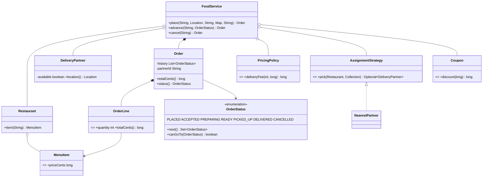
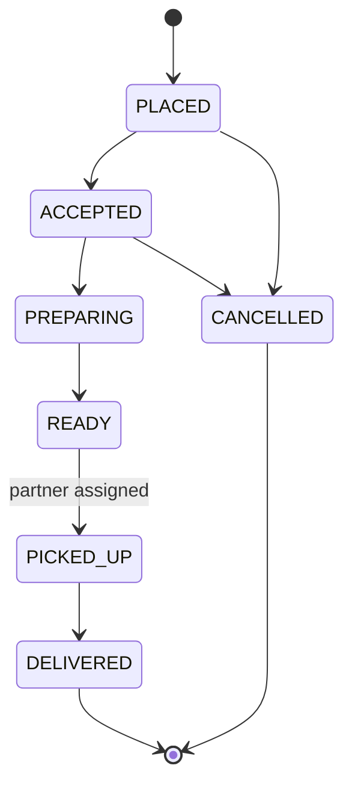

# Chapter 66 — Food Delivery

## What and why

An order moves through a life cycle, is priced from a menu, and is matched with a delivery partner when it becomes ready. Exam payoff: the **state machine as an enum**, money as `long` cents, Strategy for assignment, immutable collections, and basic control-flow compile errors (`missing return`, `unreachable`, duplicate `case`, `final`).

## Requirements

**Functional**

- Restaurants with menus; customers place an order for items and quantities.
- Price comes from the menu: `subtotal = Σ price × qty`; `total = subtotal + deliveryFee − discount`.
- Delivery fee = `base + perBlock × distance` (restaurant → customer, Manhattan); free at or above a subtotal threshold.
- Coupon: percent off the subtotal, capped.
- Status machine: `PLACED → ACCEPTED → PREPARING → READY → PICKED_UP → DELIVERED`; `CANCELLED` allowed from `PLACED` and `ACCEPTED` only; illegal moves rejected.
- When an order becomes `READY`, assign the nearest available partner; if none, queue it (FIFO) and assign when a partner is freed. Pick-up requires an assigned partner.

**Non-functional**

- Deterministic tie-breaking (lowest partner id).
- Rejected operations leave order state unchanged.

**Out of scope:** payments, ratings, live tracking, multi-restaurant carts.

## Exam flash rules

- An enum constructor is implicitly `private`; declaring it `public` is a compile error.
- Enum constants may carry data and behaviour; a `switch` expression over an enum must be exhaustive.
- `EnumSet` iterates in declaration order.
- A non-`void` method must return on **every** path: otherwise `missing return statement`.
- A statement after `throw`/`return`/`break` is `unreachable`.
- Two `case` labels with the same constant are `duplicate case label`.
- A `final` local can be assigned once; a second assignment does not compile.
- `List.copyOf` / `List.of` are unmodifiable: `add` throws `UnsupportedOperationException`.
- Keep money as `long` cents (or `BigDecimal`), never `double`.
- Integer division floors: `750 × 10 / 100 = 75`; multiply before dividing.
- Encode legal transitions as data (`next()`), then test against the data.
- Never price from caller-supplied numbers; look prices up server-side.

## Rules table

| Rule | Allowed | Not allowed | Compiler message (verbatim) |
|------|---------|-------------|------------------------------|
| Enum constructor | implicit or `private` | `public Spice(int)` | `modifier public not allowed here` |
| Return on all paths | `else` / final `return` | `if / else if` with no final branch | `missing return statement` |
| Dead code | code before the `throw` | code after the `throw` | `unreachable statement` |
| Switch labels | each constant once | `case PLACED` twice | `duplicate case label` |
| `final` local | single assignment | reassign | `cannot assign a value to final variable total` |

## Design

| Type | Kind | Responsibility |
|------|------|----------------|
| `Location` | record | coordinates, Manhattan `distanceTo` |
| `MenuItem`, `OrderLine` | records | validated price / quantity |
| `Restaurant` | class | id, location, menu lookup |
| `OrderStatus` | enum | states + `next()`, `canGoTo`, `isTerminal` |
| `Order` | class | lines (immutable), amounts, status history, partner id; package-private mutators |
| `PricingPolicy` | record | delivery fee rule |
| `Coupon` | record | percent off with cap |
| `DeliveryPartner` | class | location, availability |
| `AssignmentStrategy` / `NearestPartner` | strategy | pick a partner from the free ones |
| `FoodService` | facade | place, advance, cancel; waiting queue; partner release |

Relationships: `FoodService` **has** restaurants, partners, orders, a `PricingPolicy`, an `AssignmentStrategy`; `Order` **composes** `OrderLine`s and **refers to** its `Restaurant` and a partner id.

### API

```text
Order place(String customerId, Location dest, String restaurantId, Map<String,Integer> items, String couponOrNull)
Order advance(String orderId, OrderStatus target)   // IllegalStateException if illegal
Order cancel(String orderId)
```

## UML



State diagram:



## Walkthrough

### Life cycle as data

```java
{{#include ../../code/part-04-lld/src/main/java/lld/food/OrderStatus.java}}
```

### Order

```java
{{#include ../../code/part-04-lld/src/main/java/lld/food/Order.java}}
```

### Pricing and assignment

```java
{{#include ../../code/part-04-lld/src/main/java/lld/food/PricingPolicy.java}}
```

```java
{{#include ../../code/part-04-lld/src/main/java/lld/food/Coupon.java}}
```

```java
{{#include ../../code/part-04-lld/src/main/java/lld/food/NearestPartner.java}}
```

### Facade

```java
{{#include ../../code/part-04-lld/src/main/java/lld/food/FoodService.java}}
```

### Demo and captured output

```java
{{#include ../../code/part-04-lld/src/main/java/lld/food/FoodDemo.java}}
```

```text
{{#include ../../code/part-04-lld/out/food/FoodDemo.txt}}
```

Trace: 2×300 + 1×150 = 750; distance `(0,0)→(2,1)` = 3 → fee `30 + 10×3 = 60`; coupon `750×10/100 = 75` (< cap 100); total 735. `p2` at distance 3 beats `p1` at distance 10.

## Tests

```java
{{#include ../../code/part-04-lld/src/test/java/lld/food/FoodTest.java}}
```

## Predict the output

**P1.** Transitions.

```java
{{#include ../../code/part-04-lld/src/main/java/lld/food/exam/PredictTransitions.java}}
```

<details><summary>Answer</summary>

```text
{{#include ../../code/part-04-lld/out/food/PredictTransitions.txt}}
```

Cancellation is no longer possible once `PREPARING`; terminal states have an empty `next()`; `READY` is the 4th constant (ordinal 3).

</details>

**P2.** Arithmetic.

```java
{{#include ../../code/part-04-lld/src/main/java/lld/food/exam/PredictTotals.java}}
```

<details><summary>Answer</summary>

```text
{{#include ../../code/part-04-lld/out/food/PredictTotals.txt}}
```

Second order: subtotal 2400 ≥ 2000 → free delivery; 10% = 240, capped at 100; total 2300.

</details>

**P3.** Illegal moves.

```java
{{#include ../../code/part-04-lld/src/main/java/lld/food/exam/PredictIllegal.java}}
```

<details><summary>Answer</summary>

```text
{{#include ../../code/part-04-lld/out/food/PredictIllegal.txt}}
```

Both rejections leave the order unchanged; history has only successful moves.

</details>

**P4.** Nearest partner and ties.

```java
{{#include ../../code/part-04-lld/src/main/java/lld/food/exam/PredictNearest.java}}
```

<details><summary>Answer</summary>

```text
{{#include ../../code/part-04-lld/out/food/PredictNearest.txt}}
```

`TieA` (id `p2`) and `TieB` (`p3`) are both at distance 3; lower id wins. Empty list → `Optional.empty`. `|1−4| + |2−(−2)| = 7`.

</details>

**P5.** Waiting queue.

```java
{{#include ../../code/part-04-lld/src/main/java/lld/food/exam/PredictWaiting.java}}
```

<details><summary>Answer</summary>

```text
{{#include ../../code/part-04-lld/out/food/PredictWaiting.txt}}
```

Second order is `READY` but has no partner (`null`) until the first is delivered; then the freed partner is assigned FIFO. Unknown id → `IllegalArgumentException`.

</details>

**P6.** Immutability and validation.

```java
{{#include ../../code/part-04-lld/src/main/java/lld/food/exam/PredictImmutable.java}}
```

<details><summary>Answer</summary>

```text
{{#include ../../code/part-04-lld/out/food/PredictImmutable.txt}}
```

`List.copyOf` → unmodifiable; quantity 0 rejected by the record; unknown item rejected by the menu; `100 × 2 = 200`.

</details>

## Compile or not?

**C1.** `public` enum constructor — **fails**.

```java
{{#include ../../code/part-04-lld/broken/food/EnumPublicCtorBroken.java}}
```

```text
{{#include ../../code/part-04-lld/out/food/EnumPublicCtorBroken.javac.txt}}
```

**C2.** Missing return on one path — **fails** (the compiler does not know the two `if`s are not exhaustive).

```java
{{#include ../../code/part-04-lld/broken/food/MissingReturnBroken.java}}
```

```text
{{#include ../../code/part-04-lld/out/food/MissingReturnBroken.javac.txt}}
```

**C3.** Code after `throw` — **fails**.

```java
{{#include ../../code/part-04-lld/broken/food/UnreachableBroken.java}}
```

```text
{{#include ../../code/part-04-lld/out/food/UnreachableBroken.javac.txt}}
```

**C4.** Duplicate `case` — **fails**.

```java
{{#include ../../code/part-04-lld/broken/food/DuplicateCaseBroken.java}}
```

```text
{{#include ../../code/part-04-lld/out/food/DuplicateCaseBroken.javac.txt}}
```

**C5.** Reassigning a `final` local — **fails**.

```java
{{#include ../../code/part-04-lld/broken/food/FinalReassignBroken.java}}
```

```text
{{#include ../../code/part-04-lld/out/food/FinalReassignBroken.javac.txt}}
```

Fixes: C1 drop `public`; C2 add `else`/final `return`; C3 move the print before `throw`; C4 delete the duplicate; C5 use a new variable.

## Gotchas

1. **`double` for money** — rounding drift; use `long` cents (`Coupon`, `PricingPolicy`).
2. **Trusting caller prices** — re-read price from the menu (`priceComesFromMenuNotCaller`).
3. **Mutating before validating a transition** — check, then change (`Order.transition`, `PredictIllegal`).
4. **Partner not freed on delivery** — orders stall in `READY` (`waitingOrderGetsPartnerWhenOneIsFreed`).
5. **Non-deterministic tie-breaks** — `HashMap` iteration order differs run to run; sort by id (`NearestPartner`, `PredictNearest`).

## Extensions

| Extension | Design change |
|-----------|---------------|
| Multiple restaurants per cart | `Cart` aggregate producing several `Order`s |
| Partner rejects / timeout | `OFFERED` state per partner; re-run strategy excluding the rejecter |
| Surge pricing | `PricingPolicy` becomes an interface; decorator multiplies fee |
| Live tracking | Partner location updates published to a topic (chapter 64) |
| Cancellation fees | Fee rule per status in a map `OrderStatus → percent` |
| Persistence / audit | `history` already an append-only list of statuses; add timestamps |
| Concurrency | One lock per order + one for partner pool, instead of `synchronized` facade |

## Short-answer strip

| Question | 1–2 line answer |
|----------|-----------------|
| Entities | `Restaurant`, `MenuItem`, `Order`, `OrderLine`, `DeliveryPartner`, `Coupon`, `FoodService` |
| Pattern | State (enum `next()`), Strategy (`AssignmentStrategy`), Facade |
| Total formula | `Σ price×qty + fee − discount` |
| Why enum for states? | Closed set, transitions as data, exhaustive `switch` |
| Cancel rule | Only from `PLACED` / `ACCEPTED` |
| Partner matching | Nearest free, tie → lowest id; else FIFO waiting queue |
| Money type | `long` cents |
| Failure | `IllegalStateException` for illegal transition; `IllegalArgumentException` for bad input |

## Interview Q&A

1. **Q:** How do you model order states? **A:** Enum with `next()`; `transition` checks `canGoTo` (`OrderStatus`, `Order`).
2. **Q:** Why not a `boolean` per state? **A:** Illegal combinations become representable.
3. **Q:** Why `long` for money? **A:** Exact arithmetic; `double` drifts.
4. **Q:** How are partners chosen? **A:** `AssignmentStrategy`; default nearest with deterministic tie-break.
5. **Q:** What if no partner is free? **A:** Order waits in a FIFO queue; `release` re-runs assignment.
6. **Q:** Why can't a `PREPARING` order be cancelled here? **A:** Business rule in `next()`; change one line to relax it.
7. **Q:** Where is pricing computed? **A:** In `FoodService.place` from menu data; the caller sends ids and quantities only.
8. **Q:** Why immutable `lines`? **A:** Totals must not change after the order is placed.
9. **Q:** How is this thread-safe? **A:** `synchronized` facade; finer: per-order locks.
10. **Q:** How to add surge pricing? **A:** Make `PricingPolicy` an interface and decorate it.
11. **Q:** `final` vs immutable? **A:** `final` stops reassignment, not mutation of the object (`FinalReassignBroken`).
12. **Q:** What does `default -> {}` risk in the service `switch`? **A:** Hides new states; acceptable here only because other states need no side-effects.

## Exam writing prompts

1. (8) Draw the order state diagram and write `OrderStatus.next()` as a `switch` expression.
2. (5) Write `Order.transition(OrderStatus)` that rejects illegal moves with the message `illegal transition A -> B`.
3. (5) Write `deliveryFee(distance, subtotal)` with a free-delivery threshold using `long` arithmetic.
4. (3) Explain Strategy with `AssignmentStrategy` and show a lambda implementation choosing the first free partner.

## Exercises

Solutions: `code/part-04-lld/solutions/ch66/Solutions66.java`.

1. Shortest legal status path (BFS over `next()`) — `path`.
2. Farthest-partner strategy as a lambda — `FARTHEST`.
3. List terminal statuses with a stream — `terminal`.
4. Audit an order's totals — `totalsConsistent`.
5. Revenue of delivered orders per restaurant — `revenue`.

```java
{{#include ../../code/part-04-lld/solutions/ch66/Solutions66.java}}
```

```text
{{#include ../../code/part-04-lld/out/food/Solutions66.txt}}
```

## Recap checklist

- [x] Requirements, entities, relationships, API, state diagram
- [x] Enum state machine, pricing, coupon cap, partner queue
- [x] Enum ctor rule, missing return, unreachable, duplicate case, `final`
- [x] Tests, 6 predict stems, 5 compile-or-not stems, 4 writing prompts, 5 exercises
- [x] Extensions and short-answer strip
