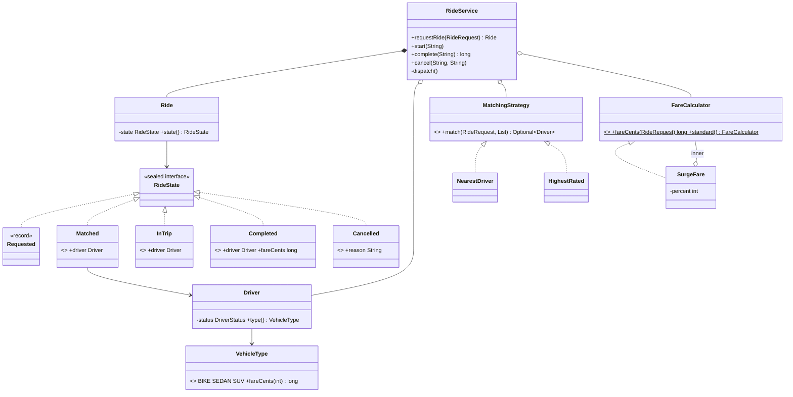
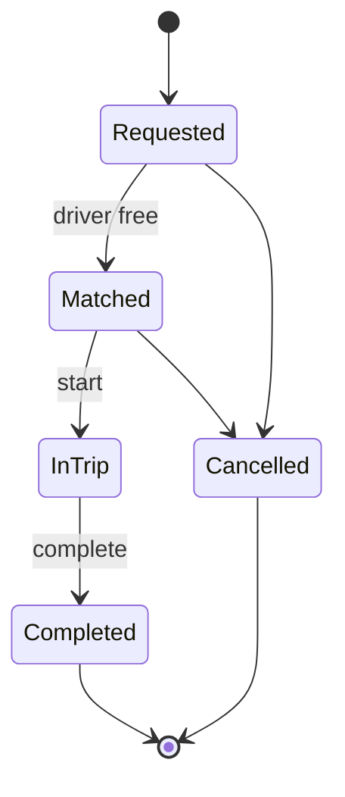

# Chapter 67 — Ride Sharing

## What and why

Riders request trips, a matcher assigns drivers, and the fare depends on vehicle and distance. The design question is **correctness under concurrency** (no driver gets two rides) plus **pluggable matching and pricing**. Exam payoff: sealed state records with pattern `switch`, enums with data, Strategy and Decorator, `Optional`, bounded generics, blank `final` fields.

## Requirements

**Functional**

- Drivers register, go online/offline, have a vehicle type, rating and location.
- A rider requests a ride (pickup, drop, vehicle type). The system matches an **available driver of that type**; if none, the ride waits in a FIFO queue and is matched when a driver becomes available.
- Ride life cycle: `Requested → Matched → InTrip → Completed`; cancel allowed in `Requested` and `Matched` only (frees the driver).
- Fare = vehicle base + per-km × distance (Manhattan km); surge multiplies by a percentage.
- On completion the driver is available again, located at the drop-off.

**Non-functional**

- Two simultaneous requests never get the same driver.
- Matching and pricing are replaceable without touching the service.

**Out of scope:** payments, maps/ETA, ratings after trip, pooling (see Extensions).

## Exam flash rules

- A `sealed` interface lets a `switch` over it omit `default`; record patterns deconstruct components (`Completed(Driver d, long fare)`).
- A record pattern must list **all** components: wrong arity → `incorrect number of nested patterns`.
- `default -> throw …` inside a `switch` expression is legal: it yields no value.
- Enum constants can have fields; the constructor is implicitly `private`.
- Static interface methods are called on the **type** (`FareCalculator.standard()`), never on an instance.
- `Optional<T>` is not `T`: unwrap with `orElse`/`orElseThrow`/`map`; do not assign directly.
- A bounded type parameter `T extends Comparable<T>` rejects classes that are not `Comparable`.
- A blank `final` field must be assigned in every constructor, or the class does not compile.
- Integer percentage maths floors: `134 × 105 / 100 = 140`.
- Shared mutable state needs one guard: here a single lock covers drivers, queue and rides.
- Validate transitions **before** mutating (`ride.complete(fare)` first, then free the driver).
- A decorator implements the same interface and wraps another instance (`SurgeFare`).

## Rules table

| Rule | Allowed | Not allowed | Compiler message (verbatim) |
|------|---------|-------------|------------------------------|
| Static interface method | `FareCalculator.standard()` | `calc.standard()` | `illegal static interface method call` |
| `Optional` | `s.match(...).orElse(null)` | `Driver d = s.match(...)` | `incompatible types: Optional<Driver> cannot be converted to Driver` |
| Bounded generic | `T extends Comparable<T>` with a `Comparable` | `best(List<Driver>)` | `inference variable T has incompatible bounds` |
| Blank final | assign in constructor | never assigned | `variable surgePercent not initialized in the default constructor` |
| Record pattern | all components | `Completed(var driver)` | `incorrect number of nested patterns` |

## Design

| Type | Kind | Responsibility |
|------|------|----------------|
| `Location` | record | grid point, Manhattan distance |
| `VehicleType` | enum | base and per-km tariff; `fareCents(km)` |
| `Driver` | class | id, type, rating, location, `DriverStatus`; package-private setters |
| `RideRequest` | record | rider, pickup, drop, type |
| `RideState` | sealed interface of records | `Requested`, `Matched(driver)`, `InTrip(driver)`, `Completed(driver, fare)`, `Cancelled(reason)` |
| `Ride` | class | owns state; each transition `switch`es on the current state |
| `MatchingStrategy` | functional interface | `NearestDriver`, `HighestRated(radius)` |
| `FareCalculator` | functional interface | `standard()`, decorated by `SurgeFare` |
| `RideService` | facade | single lock; pending FIFO; `dispatch()` after every availability change |

Relationships: `RideService` **has** drivers, rides, a pending queue, a `MatchingStrategy`, a `FareCalculator`; `Ride` **has** a `RideRequest` and one current `RideState`; `SurgeFare` **decorates** `FareCalculator`.

### API

```text
Ride  requestRide(RideRequest)           // Requested if nobody is free
void  start(String rideId)
long  complete(String rideId)            // fare in cents
void  cancel(String rideId, String reason)
void  goOnline(String driverId, Location) / goOffline(String driverId)
```

## UML





## Walkthrough

### States as sealed records

```java
{{#include ../../code/part-04-lld/src/main/java/lld/rideshare/RideState.java}}
```

```java
{{#include ../../code/part-04-lld/src/main/java/lld/rideshare/Ride.java}}
```

### Strategies and fares

```java
{{#include ../../code/part-04-lld/src/main/java/lld/rideshare/MatchingStrategy.java}}
```

```java
{{#include ../../code/part-04-lld/src/main/java/lld/rideshare/NearestDriver.java}}
```

```java
{{#include ../../code/part-04-lld/src/main/java/lld/rideshare/FareCalculator.java}}
```

```java
{{#include ../../code/part-04-lld/src/main/java/lld/rideshare/SurgeFare.java}}
```

### Service

```java
{{#include ../../code/part-04-lld/src/main/java/lld/rideshare/RideService.java}}
```

Why it cannot double-book: `requestRide` and `dispatch()` run under one lock; `dispatch()` filters `AVAILABLE`, picks, and sets `BUSY` before releasing it.

### Demo and captured output

```java
{{#include ../../code/part-04-lld/src/main/java/lld/rideshare/RideShareDemo.java}}
```

```text
{{#include ../../code/part-04-lld/out/rideshare/RideShareDemo.txt}}
```

Trace: distance `(1,1)→(4,5)` = 7 km; standard sedan fare `50 + 12×7 = 134`; surge 150% → `201`. Third rider waits; when ride 1 completes, `d1` is free and ride 3 is matched; ride 2 is cancelled while `Matched`.

## Tests

```java
{{#include ../../code/part-04-lld/src/test/java/lld/rideshare/RideShareTest.java}}
```

Includes a 40-request / 5-driver concurrency test: exactly 5 matches, 5 distinct drivers, 35 pending.

## Predict the output

**P1.** Enum with data.

```java
{{#include ../../code/part-04-lld/src/main/java/lld/rideshare/exam/PredictVehicleEnum.java}}
```

<details><summary>Answer</summary>

```text
{{#include ../../code/part-04-lld/out/rideshare/PredictVehicleEnum.txt}}
```

`50 + 12×10 = 170`; `SUV` (ordinal 2) − `BIKE` (0) = 2; three constants; `getClass()` equals the enum type because no constant has a body.

</details>

**P2.** Fare arithmetic.

```java
{{#include ../../code/part-04-lld/src/main/java/lld/rideshare/exam/PredictFare.java}}
```

<details><summary>Answer</summary>

```text
{{#include ../../code/part-04-lld/out/rideshare/PredictFare.txt}}
```

`|3|+|4| = 7`; `50+84 = 134`; `134×150/100 = 201`; `134×105/100 = 140.7 → 140` (integer floor); below 100% is rejected.

</details>

**P3.** Illegal transitions.

```java
{{#include ../../code/part-04-lld/src/main/java/lld/rideshare/exam/PredictTransitions.java}}
```

<details><summary>Answer</summary>

```text
{{#include ../../code/part-04-lld/out/rideshare/PredictTransitions.txt}}
```

Message names the **current** state. Bike, 2 km: `20 + 8×2 = 36`.

</details>

**P4.** Strategies.

```java
{{#include ../../code/part-04-lld/src/main/java/lld/rideshare/exam/PredictMatching.java}}
```

<details><summary>Answer</summary>

```text
{{#include ../../code/part-04-lld/out/rideshare/PredictMatching.txt}}
```

Nearest = distance 1. Radius 5 keeps `Near` (1) and `Good` (4) → best rating `Good`. Radius 0 → none (`-`). Radius 20 includes `Far` (5.0).

</details>

**P5.** Pending queue and type filtering.

```java
{{#include ../../code/part-04-lld/src/main/java/lld/rideshare/exam/PredictPending.java}}
```

<details><summary>Answer</summary>

```text
{{#include ../../code/part-04-lld/out/rideshare/PredictPending.txt}}
```

The bike driver never serves a sedan request. When the sedan driver comes online, `r1` is matched; `r2` waits until `r1` completes.

</details>

**P6.** Sealed state text.

```java
{{#include ../../code/part-04-lld/src/main/java/lld/rideshare/exam/PredictStateText.java}}
```

<details><summary>Answer</summary>

```text
{{#include ../../code/part-04-lld/out/rideshare/PredictStateText.txt}}
```

Each record shows its own data; empty records are equal; `toString` is generated.

</details>

## Compile or not?

**C1.** Static interface method via an instance — **fails**.

```java
{{#include ../../code/part-04-lld/broken/rideshare/StaticViaInstanceBroken.java}}
```

```text
{{#include ../../code/part-04-lld/out/rideshare/StaticViaInstanceBroken.javac.txt}}
```

**C2.** Assigning an `Optional` to its element type — **fails**.

```java
{{#include ../../code/part-04-lld/broken/rideshare/OptionalUnwrapBroken.java}}
```

```text
{{#include ../../code/part-04-lld/out/rideshare/OptionalUnwrapBroken.javac.txt}}
```

**C3.** Bounded generic with a non-`Comparable` type — **fails**.

```java
{{#include ../../code/part-04-lld/broken/rideshare/BoundedGenericBroken.java}}
```

```text
{{#include ../../code/part-04-lld/out/rideshare/BoundedGenericBroken.javac.txt}}
```

**C4.** Blank `final` never assigned — **fails**.

```java
{{#include ../../code/part-04-lld/broken/rideshare/BlankFinalBroken.java}}
```

```text
{{#include ../../code/part-04-lld/out/rideshare/BlankFinalBroken.javac.txt}}
```

**C5.** Record pattern with the wrong number of components — **fails**.

```java
{{#include ../../code/part-04-lld/broken/rideshare/RecordPatternArityBroken.java}}
```

```text
{{#include ../../code/part-04-lld/out/rideshare/RecordPatternArityBroken.javac.txt}}
```

Fixes: C1 `FareCalculator.standard()`; C2 `.orElse(null)`; C3 make `Driver implements Comparable<Driver>` or pass a `Comparator`; C4 add a constructor assigning it; C5 `Completed(Driver d, long fare)`.

## Gotchas

1. **Check-then-act on driver status without a lock** — two requests see the same driver as free (`concurrentRequestsNeverShareADriver`).
2. **Freeing the driver before the transition is validated** — a rejected `complete` would leave a stuck/incorrect status (`failedCompleteDoesNotChangeDriverStatus`).
3. **Forgetting to re-dispatch** when a driver frees up leaves rides pending forever (`pendingRideIsMatchedWhenDriverComesOnline`).
4. **Ignoring vehicle type** during matching (`pendingIsFifoAndTypeAware`).
5. **Percent maths with `double`** — use integer percent and accept flooring (`PredictFare`).

## Extensions

| Extension | Design change |
|-----------|---------------|
| Real distance / ETA | `DistanceService` interface; strategies use it instead of Manhattan |
| Surge by demand | `SurgeFare` percent from a supplier fed by `pendingCount()` |
| Pooling (shared rides) | A `Ride` with several `RideRequest`s; matching considers detour |
| Driver accept/decline | Add `Offered(driver, deadline)` state; timeout returns to `Requested` |
| Scale | Shard by city; per-city lock instead of one global lock; geo-index (grid/quadtree) for candidates |
| Cancellation fees | Fee rule per state at cancel time |
| Events | Publish state changes to a topic (chapter 64) for notifications |

## Short-answer strip

| Question | 1–2 line answer |
|----------|-----------------|
| Entities | `Rider`, `Driver`, `RideRequest`, `Ride`, `RideState`, `VehicleType`, `RideService` |
| Patterns | State (sealed records), Strategy (`MatchingStrategy`), Decorator (`SurgeFare`), Facade |
| Prevent double booking | Single lock; select-and-mark-busy in one critical section |
| Fare | `base + perKm × km`, surge `× percent / 100` |
| No driver free | Ride stays `Requested` in FIFO queue; `dispatch()` on every availability change |
| Cancel rule | `Requested` or `Matched` only |
| Scale-out | Shard by city, geo-index candidates, per-shard lock |
| Failure | `IllegalStateException` for bad transition; `IllegalArgumentException` unknown ids |

## Interview Q&A

1. **Q:** How do you prevent two riders getting one driver? **A:** One critical section for select + mark `BUSY` (`RideService`).
2. **Q:** Why sealed records for state? **A:** Each state holds only its data; exhaustive switches (`RideState.describe`).
3. **Q:** Why does a `Ride` own its transitions? **A:** Invariants live next to the data; the service only coordinates.
4. **Q:** Strategy vs Decorator here? **A:** Matching is an interchangeable algorithm; surge wraps an existing fare calculator.
5. **Q:** What if nobody is available? **A:** Stay `Requested`, queue FIFO, retry when someone frees up.
6. **Q:** Why `Optional<Driver>` from the strategy? **A:** "No match" is a normal outcome (`OptionalUnwrapBroken`).
7. **Q:** Why integer percent for surge? **A:** Exact, testable maths; `double` would need rounding rules.
8. **Q:** How do you scale matching? **A:** Spatial index, partition by region, per-region locks/queues.
9. **Q:** Can a driver go offline mid-trip? **A:** Rejected (`BUSY`); would need a "finish then offline" flag.
10. **Q:** Where is the fare computed? **A:** At completion from the request (could be at match time to lock the price).
11. **Q:** Why package-private setters on `Driver`? **A:** Only the service may change status/location.
12. **Q:** How to add a vehicle type? **A:** One enum constant with its tariff; strategies filter on it.

## Exam writing prompts

1. (8) Draw the ride state diagram and define `RideState` as a sealed interface of records.
2. (5) Write `Ride.start()` as a pattern `switch` that rejects any state except `Matched` with `cannot start from <State>`.
3. (5) Write `SurgeFare` as a decorator of `FareCalculator` using integer percent.
4. (3) Explain why `requestRide` and driver selection must share one lock.

## Exercises

Solutions: `code/part-04-lld/solutions/ch67/Solutions67.java`.

1. Strategy as a lambda — `LOWEST_ID`.
2. Another decorator (flat fee) — `FlatFee`.
3. Exhaustive `isFinished` — `isFinished`.
4. Quote all vehicle types with an `EnumMap` — `quote`.
5. Count rides by state — `byState`.

```java
{{#include ../../code/part-04-lld/solutions/ch67/Solutions67.java}}
```

```text
{{#include ../../code/part-04-lld/out/rideshare/Solutions67.txt}}
```

## Recap checklist

- [x] Requirements, entities, relationships, API, state diagram
- [x] Sealed state records, strategy, decorator, pending queue, concurrency test
- [x] Static interface call, `Optional`, bounded generics, blank final, record-pattern arity
- [x] Tests, 6 predict stems, 5 compile-or-not stems, 4 writing prompts, 5 exercises
- [x] Extensions and short-answer strip
