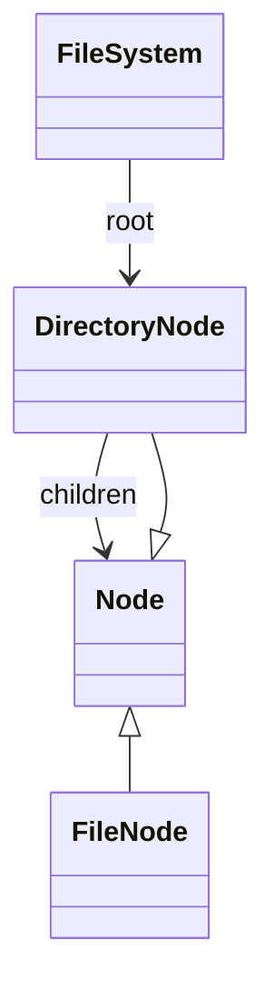

# Chapter 68 — File System

## What and why

An in-memory FS is the Composite LLD: sealed `Node` (`FileNode` / `DirectoryNode`), path resolution with `.`/`..`, and commands `mkdir`/`write`/`ls`/`mv`/`cp`/`rm`/`size`. Exam payoff: pattern `switch` on sealed nodes, lexical path rules, and “cannot move into self”.

## Exam flash rules

- Paths are lexical: collapse `.` and `..`; `..` at root stays at root (`PredictPaths`).
- `Node` is sealed; exhaustive `switch` — no silent `default`.
- `mkdir` fails if the name exists; `mkdirs` creates missing parents.
- `write` overwrites files; writing onto a directory → `NOT_A_FILE`.
- `rm` on a non-empty directory → `NOT_EMPTY`; cannot remove `/`.
- `mv` / `cp` refuse moving a directory into itself (`INVALID_PATH`).
- Directory `size` is the recursive sum of file bytes (`PredictSize`).
- `ls` sorts: directories with trailing `/`, then files (`PredictLs`).
- Package-private constructors keep node creation inside the package.
- Pattern binding scope: `f` from `instanceof FileNode f` is not visible outside the `if`.
- A more specific `case FileNode` after `case Node` is dominated.

## Short-answer strip

| Item | Answer |
|------|--------|
| Entities | `FileSystem`, `Node`, `FileNode`, `DirectoryNode`, `FsException` |
| Patterns | Composite (`Node` tree), Facade (`FileSystem`) |
| APIs | `pwd/cd/mkdir/mkdirs/write/read/ls/mv/cp/rm/size/tree` |
| Concurrency | not thread-safe — document and lock externally if shared |

## Requirements

| Kind | Line |
|------|------|
| Functional | POSIX-ish subset listed above |
| Non-functional | Deterministic errors via `FsException.Kind` |
| Out of scope | permissions, links, real disk, watchers |

## Rules table

| Case | Compiles? | Message |
|------|-----------|---------|
| Extra `Node` subtype | No | `class is not allowed to extend sealed class: Node …` |
| Incomplete `switch` on `Node` | No | `does not cover all possible input values` |
| `extends DirectoryNode` | No | `cannot inherit from final DirectoryNode` |
| `new FileNode` outside package | No | `FileNode(String,String) is not public …` |
| Use pattern var outside `if` | No | `cannot find symbol` |
| Dominated case label | No | `this case label is dominated by a preceding case label` |

## Walkthrough

```java
{{#include ../../code/part-04-lld/src/main/java/lld/fs/Node.java:node}}
```

```java
{{#include ../../code/part-04-lld/src/main/java/lld/fs/FileNode.java:file-node}}
```

```java
{{#include ../../code/part-04-lld/src/main/java/lld/fs/DirectoryNode.java:directory-node}}
```

```java
{{#include ../../code/part-04-lld/src/main/java/lld/fs/FileSystem.java:file-system}}
```

```java
{{#include ../../code/part-04-lld/src/main/java/lld/fs/FsDemo.java:fs-demo}}
```

```text
{{#include ../../code/part-04-lld/out/fs/FsDemo.txt}}
```

## Predict the output

```java
{{#include ../../code/part-04-lld/src/main/java/lld/fs/exam/PredictPaths.java:predict-paths}}
```

```text
{{#include ../../code/part-04-lld/out/fs/PredictPaths.txt}}
```

```java
{{#include ../../code/part-04-lld/src/main/java/lld/fs/exam/PredictLs.java:predict-ls}}
```

```text
{{#include ../../code/part-04-lld/out/fs/PredictLs.txt}}
```

```java
{{#include ../../code/part-04-lld/src/main/java/lld/fs/exam/PredictMv.java:predict-mv}}
```

```text
{{#include ../../code/part-04-lld/out/fs/PredictMv.txt}}
```

```java
{{#include ../../code/part-04-lld/src/main/java/lld/fs/exam/PredictRm.java:predict-rm}}
```

```text
{{#include ../../code/part-04-lld/out/fs/PredictRm.txt}}
```

```java
{{#include ../../code/part-04-lld/src/main/java/lld/fs/exam/PredictCopy.java:predict-copy}}
```

```text
{{#include ../../code/part-04-lld/out/fs/PredictCopy.txt}}
```

```java
{{#include ../../code/part-04-lld/src/main/java/lld/fs/exam/PredictSize.java:predict-size}}
```

```text
{{#include ../../code/part-04-lld/out/fs/PredictSize.txt}}
```

## Compile or not?

```java
{{#include ../../code/part-04-lld/broken/fs/SealedPermitsBroken.java}}
```

```text
{{#include ../../code/part-04-lld/out/fs/SealedPermitsBroken.javac.txt}}
```

```java
{{#include ../../code/part-04-lld/broken/fs/SwitchNotExhaustiveBroken.java}}
```

```text
{{#include ../../code/part-04-lld/out/fs/SwitchNotExhaustiveBroken.javac.txt}}
```

```java
{{#include ../../code/part-04-lld/broken/fs/FinalClassBroken.java}}
```

```text
{{#include ../../code/part-04-lld/out/fs/FinalClassBroken.javac.txt}}
```

```java
{{#include ../../code/part-04-lld/broken/fs/PackagePrivateCtorBroken.java}}
```

```text
{{#include ../../code/part-04-lld/out/fs/PackagePrivateCtorBroken.javac.txt}}
```

```java
{{#include ../../code/part-04-lld/broken/fs/PatternScopeBroken.java}}
```

```text
{{#include ../../code/part-04-lld/out/fs/PatternScopeBroken.javac.txt}}
```

```java
{{#include ../../code/part-04-lld/broken/fs/DominatedCaseBroken.java}}
```

```text
{{#include ../../code/part-04-lld/out/fs/DominatedCaseBroken.javac.txt}}
```

## Gotchas

1. `cd` to a file → `NOT_A_DIRECTORY`.
2. Copying a directory deep-clones content; later writes to the source do not update the copy (`PredictCopy`).
3. `mv` into an existing file name → `ALREADY_EXISTS`.

## UML



## Short answers / Interview

| Marks | Prompt | Answer |
|-------|--------|--------|
| 2 | Composite here | Directory contains Nodes; uniform path ops |
| 5 | Self-move ban | Detect if destination is under source path |
| 3 | Why sealed Node? | Exhaustive switches for file vs dir |

## Exam writing prompts

1. (5) Implement `size` recursively.
2. (5) Write path normalization for `/a/./b/../c`.
3. (2) Why package-private node constructors?

## Exercises

`code/part-04-lld/solutions/ch68/Solutions68.java`.

## Recap checklist

- [x] Composite FS + demo + banks + `FsTest`
