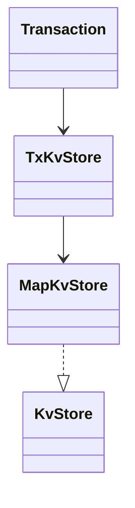

# Chapter 69 — In-memory KV store

## What and why

A Redis-flavoured map: `get`/`put`/`putIfAbsent`/`compareAndSet`, lazy TTL expiry, prefix scan, and a tiny transaction (`TxKvStore`) that buffers writes until commit. Exam payoff: `Optional` returns, `Clock` injection, `ConcurrentHashMap.compute*`, and try-with-resources rollback.

## Exam flash rules

- `get` returns `Optional`; never assign it to `String` without unwrapping.
- TTL uses `Duration`; zero/negative rejected. Expiry is **lazy** — dead entries vanish on touch or `purgeExpired`.
- Boundary: at exact expire instant, `get` is empty (`PredictTtlBoundary`).
- `put` returns the previous live value (or empty).
- `putIfAbsent` / `CAS` use `compute` so check-and-act is atomic.
- Null keys/values rejected; static helpers on the interface are called on the type, not an instance.
- Generics: no primitive type args (`KvStore<String, int>` fails).
- Wildcards: `KvStore<?, Integer>` will not accept `put("a", 1)` (capture).
- Record compact ctor may not assign `this.field`.
- Lambdas need effectively-final locals (`LambdaCaptureBroken`).
- Transaction: writes invisible outside until commit; abort / failed try-with-resources discards (`PredictTryWithResources`).
- Snapshot/aliasing: mutating a returned list must not corrupt the store (`PredictAliasing`).

## Short-answer strip

| Item | Answer |
|------|--------|
| Entities | `KvStore`, `MapKvStore`, `Entry`, `TxKvStore`, `Transaction`, `Write` |
| Patterns | Facade; Unit of Work (tx); Strategy-free map |
| APIs | get/put/ttl/CAS/keysWithPrefix/purge; begin/commit/abort |
| Concurrency | `ConcurrentHashMap`; tx is single-threaded per handle |

## Requirements

| Kind | Line |
|------|------|
| Functional | CRUD + TTL + CAS + prefix + transactions |
| Non-functional | Deterministic clock; thread-safe base map |
| Out of scope | persistence, replication, Lua |

## Rules table

| Case | Compiles? | Message |
|------|-----------|---------|
| `String v = store.get(k)` | No | `Optional<String> cannot be converted to String` |
| `KvStore<String, int>` | No | `unexpected type` |
| `store.put` on `KvStore<?,Integer>` | No | `int cannot be converted to CAP#1` |
| `this.value = …` in record compact ctor | No | `cannot assign a value to final variable value` |
| Mutate local from lambda | No | `local variables referenced from a lambda … must be final or effectively final` |
| Instance call to static interface method | No | `illegal static interface method call` |

## Walkthrough

```java
{{#include ../../code/part-04-lld/src/main/java/lld/kv/KvStore.java:kv-store}}
```

```java
{{#include ../../code/part-04-lld/src/main/java/lld/kv/Entry.java:entry}}
```

```java
{{#include ../../code/part-04-lld/src/main/java/lld/kv/MapKvStore.java:map-kv-store}}
```

```java
{{#include ../../code/part-04-lld/src/main/java/lld/kv/TxKvStore.java:tx-kv-store}}
```

```java
{{#include ../../code/part-04-lld/src/main/java/lld/kv/Transaction.java:transaction}}
```

```java
{{#include ../../code/part-04-lld/src/main/java/lld/kv/KvDemo.java:kv-demo}}
```

```text
{{#include ../../code/part-04-lld/out/kv/KvDemo.txt}}
```

## Predict the output

```java
{{#include ../../code/part-04-lld/src/main/java/lld/kv/exam/PredictPutReturn.java:predict-put-return}}
```

```text
{{#include ../../code/part-04-lld/out/kv/PredictPutReturn.txt}}
```

```java
{{#include ../../code/part-04-lld/src/main/java/lld/kv/exam/PredictTtlBoundary.java:predict-ttl-boundary}}
```

```text
{{#include ../../code/part-04-lld/out/kv/PredictTtlBoundary.txt}}
```

```java
{{#include ../../code/part-04-lld/src/main/java/lld/kv/exam/PredictLazyExpiry.java:predict-lazy-expiry}}
```

```text
{{#include ../../code/part-04-lld/out/kv/PredictLazyExpiry.txt}}
```

```java
{{#include ../../code/part-04-lld/src/main/java/lld/kv/exam/PredictTransaction.java:predict-transaction}}
```

```text
{{#include ../../code/part-04-lld/out/kv/PredictTransaction.txt}}
```

```java
{{#include ../../code/part-04-lld/src/main/java/lld/kv/exam/PredictTryWithResources.java:predict-try-with-resources}}
```

```text
{{#include ../../code/part-04-lld/out/kv/PredictTryWithResources.txt}}
```

```java
{{#include ../../code/part-04-lld/src/main/java/lld/kv/exam/PredictAliasing.java:predict-aliasing}}
```

```text
{{#include ../../code/part-04-lld/out/kv/PredictAliasing.txt}}
```

```java
{{#include ../../code/part-04-lld/src/main/java/lld/kv/exam/PredictNullRules.java:predict-null-rules}}
```

```text
{{#include ../../code/part-04-lld/out/kv/PredictNullRules.txt}}
```

## Compile or not?

```java
{{#include ../../code/part-04-lld/broken/kv/OptionalAssignBroken.java}}
```

```text
{{#include ../../code/part-04-lld/out/kv/OptionalAssignBroken.javac.txt}}
```

```java
{{#include ../../code/part-04-lld/broken/kv/PrimitiveTypeArgBroken.java}}
```

```text
{{#include ../../code/part-04-lld/out/kv/PrimitiveTypeArgBroken.javac.txt}}
```

```java
{{#include ../../code/part-04-lld/broken/kv/WildcardPutBroken.java}}
```

```text
{{#include ../../code/part-04-lld/out/kv/WildcardPutBroken.javac.txt}}
```

```java
{{#include ../../code/part-04-lld/broken/kv/LambdaCaptureBroken.java}}
```

```text
{{#include ../../code/part-04-lld/out/kv/LambdaCaptureBroken.javac.txt}}
```

```java
{{#include ../../code/part-04-lld/broken/kv/RecordCompactAssignBroken.java}}
```

```text
{{#include ../../code/part-04-lld/out/kv/RecordCompactAssignBroken.javac.txt}}
```

```java
{{#include ../../code/part-04-lld/broken/kv/StaticViaInstanceBroken.java}}
```

```text
{{#include ../../code/part-04-lld/out/kv/StaticViaInstanceBroken.javac.txt}}
```

## Gotchas

1. Lazy expiry: `size`/iteration counts can include dead entries until purged — demos print both.
2. Double-commit of a transaction throws.
3. Returning a live mutable collection aliases the store (`PredictAliasing`).

## UML



## Short answers / Interview

| Marks | Prompt | Answer |
|-------|--------|--------|
| 2 | Why Optional? | Distinguish missing vs present without null |
| 5 | Lazy TTL | Skip expired on read; optional background purge |
| 5 | Tx isolation here | Buffer writes; apply atomically on commit |

## Exam writing prompts

1. (5) Implement `compareAndSet` with `compute`.
2. (5) Sketch try-with-resources transaction that aborts on exception.
3. (2) Why inject `Clock` for TTL tests?

## Exercises

`code/part-04-lld/solutions/ch69/Solutions69.java`.

## Recap checklist

- [x] Map + tx + banks + `KvTest`
