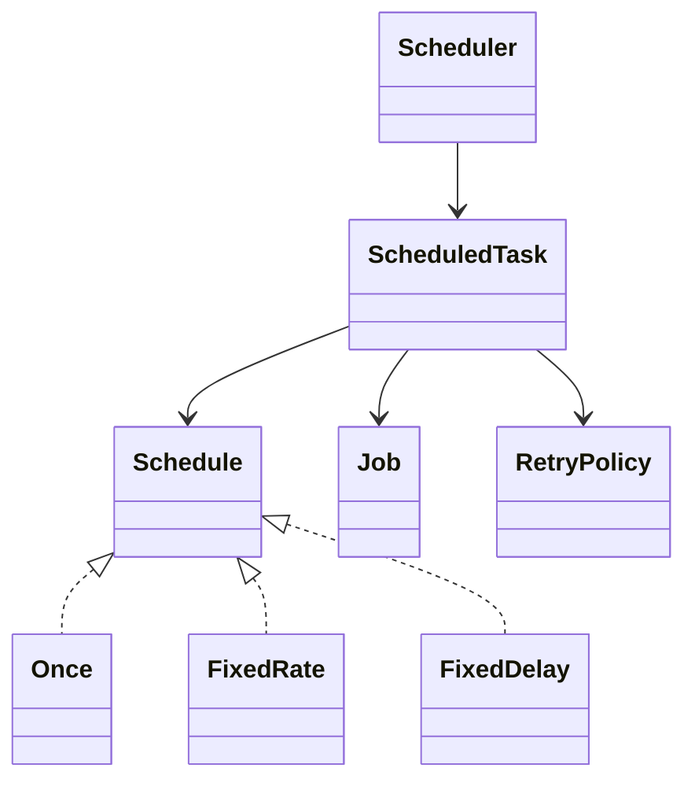

# Chapter 70 — Task Scheduler

## What and why

A deterministic scheduler core (not `java.util.Timer` fluff): priority queue ordered by due time, then priority, then submission order; sealed `Schedule` (`Once` / `FixedRate` / `FixedDelay`); retries; jobs run **outside** the lock. Exam payoff: catch-up vs delay semantics, failure isolation, self-cancel from a running job.

## Exam flash rules

- Queue order: earlier `nextRun`, then higher priority, then lower seq (`PredictOrdering`, `PredictQueueOrder`).
- `runDue()` snapshots `now` once — a job advancing the clock cannot create an infinite loop in that call.
- Jobs execute outside the scheduler lock so they may `schedule`/`cancel` safely.
- `FixedRate` schedules from the **planned** fire time (catch-up); `FixedDelay` from the **actual** finish (`PredictRateVsDelay`, `PredictCatchUp`).
- One failing job does not stop siblings in the same `runDue` batch (`PredictFailureIsolation`).
- `RetryPolicy` reschedules failures with backoff until attempts are exhausted.
- Cancel of a never-started task removes it from the queue; cancel during run finishes the current execution then stops (`PredictSelfCancel`).
- `Job` is a functional interface (`void run(Scheduler)`); checked exceptions must be wrapped.
- `Duration` has no `+` operator — use `plus`.
- `Schedule` is sealed; incomplete switches fail; package-private mutators stay hidden.
- Real wall-clock looping is `TimerDriver`; tests use `ManualClock` + `runDue`.

## Short-answer strip

| Item | Answer |
|------|--------|
| Entities | `Scheduler`, `ScheduledTask`, `Schedule`, `Job`, `RetryPolicy`, `TimerDriver` |
| Patterns | Command (`Job`), Strategy (`Schedule` / retry), Priority Queue |
| APIs | `schedule`, `cancel`, `runDue`, `pending` |
| Concurrency | lock around queue; jobs unlocked |

## Requirements

| Kind | Line |
|------|------|
| Functional | once / fixed-rate / fixed-delay; priority; cancel; retry |
| Non-functional | Deterministic under `ManualClock` |
| Out of scope | distributed cron, persistence, calendars |

## Rules table

| Case | Compiles? | Message |
|------|-----------|---------|
| Extra `Schedule` implementor | No | `class is not allowed to extend sealed class: Schedule …` |
| Incomplete `switch` on `Schedule` | No | `does not cover all possible input values` |
| `Duration a + b` | No | `bad operand types for binary operator '+'` |
| Checked exception in `Job` lambda | No | `unreported exception Exception` |
| `Scheduler.cancel` static | No | `non-static method cancel(String) cannot be referenced from a static context` |
| Call package-private `startRun` | No | `startRun() is not public in ScheduledTask …` |

## Walkthrough

```java
{{#include ../../code/part-04-lld/src/main/java/lld/scheduler/Schedule.java:schedule}}
```

```java
{{#include ../../code/part-04-lld/src/main/java/lld/scheduler/Job.java:job}}
```

```java
{{#include ../../code/part-04-lld/src/main/java/lld/scheduler/RetryPolicy.java:retry-policy}}
```

```java
{{#include ../../code/part-04-lld/src/main/java/lld/scheduler/ScheduledTask.java:scheduled-task}}
```

```java
{{#include ../../code/part-04-lld/src/main/java/lld/scheduler/Scheduler.java:scheduler}}
```

```java
{{#include ../../code/part-04-lld/src/main/java/lld/scheduler/SchedulerDemo.java:scheduler-demo}}
```

```text
{{#include ../../code/part-04-lld/out/scheduler/SchedulerDemo.txt}}
```

## Predict the output

```java
{{#include ../../code/part-04-lld/src/main/java/lld/scheduler/exam/PredictOrdering.java:predict-ordering}}
```

```text
{{#include ../../code/part-04-lld/out/scheduler/PredictOrdering.txt}}
```

```java
{{#include ../../code/part-04-lld/src/main/java/lld/scheduler/exam/PredictQueueOrder.java:predict-queue-order}}
```

```text
{{#include ../../code/part-04-lld/out/scheduler/PredictQueueOrder.txt}}
```

```java
{{#include ../../code/part-04-lld/src/main/java/lld/scheduler/exam/PredictRateVsDelay.java:predict-rate-vs-delay}}
```

```text
{{#include ../../code/part-04-lld/out/scheduler/PredictRateVsDelay.txt}}
```

```java
{{#include ../../code/part-04-lld/src/main/java/lld/scheduler/exam/PredictCatchUp.java:predict-catch-up}}
```

```text
{{#include ../../code/part-04-lld/out/scheduler/PredictCatchUp.txt}}
```

```java
{{#include ../../code/part-04-lld/src/main/java/lld/scheduler/exam/PredictRetry.java:predict-retry}}
```

```text
{{#include ../../code/part-04-lld/out/scheduler/PredictRetry.txt}}
```

```java
{{#include ../../code/part-04-lld/src/main/java/lld/scheduler/exam/PredictFailureIsolation.java:predict-failure-isolation}}
```

```text
{{#include ../../code/part-04-lld/out/scheduler/PredictFailureIsolation.txt}}
```

```java
{{#include ../../code/part-04-lld/src/main/java/lld/scheduler/exam/PredictSelfCancel.java:predict-self-cancel}}
```

```text
{{#include ../../code/part-04-lld/out/scheduler/PredictSelfCancel.txt}}
```

## Compile or not?

```java
{{#include ../../code/part-04-lld/broken/scheduler/SealedScheduleBroken.java}}
```

```text
{{#include ../../code/part-04-lld/out/scheduler/SealedScheduleBroken.javac.txt}}
```

```java
{{#include ../../code/part-04-lld/broken/scheduler/SwitchMissingCaseBroken.java}}
```

```text
{{#include ../../code/part-04-lld/out/scheduler/SwitchMissingCaseBroken.javac.txt}}
```

```java
{{#include ../../code/part-04-lld/broken/scheduler/DurationPlusBroken.java}}
```

```text
{{#include ../../code/part-04-lld/out/scheduler/DurationPlusBroken.javac.txt}}
```

```java
{{#include ../../code/part-04-lld/broken/scheduler/CheckedInRunnableBroken.java}}
```

```text
{{#include ../../code/part-04-lld/out/scheduler/CheckedInRunnableBroken.javac.txt}}
```

```java
{{#include ../../code/part-04-lld/broken/scheduler/StaticContextBroken.java}}
```

```text
{{#include ../../code/part-04-lld/out/scheduler/StaticContextBroken.javac.txt}}
```

```java
{{#include ../../code/part-04-lld/broken/scheduler/PackagePrivateMutatorBroken.java}}
```

```text
{{#include ../../code/part-04-lld/out/scheduler/PackagePrivateMutatorBroken.javac.txt}}
```

## Gotchas

1. Fixed-rate catch-up can fire multiple times in one `runDue` if the clock jumped.
2. PriorityQueue is not ordered for equal keys under wrong comparators — demos show `ClassCastException` traps when misusing raw types.
3. Cancel returns `false` if already terminal.

## UML



## Short answers / Interview

| Marks | Prompt | Answer |
|-------|--------|--------|
| 3 | Rate vs delay | Rate from planned time; delay from completion |
| 5 | Why unlock for jobs? | Avoid deadlock when a job schedules/cancels; isolate slow work |
| 2 | Test seam | `ManualClock` + `runDue` |

## Exam writing prompts

1. (5) Comparator for due/priority/seq.
2. (5) Pseudocode `runDue` with snapshot `now` and unlocked job execution.
3. (2) When is fixed-rate wrong for “run 5s after finish”?

## Exercises

`code/part-04-lld/solutions/ch70/Solutions70.java`.

## Recap checklist

- [x] Scheduler core + banks + `SchedulerTest`
